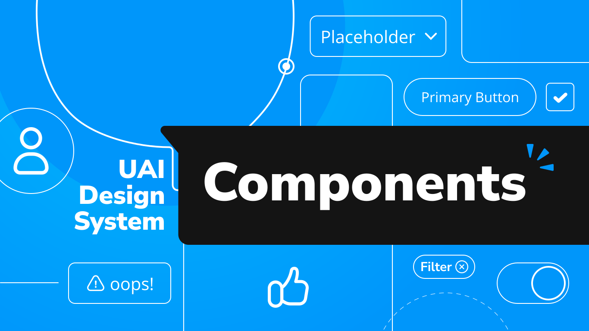

![Built With Stencil](https://img.shields.io/badge/-Built%20With%20Stencil-16161d.svg?logo=data%3Aimage%2Fsvg%2Bxml%3Bbase64%2CPD94bWwgdmVyc2lvbj0iMS4wIiBlbmNvZGluZz0idXRmLTgiPz4KPCEtLSBHZW5lcmF0b3I6IEFkb2JlIElsbHVzdHJhdG9yIDE5LjIuMSwgU1ZHIEV4cG9ydCBQbHVnLUluIC4gU1ZHIFZlcnNpb246IDYuMDAgQnVpbGQgMCkgIC0tPgo8c3ZnIHZlcnNpb249IjEuMSIgaWQ9IkxheWVyXzEiIHhtbG5zPSJodHRwOi8vd3d3LnczLm9yZy8yMDAwL3N2ZyIgeG1sbnM6eGxpbms9Imh0dHA6Ly93d3cudzMub3JnLzE5OTkveGxpbmsiIHg9IjBweCIgeT0iMHB4IgoJIHZpZXdCb3g9IjAgMCA1MTIgNTEyIiBzdHlsZT0iZW5hYmxlLWJhY2tncm91bmQ6bmV3IDAgMCA1MTIgNTEyOyIgeG1sOnNwYWNlPSJwcmVzZXJ2ZSI%2BCjxzdHlsZSB0eXBlPSJ0ZXh0L2NzcyI%2BCgkuc3Qwe2ZpbGw6I0ZGRkZGRjt9Cjwvc3R5bGU%2BCjxwYXRoIGNsYXNzPSJzdDAiIGQ9Ik00MjQuNywzNzMuOWMwLDM3LjYtNTUuMSw2OC42LTkyLjcsNjguNkgxODAuNGMtMzcuOSwwLTkyLjctMzAuNy05Mi43LTY4LjZ2LTMuNmgzMzYuOVYzNzMuOXoiLz4KPHBhdGggY2xhc3M9InN0MCIgZD0iTTQyNC43LDI5Mi4xSDE4MC40Yy0zNy42LDAtOTIuNy0zMS05Mi43LTY4LjZ2LTMuNkgzMzJjMzcuNiwwLDkyLjcsMzEsOTIuNyw2OC42VjI5Mi4xeiIvPgo8cGF0aCBjbGFzcz0ic3QwIiBkPSJNNDI0LjcsMTQxLjdIODcuN3YtMy42YzAtMzcuNiw1NC44LTY4LjYsOTIuNy02OC42SDMzMmMzNy45LDAsOTIuNywzMC43LDkyLjcsNjguNlYxNDEuN3oiLz4KPC9zdmc%2BCg%3D%3D&colorA=16161d&style=flat-square)


# BliP Design System

BliP Design System is a comprehensive component library built with Web Components using StencilJS, providing a consistent and scalable UI foundation for BliP applications. The design system includes reusable components, design tokens, and guidelines that follow BliP's design principles.

## Asset Delivery

Artwork is delivered from exact-version global CDN URLs, not application clusters. Images use browser-native URLs; SVG fetching is reserved for inline rendering that preserves inherited colors and icon color props.

`blip-tokens` 2.x provides token values, icon types, and a path/hash manifest. Artwork JSON catalogs, base64 payloads, and SVG files are not required in the npm package. `npm run assets:prepare` reads the installed manifest and generates path metadata only. The build, development, and test scripts run this preparation automatically, without fetching the public CDN or requiring `CDN_ASSETS_VERSION`.

Styles consume the token SCSS files, and extended colors consume their theme JSON. Components do not read `variables.json` or its former `asset-*` source-path entries. Those entries do not need CDN URLs: icons, emojis, logos, illustrations, and loading/upload artwork resolve through the installed manifest instead. Inline SVG rendering preserves icon color controls; illustrations and upload images use native image URLs.

Playwright intercepts the manifest's CDN origin in the shared browser-context fixture before navigation. Known artwork URLs receive a deterministic local SVG; unknown paths receive a local 404, without contacting the CDN. Service workers are blocked so they cannot bypass interception. These tests exercise component rendering and behavior with mocked artwork, not production artwork fidelity or CDN availability. Stencil E2E tests also use local SVG responses.

Released packages use `https://cdn.blip.ai/blip-tokens/<exact-version>/<asset-path>`. The package and manifest versions must match. Local token builds use `unreleased`; ordinary token CI builds require the conventions version, while semantic-release supplies the upcoming exact release version internally. A local token build does not publish its corresponding CDN directory.

### Deployment Requirements

- Publish each release's SVGs and manifest before publishing its npm package. Keep older version directories available for existing consumers.
- Configure working CDN DNS and HTTPS, wildcard CORS, `image/svg+xml` for SVGs, `application/json` for the manifest, and immutable caching on released version paths.
- Applications with a Content Security Policy must allow `https://cdn.blip.ai` in both `connect-src` and `img-src`. Native images do not require `blob:` URLs.
- Install dependencies with `npm ci --legacy-peer-deps`. CI uses the lockfile and offline asset checks, not automatic token upgrades or live-CDN verification.
- After deploying the CDN, run `npm run assets:verify` manually outside CI to check the installed version's manifest and asset families. This checks availability, hashes, MIME types, CORS, and immutable caching. Do not enable production consumers until this succeeds.

## 📦 Packages

This monorepo contains two main packages:

- **`blip-ds`** - Core web components built with StencilJS
- **`blip-ds-react`** - React wrapper components for seamless React integration

## 🎨 Design System

Components. Guides. Brands. It's all here, no riddles. [UAI is all yours](https://design.take.net/240287753/p/9953dc-take-blip-ds-elementar).



## 🚀 Features

- **Framework Agnostic**: Web Components work with any framework (React, Vue, Angular) or vanilla JavaScript
- **TypeScript Support**: Full TypeScript support with generated type definitions
- **Storybook Documentation**: Comprehensive component documentation and examples
- **React Integration**: Auto-generated React wrapper components for optimal React experience
- **Accessibility**: Components built with accessibility best practices
- **Testing**: Comprehensive unit and e2e test coverage

## 📋 Installation

### Core Web Components (`blip-ds`)

```bash
npm install blip-ds
```

### React Components (`blip-ds-react`)

```bash
npm install blip-ds-react
```

For detailed installation and usage instructions, visit the [Design Portal](https://design.take.net/240287753/p/216ef2-instalao/b/8176c4).

## 🛠️ Development

### Prerequisites

- Node.js 16+ 
- npm 7+

### Getting Started

```bash
# Clone the repository
git clone https://github.com/takenet/blip-ds.git
cd blip-ds

# Install dependencies
npm install

# Start development environment (Stencil + Storybook)
npm run dev

# Build the library
npm run build

# Build React wrapper components
npm run build:react

# Run tests
npm run test

# Start Storybook for component development
npm run storybook
```

### Project Structure

```
├── src/
│   ├── components/        # StencilJS web components
│   ├── assets/           # Static assets (images, SVGs)
│   ├── globals/          # Global styles and variables
│   ├── pages/            # Storybook documentation pages
│   ├── snippets/         # Reusable code examples
│   ├── templates/        # Full page layout templates
│   └── utils/            # Utility functions
├── blip-ds-react/        # React wrapper components
```

## 📖 Documentation

- **[Storybook](https://takenet.github.io/blip-ds/v2/?path=/docs/welcome--welcome)** - Interactive component documentation
- **[Design System](https://design.blip.ai/)** - Complete design guidelines and specifications
- **[GitHub](https://github.com/takenet/blip-ds)** - Source code and issue tracking

## 🏗️ Architecture

### StencilJS Core

The project uses [StencilJS](https://stenciljs.com/) as the core technology for building standards-compliant Web Components. StencilJS compiles components to highly optimized vanilla JavaScript that runs in any browser.

### React Integration

React wrapper components are automatically generated using `@stencil/react-output-target`, providing optimal React developer experience with proper TypeScript support and React-specific optimizations.

## 🧪 Testing

The project uses StencilJS's built-in testing utilities:

- **Unit Tests**: Component logic and functionality
- **E2E Tests**: Integration and user interaction scenarios

Stencil e2e tests intercept design-CDN requests before navigation and serve local SVG fixtures. They test component loading without contacting the public CDN; real deployment readiness is checked separately with `npm run assets:verify` outside CI.

```bash
# Run all tests
npm run test

# Run tests for a specific component
npm run test -- -- <componentFolder>
```

## 📦 Versioning

`blip-ds` uses [Semantic Versioning](https://semver.org/).

### Release Branches

- **`main`** - Version 1.x (Stable)
- **`v2`** - Current v2 development (Release Candidate)

The v2 is currently in release candidate phase but it is already stable for production use. We recommend using the v2 branch for new projects.

## 🤝 Contributing

We welcome contributions! Please see our [Contributing Guide](CONTRIBUTING.md) for details on:

- Development workflow
- Code standards
- Testing requirements
- Pull request process

## 📄 License

`blip-ds` is under the [ISC license](https://opensource.org/licenses/ISC).