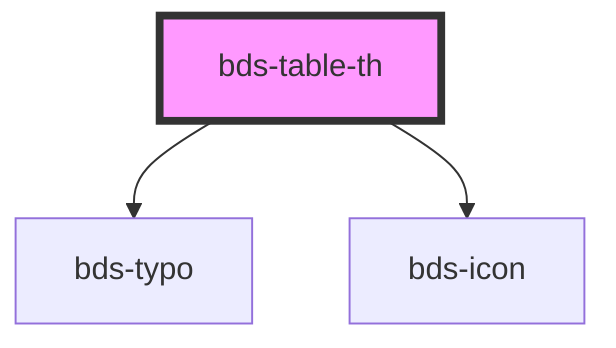

# bds-table-th

<!-- Auto Generated Below -->

> **[DEPRECATED]** Use uai-table-th with UaiThemeProvider for tokenized styling and table semantics.

## Properties

| Property         | Attribute         | Description | Type                            | Default  |
| ---------------- | ----------------- | ----------- | ------------------------------- | -------- |
| `arrow`          | `arrow`           |             | `string`                        | `''`     |
| `justifyContent` | `justify-content` |             | `"center" \| "left" \| "right"` | `'left'` |
| `sortable`       | `sortable`        |             | `boolean`                       | `false`  |

## Slots

| Slot | Description      |
| ---- | ---------------- |
|      | The default slot |

## Dependencies

### Depends on

- [bds-typo](../../typo)
- [bds-icon](../../icon)

### Graph

----------------------------------------------

*Built with [StencilJS](https://stenciljs.com/)*
