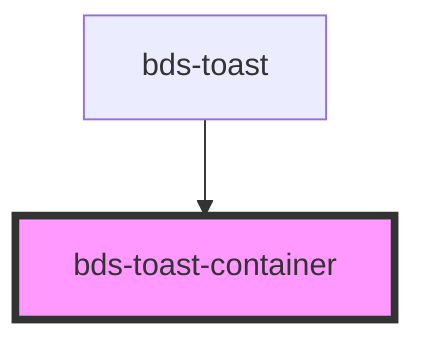

# toast-container

<!-- Auto Generated Below -->

> **[DEPRECATED]** Use uai-toast-container with UaiThemeProvider for tokenized styling.

## Slots

| Slot | Description      |
| ---- | ---------------- |
|      | The default slot |

## Dependencies

### Used by

 - [bds-toast](../toast)

### Graph

----------------------------------------------

*Built with [StencilJS](https://stenciljs.com/)*
