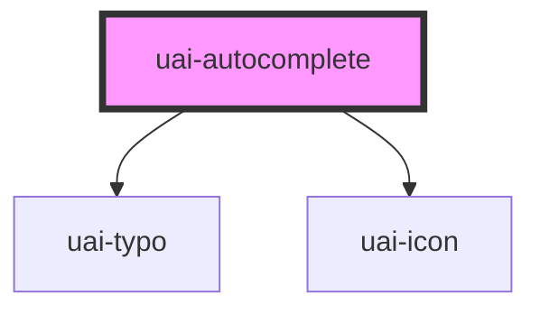

# uai-autocomplete

<!-- Auto Generated Below -->

## Overview

Field to choose from a long list by typing to search it. With selectionType "single" (default) the person picks one
option and the field shows its label; with "multiple" the options are checkboxes and the field shows how many are
checked. It takes part in native forms: give it a name to submit the value (each checked value in a multiple
choice). Use it for lists that are too long to scan, such as people, teams or cities. Pair with a visible label.
Avoid it for short lists without search (use uai-select) or for free text (use uai-input with suggestions).
Wrap the app in UaiThemeProvider.

## Properties

| Property               | Attribute                | Description                                                                                                                                                                                                                                                 | Type                                | Default     |
| ---------------------- | ------------------------ | ----------------------------------------------------------------------------------------------------------------------------------------------------------------------------------------------------------------------------------------------------------- | ----------------------------------- | ----------- |
| `ariaLabel`            | `aria-label`             | Accessible name of the field when there is no visible label.                                                                                                                                                                                                | `string`                            | `null`      |
| `clearIconOnFocus`     | `clear-icon-on-focus`    | If true, the clear button shows only while the field has the focus.                                                                                                                                                                                         | `boolean`                           | `false`     |
| `danger`               | `danger`                 | If true, shows the error state and errorMessage. Has priority over success.                                                                                                                                                                                 | `boolean`                           | `false`     |
| `dataTest`             | `data-test`              | Data test id, set on the native input.                                                                                                                                                                                                                      | `string`                            | `null`      |
| `disabled`             | `disabled`               | If true, the field cannot be used and is left out of the form data.                                                                                                                                                                                         | `boolean`                           | `false`     |
| `errorMessage`         | `error-message`          | Message below the field while danger is true.                                                                                                                                                                                                               | `string`                            | `''`        |
| `helperMessage`        | `helper-message`         | Message below the field that helps to fill it.                                                                                                                                                                                                              | `string`                            | `''`        |
| `icon`                 | `icon`                   | UaiIcon name shown before the text, for example "search".                                                                                                                                                                                                   | `string`                            | `''`        |
| `label`                | `label`                  | Label shown above the field. Without a visible label, set aria-label.                                                                                                                                                                                       | `string`                            | `''`        |
| `language`             | `language`               | Language of the default texts. Can be one of: 'pt_BR' (default), 'en_US', 'es_ES'.                                                                                                                                                                          | `"en_US" \| "es_ES" \| "pt_BR"`     | `'pt_BR'`   |
| `loading`              | `loading`                | If true, the list shows that the options are loading. Pair with uaiInput to search on a server.                                                                                                                                                             | `boolean`                           | `false`     |
| `name`                 | `name`                   | Name of the value in the submitted form data. Without it, the field is not submitted.                                                                                                                                                                       | `string`                            | `undefined` |
| `options`              | `options`                | The options, as an array of { value, label, icon?, disabled?, checked? } or, in HTML, a JSON array (options='[{"value": "sp", "label": "São Paulo"}]'). With selectionType "multiple", checked marks the options checked: change the array to control them. | `UaiAutocompleteOption[] \| string` | `undefined` |
| `optionsPosition`      | `options-position`       | Side of the list. Can be one of: 'auto' (default, where there is room), 'top', 'bottom'.                                                                                                                                                                    | `"auto" \| "bottom" \| "top"`       | `'auto'`    |
| `placeholder`          | `placeholder`            | Text shown while the field is empty, such as "Buscar pessoa". Do not use it as the label.                                                                                                                                                                   | `string`                            | `''`        |
| `required`             | `required`               | If true, the form is invalid while nothing is chosen. Pair with requiredErrorMessage.                                                                                                                                                                       | `boolean`                           | `false`     |
| `requiredErrorMessage` | `required-error-message` | Message shown when required and nothing is chosen. Without it, the default text of the language is shown.                                                                                                                                                   | `string`                            | `undefined` |
| `searchOnlyTitle`      | `search-only-title`      | **[DEPRECATED]** Options have only a label, which the search always uses. Has no effect.                                                                                                                             | `boolean`                           | `undefined` |
| `selectedAll`          | `selected-all`           | With selectionType "multiple": if true (default), the first row checks or unchecks all options.                                                                                                                                                             | `boolean`                           | `true`      |
| `selectionTitle`       | `selection-title`        | Title shown above the options of a multiple choice.                                                                                                                                                                                                         | `string`                            | `''`        |
| `selectionType`        | `selection-type`         | One option or many. Can be one of: 'single' (default), 'multiple'. With 'multiple', options are checkboxes and uaiMultiselectedChange tells the checked ones.                                                                                               | `"multiple" \| "single"`            | `'single'`  |
| `size`                 | `size`                   | Height of the field. Can be one of: 'short', 'medium' (default).                                                                                                                                                                                            | `"medium" \| "short"`               | `'medium'`  |
| `success`              | `success`                | If true, shows the success state and successMessage.                                                                                                                                                                                                        | `boolean`                           | `false`     |
| `successMessage`       | `success-message`        | Message below the field while success is true.                                                                                                                                                                                                              | `string`                            | `''`        |
| `value`                | `value`                  | Chosen value, with selectionType "single". Use it to preselect or control the field; pair with uaiChange. Typing only searches: the value changes when the person picks or clears.                                                                          | `string`                            | `undefined` |

## Events

| Event                    | Description                                                                                                     | Type                                              |
| ------------------------ | --------------------------------------------------------------------------------------------------------------- | ------------------------------------------------- |
| `uaiBlur`                | Emitted when the field loses focus.                                                                             | `CustomEvent<void>`                               |
| `uaiCancel`              | Emitted when the choice is cleared with the clear button. detail: { value: '' }.                                | `CustomEvent<UaiAutocompleteChange>`              |
| `uaiChange`              | Emitted when the chosen value changes, by picking or clearing (selectionType "single"). detail: { value }.      | `CustomEvent<UaiAutocompleteChange>`              |
| `uaiFocus`               | Emitted when the field receives focus.                                                                          | `CustomEvent<void>`                               |
| `uaiInput`               | Emitted on every keystroke in the search with the native InputEvent.                                            | `CustomEvent<InputEvent>`                         |
| `uaiMultiselectedChange` | Emitted when the checked options change (selectionType "multiple"). detail: { value } with the checked options. | `CustomEvent<UaiAutocompleteMultiselectedChange>` |
| `uaiSelectedChange`      | Emitted when the person picks an option (selectionType "single"). detail: { value, label }.                     | `CustomEvent<UaiAutocompleteSelectedChange>`      |

## Methods

### `cleanMultipleSelection() => Promise<void>`

Unchecks every option of a multiple choice, or clears the choice of a single one.

#### Returns

Type: `Promise<void>`

### `close() => Promise<void>`

Closes the list.

#### Returns

Type: `Promise<void>`

### `open() => Promise<void>`

Opens the list.

#### Returns

Type: `Promise<void>`

### `setFocus() => Promise<void>`

Moves the focus to the field.

#### Returns

Type: `Promise<void>`

## Shadow Parts

| Part                | Description                                                        |
| ------------------- | ------------------------------------------------------------------ |
| `"clear-button"`    | The button that clears the choice.                                 |
| `"input"`           | The native text input used to search.                              |
| `"input-container"` | The field box with border, icon, the search input and the buttons. |
| `"input__message"`  | The helper, error or success message below the field.              |
| `"list"`            | The floating list of options.                                      |
| `"option"`          | Each option in the list.                                           |

## CSS Custom Properties

| Name                       | Description                                                      |
| -------------------------- | ---------------------------------------------------------------- |
| `--uai-autocomplete-width` | Width of the field. Defaults to the full width of the container. |

## Dependencies

### Depends on

- [uai-typo](../uai-typo)
- [uai-icon](../uai-icon)

### Graph

----------------------------------------------

*Built with [StencilJS](https://stenciljs.com/)*
