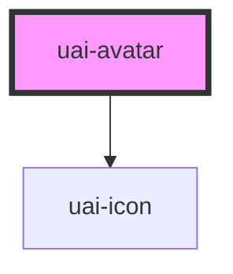

# uai-avatar

<!-- Auto Generated Below -->

## Overview

Static user avatar. Pass a remote image URL with `src`, explicit fallback initials with `initials`,
and an accessible name with `label`. The consuming application is responsible for uploading images.

## Properties

| Property   | Attribute   | Description                                                                                                                                                          | Type                                                                            | Default      |
| ---------- | ----------- | -------------------------------------------------------------------------------------------------------------------------------------------------------------------- | ------------------------------------------------------------------------------- | ------------ |
| `dataTest` | `data-test` | Value placed on the avatar host for automated tests.                                                                                                                 | `string`                                                                        | `undefined`  |
| `initials` | `initials`  | Explicit one- or two-character fallback shown when the image is absent or fails to load.                                                                             | `string`                                                                        | `undefined`  |
| `label`    | `label`     | Accessible name for the avatar. Without a label, the avatar is hidden from assistive technology.                                                                     | `string`                                                                        | `undefined`  |
| `size`     | `size`      | Avatar diameter: micro (`sizing/lg`), extra-small (`sizing/xl`), small (`sizing/2xl`), standard (`sizing/3xl`), large (`sizing/4xl`), or extra-large (`sizing/5xl`). | `"extra-large" \| "extra-small" \| "large" \| "micro" \| "small" \| "standard"` | `'standard'` |
| `src`      | `src`       | URL of the avatar image. The consuming application handles file selection and upload.                                                                                | `string`                                                                        | `undefined`  |

## Dependencies

### Depends on

- [uai-icon](../uai-icon)

### Graph

----------------------------------------------

*Built with [StencilJS](https://stenciljs.com/)*
