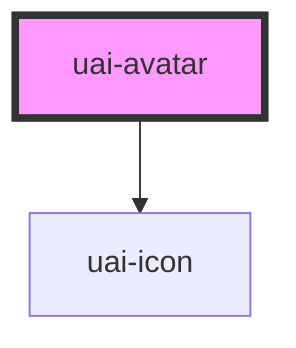

# uai-avatar

<!-- Auto Generated Below -->

## Overview

Avatar of a person: photo, initials of the name or a generic icon. Same contract as bds-avatar with UAI tokens.
Give the full name in `name`: it builds the initials and the accessible name. Use it in lists, profiles and
headers. Pair with the person's name nearby when the avatar is small. Avoid it as a generic button; use `upload`
or `openUpload` only when the avatar itself changes the photo. Wrap the app in UaiThemeProvider.

## Properties

| Property     | Attribute     | Description                                                                                                                                                                           | Type                                                                                    | Default         |
| ------------ | ------------- | ------------------------------------------------------------------------------------------------------------------------------------------------------------------------------------- | --------------------------------------------------------------------------------------- | --------------- |
| `color`      | `color`       | Background behind the initials. Can be one of: 'colorLetter' (default, picked by the first letter of the name), 'system', 'success', 'warning', 'error', 'info', 'surface' (neutral). | `"colorLetter" \| "error" \| "info" \| "success" \| "surface" \| "system" \| "warning"` | `'colorLetter'` |
| `dataTest`   | `data-test`   | Data test id, set on the host.                                                                                                                                                        | `string`                                                                                | `null`          |
| `ellipsis`   | `ellipsis`    | Number of hidden people, shown as "+N" (for example in a group of avatars).                                                                                                           | `number`                                                                                | `null`          |
| `initials`   | `initials`    | **[DEPRECATED]** The initials come from name. Without name, at most two characters are shown.                                                  | `string`                                                                                | `undefined`     |
| `label`      | `label`       | **[DEPRECATED]** Use name. It builds the initials and the accessible name.                                                                     | `string`                                                                                | `undefined`     |
| `name`       | `name`        | Full name of the person. Builds the initials (first letter of the first and the last name) and the accessible name.                                                                   | `string`                                                                                | `null`          |
| `openUpload` | `open-upload` | If true, activating the avatar opens the image picker, shows the chosen image and emits uaiImageUpload.                                                                               | `boolean`                                                                               | `false`         |
| `size`       | `size`        | Avatar size. Can be one of: 'micro', 'extra-small', 'small', 'standard' (default), 'large', 'extra-large'.                                                                            | `"extra-large" \| "extra-small" \| "large" \| "micro" \| "small" \| "standard"`         | `'standard'`    |
| `src`        | `src`         | **[DEPRECATED]** Use thumbnail.                                                                                                                | `string`                                                                                | `undefined`     |
| `thumbnail`  | `thumbnail`   | URL of the photo. Without it, or if it fails to load, the initials are shown.                                                                                                         | `string`                                                                                | `null`          |
| `upload`     | `upload`      | If true, shows the upload icon on hover and focus. The click only emits uaiClickAvatar; the app opens its own picker.                                                                 | `boolean`                                                                               | `false`         |

## Events

| Event            | Description                                                                                  | Type                                         |
| ---------------- | -------------------------------------------------------------------------------------------- | -------------------------------------------- |
| `uaiClickAvatar` | Emitted when the avatar is clicked, or activated with Enter or Space when it is interactive. | `CustomEvent<KeyboardEvent \| PointerEvent>` |
| `uaiImageUpload` | Emitted with the chosen image as a data URL, when openUpload is true.                        | `CustomEvent<string>`                        |

## Shadow Parts

| Part       | Description                                           |
| ---------- | ----------------------------------------------------- |
| `"avatar"` | The circle with the photo, initials, icon or counter. |

## Dependencies

### Depends on

- [uai-icon](../uai-icon)

### Graph

----------------------------------------------

*Built with [StencilJS](https://stenciljs.com/)*
