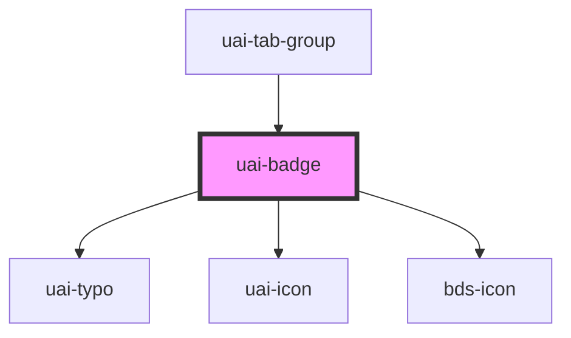

# uai-badge

<!-- Auto Generated Below -->

## Overview

Passive status, icon or count indicator. Use for supplementary information;
pair with an explanatory label; avoid using color alone to convey meaning.

## Properties

| Property    | Attribute    | Description                                                                                                                                  | Type                                                                    | Default     |
| ----------- | ------------ | -------------------------------------------------------------------------------------------------------------------------------------------- | ----------------------------------------------------------------------- | ----------- |
| `animation` | `animation`  | Enables a pulse unless reduced motion is requested. Use sparingly; pair with meaningful status; avoid continuous distraction.                | `boolean`                                                               | `false`     |
| `ariaLabel` | `aria-label` | Accessible indicator description, mapped to aria-label. Use for standalone meaning; pair with status or icon; avoid duplicate announcements. | `string`                                                                | `null`      |
| `color`     | `color`      | Semantic color: system, danger, warning, success or neutral. Use for status; pair with a label; avoid arbitrary colors.                      | `string`                                                                | `'system'`  |
| `dataTest`  | `data-test`  | Inner visual element data-test marker. Use for automation; pair with semantic queries; avoid treating it as an accessible label.             | `string`                                                                | `null`      |
| `icon`      | `icon`       | UAI or legacy icon name. Use when no count is supplied; pair with ariaLabel; avoid relying on an unnamed icon for meaning.                   | `string`                                                                | `null`      |
| `number`    | `number`     | Count, visually capped at 999+ inclusively. Use zero for an empty indicator; pair with a label; avoid using counts as actions.               | `number`                                                                | `undefined` |
| `shape`     | `shape`      | Indicator shape. Use for status, icon or empty badges; pair with color; avoid expecting numeric capsules to change shape.                    | `"circle" \| "polygon" \| "square" \| "triangle" \| "triangle-reverse"` | `'circle'`  |

## Dependencies

### Used by

 - [uai-tab-group](../uai-tab-group)

### Depends on

- [uai-typo](../uai-typo)
- [uai-icon](../uai-icon)
- [bds-icon](../icon)

### Graph

----------------------------------------------

*Built with [StencilJS](https://stenciljs.com/)*
