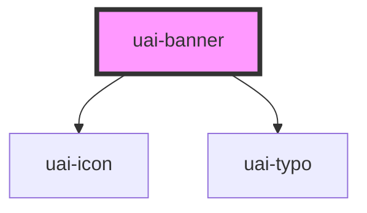

# uai-banner

<!-- Auto Generated Below -->

## Overview

Notification bar for a system, informational, success, warning or error message.
Use for page or section level notices; pair with UaiThemeProvider and a short text; avoid it for transient feedback.

## Properties

| Property        | Attribute         | Description                                                                                                                           | Type                                                      | Default     |
| --------------- | ----------------- | ------------------------------------------------------------------------------------------------------------------------------------- | --------------------------------------------------------- | ----------- |
| `bannerAlign`   | `banner-align`    | Kept for compatibility; the content always fills the available width. Avoid relying on it for layout.                                 | `"center" \| "left" \| "right"`                           | `'center'`  |
| `buttonClose`   | `button-close`    | Shows the close button when 'true'. Use for dismissible notices; pair with uaiBannerClose; avoid it for critical errors.              | `"false" \| "true"`                                       | `'false'`   |
| `closeLabel`    | `close-label`     | Accessible name of the close button. Use a translated label; pair with buttonClose. Avoid leaving it generic.                         | `string`                                                  | `'Fechar'`  |
| `context`       | `context`         | Rounds the banner when 'inside' a container. Use 'outside' for a full-width bar; avoid mixing both in one page.                       | `"inside" \| "outside"`                                   | `'outside'` |
| `dtButtonClose` | `dt-button-close` | Test selector on the close button. Use for automation; pair with semantic queries. Avoid styling by it.                               | `string`                                                  | `null`      |
| `heading`       | `heading`         | Optional short title shown above the text, without a final period. Use for the reason of the notice; avoid long titles.               | `string`                                                  | `null`      |
| `variant`       | `variant`         | Semantic variant: system, info, success, warning or error. Use the one that matches the message; avoid color alone to convey meaning. | `"error" \| "info" \| "success" \| "system" \| "warning"` | `'system'`  |

## Events

| Event            | Description                                                                                                      | Type                |
| ---------------- | ---------------------------------------------------------------------------------------------------------------- | ------------------- |
| `uaiBannerClose` | Emitted when the banner is closed with the close button. Use to persist the dismissal; avoid duplicate handlers. | `CustomEvent<void>` |

## Methods

### `toggle() => Promise<void>`

Toggles the banner visibility. Use for imperative control; pair with uaiBannerClose. Avoid hiding critical errors.

#### Returns

Type: `Promise<void>`

## Slots

| Slot     | Description                                            |
| -------- | ------------------------------------------------------ |
|          | Short message text, preferably one line.               |
| `"link"` | Optional link or action shown before the close button. |

## Shadow Parts

| Part         | Description                      |
| ------------ | -------------------------------- |
| `"close"`    | The close button.                |
| `"holder"`   | The banner container.            |
| `"icon-box"` | The box around the variant icon. |

## Dependencies

### Depends on

- [uai-icon](../uai-icon)
- [uai-typo](../uai-typo)

### Graph

----------------------------------------------

*Built with [StencilJS](https://stenciljs.com/)*
