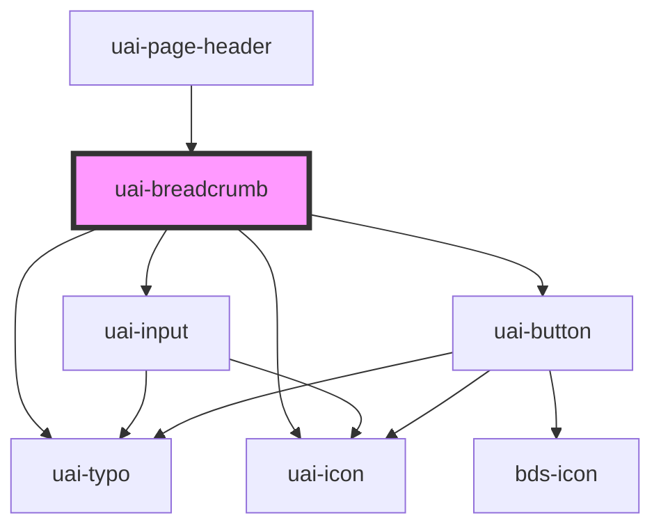

# uai-breadcrumb

<!-- Auto Generated Below -->

## Overview

Hierarchical page navigation. Use items in ancestor-to-current order; pair with UaiPageHeader;
avoid using it as an organization or flow context switcher.

## Properties

| Property              | Attribute               | Description                                                                                                                   | Type                            | Default     |
| --------------------- | ----------------------- | ----------------------------------------------------------------------------------------------------------------------------- | ------------------------------- | ----------- |
| `currentHeadingLevel` | `current-heading-level` | Optional heading level for the current label. Use inside page headers; pair with page semantics; avoid headings on ancestors. | `1 \| 2 \| 3 \| 4 \| 5 \| 6`    | `undefined` |
| `editable`            | `editable`              | Allows renaming the last item. Use with the edit event; pair with UaiInput; avoid assuming the component persists changes.    | `boolean`                       | `false`     |
| `items`               | `items`                 | Ordered page items as an array or JSON. Use label and optional href; pair with wrapItems; avoid context-selector data.        | `UaiBreadcrumbItem[] \| string` | `[]`        |
| `labels`              | --                      | Partial overrides for built-in text. Use for accessible names and validation; pair with language; avoid empty action names.   | `UaiBreadcrumbLabels`           | `undefined` |
| `language`            | `language`              | Language for built-in messages. Use pt_BR, en_US or es_ES; pair with labels; avoid translating item labels implicitly.        | `"en_US" \| "es_ES" \| "pt_BR"` | `'pt_BR'`   |
| `wrapItems`           | `wrap-items`            | Collapses intermediate items above three entries. Use false to show all; pair with items; avoid treating it as a depth limit. | `boolean`                       | `true`      |

## Events

| Event                    | Description                                                                                                                 | Type                                   |
| ------------------------ | --------------------------------------------------------------------------------------------------------------------------- | -------------------------------------- |
| `uaiBreadcrumbItemClick` | Link activation with { label, href? }. Use to observe native navigation; pair with href; avoid duplicate router navigation. | `CustomEvent<UaiBreadcrumbItem>`       |
| `uaiBreadcrumbItemEdit`  | Rename request with original index and old/new value. Use to update items; pair with editable; avoid mutating input data.   | `CustomEvent<UaiBreadcrumbEditDetail>` |

## Dependencies

### Used by

 - [uai-page-header](../uai-page-header)

### Depends on

- [uai-input](../uai-input)
- [uai-button](../uai-button)
- [uai-typo](../uai-typo)
- [uai-icon](../uai-icon)

### Graph

----------------------------------------------

*Built with [StencilJS](https://stenciljs.com/)*
