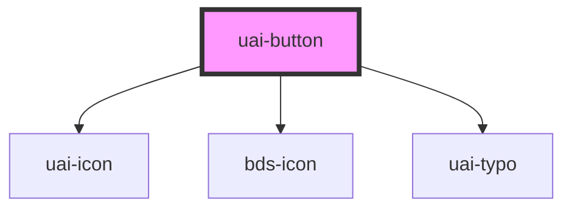

# uai-button

<!-- Auto Generated Below -->

## Overview

Button that triggers an action. Use variant "solid" for the main action of a screen and "outline" or "text" for the others;
color says what the action does (primary, content, positive, negative). For navigation to another page, use a link.
The label is the children. Icons use UaiIcon names. Wrap the app in UaiThemeProvider.

## Properties

| Property            | Attribute             | Description                                                                                                                                                                                                                  | Type                                                            | Default     |
| ------------------- | --------------------- | ---------------------------------------------------------------------------------------------------------------------------------------------------------------------------------------------------------------------------- | --------------------------------------------------------------- | ----------- |
| `ariaLabel`         | `aria-label`          | Accessible name of the button. Required when the button has no visible label.                                                                                                                                                | `string`                                                        | `null`      |
| `arrow`             | `arrow`               | If true, renders an 'arrow-right' icon after the label.                                                                                                                                                                      | `boolean`                                                       | `false`     |
| `bdsLoadingColor`   | `bds-loading-color`   | **[DEPRECATED]** The spinner follows the button variant and color. This prop has no effect.                                                                                           | `"content" \| "light" \| "main" \| "negative" \| "positive"`    | `undefined` |
| `bdsLoadingVariant` | `bds-loading-variant` | **[DEPRECATED]** The spinner follows the button variant and color. This prop has no effect.                                                                                           | `"delete" \| "ghost" \| "primary" \| "secondary" \| "tertiary"` | `undefined` |
| `block`             | `block`               | If true, the button takes the full width of its container.                                                                                                                                                                   | `boolean`                                                       | `false`     |
| `color`             | `color`               | Color of the button. Can be one of: 'primary', 'content', 'negative', 'positive'.                                                                                                                                            | `"content" \| "negative" \| "positive" \| "primary"`            | `'primary'` |
| `dataTest`          | `data-test`           | Data test is the prop to specifically test the component action object.                                                                                                                                                      | `string`                                                        | `null`      |
| `disabled`          | `disabled`            | If true, the button is disabled.                                                                                                                                                                                             | `boolean`                                                       | `false`     |
| `fullWidth`         | `full-width`          | If true, the button takes the full width of its container with centered content.                                                                                                                                             | `boolean`                                                       | `false`     |
| `groupIcon`         | `group-icon`          | **[DEPRECATED]** Put the left icon and the label together in the default slot instead. If true, keeps the left icon together with the label when justifyContent is 'space-between'.   | `boolean`                                                       | `undefined` |
| `icon`              | `icon`                | Icon rendered before the label. Uses the bds-icon component. Takes precedence over iconLeft.                                                                                                                                 | `string`                                                        | `null`      |
| `iconLeft`          | `icon-left`           | Icon rendered before the label. Uses the bds-icon component.                                                                                                                                                                 | `string`                                                        | `null`      |
| `iconRight`         | `icon-right`          | Icon rendered after the label. Uses the bds-icon component.                                                                                                                                                                  | `string`                                                        | `null`      |
| `iconTheme`         | `icon-theme`          | Theme of the icons. Can be one of: 'outline', 'solid'.                                                                                                                                                                       | `"outline" \| "solid"`                                          | `'outline'` |
| `justifyContent`    | `justify-content`     | Horizontal alignment of the button content. Can be one of: 'center' (default), 'space-between' (left content to the left, right content to the right).                                                                       | `"center" \| "space-between"`                                   | `'center'`  |
| `loading`           | `loading`             | If true, shows a loading spinner and blocks uaiClick.                                                                                                                                                                        | `boolean`                                                       | `false`     |
| `size`              | `size`                | Size of the button. Can be one of: 'compact' (24px), 'short' (32px), 'medium' (40px), 'large' (56px).                                                                                                                        | `"compact" \| "large" \| "medium" \| "short"`                   | `'medium'`  |
| `type`              | `type`                | Type of the button. Can be one of: 'button', 'submit', 'reset'. 'submit' and 'reset' act on the enclosing form.                                                                                                              | `"button" \| "reset" \| "submit"`                               | `'button'`  |
| `typeIcon`          | `type-icon`           | Type of the icons. Can be one of: 'icon', 'logo', 'emoji'.                                                                                                                                                                   | `"emoji" \| "icon" \| "logo"`                                   | `'icon'`    |
| `variant`           | `variant`             | Visual style of the button. Can be one of: 'solid', 'outline', 'text'.                                                                                                                                                       | `"outline" \| "solid" \| "text"`                                | `'solid'`   |

## Events

| Event      | Description                                                                                                                                         | Type                      |
| ---------- | --------------------------------------------------------------------------------------------------------------------------------------------------- | ------------------------- |
| `uaiClick` | Emitted when the button is activated by click, Enter or Space. Carries the native click event. Not emitted while the button is disabled or loading. | `CustomEvent<MouseEvent>` |

## Methods

### `isActive(value: boolean) => Promise<void>`

Sets the active (pressed) state of the button.

#### Parameters

| Name    | Type      | Description |
| ------- | --------- | ----------- |
| `value` | `boolean` |             |

#### Returns

Type: `Promise<void>`

### `setColor(color: UaiButtonColor) => Promise<void>`

Sets the color of the button.

#### Parameters

| Name    | Type                                                 | Description |
| ------- | ---------------------------------------------------- | ----------- |
| `color` | `"content" \| "positive" \| "negative" \| "primary"` |             |

#### Returns

Type: `Promise<void>`

### `setDirection(direction: UaiButtonDirection) => Promise<void>`

Sets the direction of the group the button belongs to.

#### Parameters

| Name        | Type                | Description |
| ----------- | ------------------- | ----------- |
| `direction` | `"row" \| "column"` |             |

#### Returns

Type: `Promise<void>`

### `setPosition(position: UaiButtonPosition) => Promise<void>`

Sets the position of the button inside a group.

#### Parameters

| Name       | Type                            | Description |
| ---------- | ------------------------------- | ----------- |
| `position` | `"first" \| "last" \| "middle"` |             |

#### Returns

Type: `Promise<void>`

### `setSize(size: UaiButtonSize) => Promise<void>`

Sets the size of the button.

#### Parameters

| Name   | Type                                          | Description |
| ------ | --------------------------------------------- | ----------- |
| `size` | `"medium" \| "large" \| "short" \| "compact"` |             |

#### Returns

Type: `Promise<void>`

### `setVariant(variant: UaiButtonVariant) => Promise<void>`

Sets the variant of the button.

#### Parameters

| Name      | Type                             | Description |
| --------- | -------------------------------- | ----------- |
| `variant` | `"outline" \| "solid" \| "text"` |             |

#### Returns

Type: `Promise<void>`

## Shadow Parts

| Part       | Description |
| ---------- | ----------- |
| `"button"` |             |

## Dependencies

### Depends on

- [uai-icon](../uai-icon)
- [bds-icon](../icon)
- [uai-typo](../uai-typo)

### Graph

----------------------------------------------

*Built with [StencilJS](https://stenciljs.com/)*
