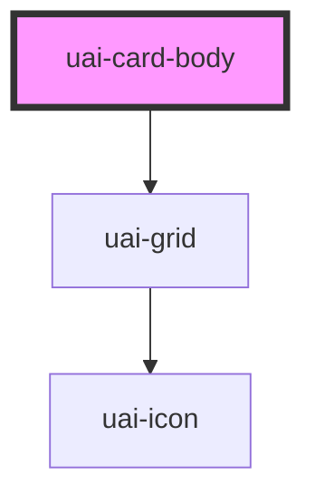

# uai-card-body

<!-- Auto Generated Below -->

## Overview

Body container for `UaiCard` when migrating from `bds-card-body`.
Use inside `uai-card` (or place content directly in `uai-card`'s default slot);
pair with `UaiCardHeader` and `UaiCardFooter`; avoid extra manual padding that duplicates the card body spacing.

## Slots

| Slot | Description                     |
| ---- | ------------------------------- |
|      | Main body elements of the card. |

## Dependencies

### Depends on

- [uai-grid](../uai-grid)

### Graph

----------------------------------------------

*Built with [StencilJS](https://stenciljs.com/)*
