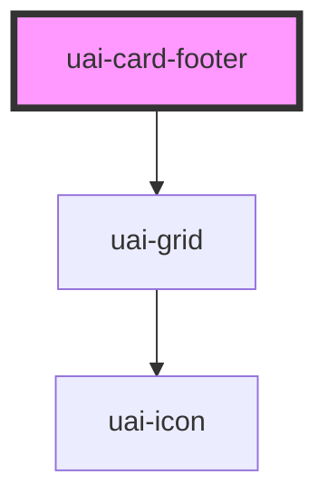

# uai-card-footer

<!-- Auto Generated Below -->

## Overview

Footer container for `UaiCard` when composing with subcomponents.
Use inside `uai-card` (or place content directly with `slot="footer"`);
pair with `UaiButton` or supporting trend/goal metadata; avoid using outside a card context.

## Properties

| Property | Attribute | Description                                                                                                                                                                             | Type                                                                                            | Default      |
| -------- | --------- | --------------------------------------------------------------------------------------------------------------------------------------------------------------------------------------- | ----------------------------------------------------------------------------------------------- | ------------ |
| `align`  | `align`   | Horizontal distribution of children inside the footer. Use `flex-end` for action buttons or `space-between` for dual metadata; pair with `UaiCard`; avoid invalid CSS alignment values. | `"center" \| "flex-end" \| "flex-start" \| "space-around" \| "space-between" \| "space-evenly"` | `'flex-end'` |

## Slots

| Slot | Description                                                                   |
| ---- | ----------------------------------------------------------------------------- |
|      | Footer elements such as metadata labels, trend indicators, or action buttons. |

## Dependencies

### Depends on

- [uai-grid](../uai-grid)

### Graph

----------------------------------------------

*Built with [StencilJS](https://stenciljs.com/)*
