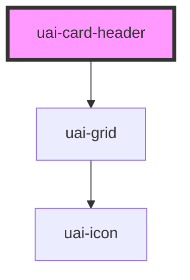

# uai-card-header

<!-- Auto Generated Below -->

## Overview

Header container for `UaiCard` when composing with subcomponents.
Use inside `uai-card` (or prefer `heading`/`description` and `slot="actions"` directly on `uai-card`);
pair with `UaiCardTitle` and `UaiCardSubtitle`; avoid using outside a card context.

## Properties

| Property | Attribute | Description                                                                                                                                                                                        | Type                                                                                            | Default           |
| -------- | --------- | -------------------------------------------------------------------------------------------------------------------------------------------------------------------------------------------------- | ----------------------------------------------------------------------------------------------- | ----------------- |
| `align`  | `align`   | Horizontal distribution of children inside the header. Use `space-between` for title + actions or `flex-start` for stacked headings; pair with `UaiCardTitle`; avoid invalid CSS alignment values. | `"center" \| "flex-end" \| "flex-start" \| "space-around" \| "space-between" \| "space-evenly"` | `'space-between'` |

## Slots

| Slot | Description                                                                        |
| ---- | ---------------------------------------------------------------------------------- |
|      | Header elements such as `uai-card-title`, `uai-card-subtitle`, and action buttons. |

## Dependencies

### Depends on

- [uai-grid](../uai-grid)

### Graph

----------------------------------------------

*Built with [StencilJS](https://stenciljs.com/)*
