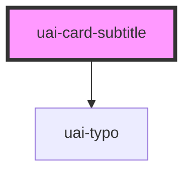

# uai-card-subtitle

<!-- Auto Generated Below -->

## Overview

Subtitle element for `UaiCardHeader` when composing with subcomponents.
Use inside `uai-card-header` (or pass `description` directly to `uai-card`);
pair with `UaiCardTitle`; avoid using without a corresponding title.

## Properties

| Property | Attribute | Description                                                                                                                                              | Type     | Default |
| -------- | --------- | -------------------------------------------------------------------------------------------------------------------------------------------------------- | -------- | ------- |
| `text`   | `text`    | Text rendered as the card subtitle. Use for secondary context such as timestamps or scope; pair with `UaiCardTitle`; avoid duplicating the default slot. | `string` | `''`    |

## Slots

| Slot | Description                                            |
| ---- | ------------------------------------------------------ |
|      | Optional subtitle content when `text` is not provided. |

## Dependencies

### Depends on

- [uai-typo](../uai-typo)

### Graph

----------------------------------------------

*Built with [StencilJS](https://stenciljs.com/)*
