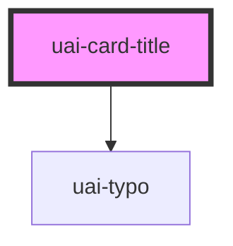

# uai-card-title

<!-- Auto Generated Below -->

## Overview

Title element for `UaiCardHeader` when composing with subcomponents.
Use inside `uai-card-header` (or pass `heading` directly to `uai-card`);
pair with `UaiCardSubtitle`; avoid long sentences that wrap onto multiple lines.

## Properties

| Property | Attribute | Description                                                                                                                  | Type     | Default |
| -------- | --------- | ---------------------------------------------------------------------------------------------------------------------------- | -------- | ------- |
| `text`   | `text`    | Text rendered as the card title. Use a concise label; pair with `UaiCardHeader`; avoid duplicating the default slot content. | `string` | `''`    |

## Slots

| Slot | Description                                         |
| ---- | --------------------------------------------------- |
|      | Optional title content when `text` is not provided. |

## Dependencies

### Depends on

- [uai-typo](../uai-typo)

### Graph

----------------------------------------------

*Built with [StencilJS](https://stenciljs.com/)*
