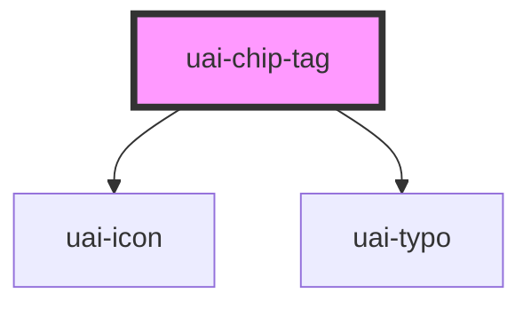

# uai-chip-tag

<!-- Auto Generated Below -->

## Overview

Small passive label that categorizes or tags an item. Use for short keywords or statuses;
pair with a text label; avoid using color alone to convey meaning or using it as an action.

## Properties

| Property   | Attribute   | Description                                                                                                                                                                       | Type     | Default     |
| ---------- | ----------- | --------------------------------------------------------------------------------------------------------------------------------------------------------------------------------- | -------- | ----------- |
| `color`    | `color`     | Semantic color: system, outline, info, success, warning, danger or disabled. Use for status; pair with the text; avoid arbitrary colors. The legacy default value maps to system. | `string` | `'system'`  |
| `dataTest` | `data-test` | Test selector on the chip. Use for automation; pair with semantic queries. Avoid styling by it.                                                                                   | `string` | `null`      |
| `icon`     | `icon`      | Icon name shown before the text. Use to reinforce the meaning; pair with the text; avoid decorative icons.                                                                        | `string` | `undefined` |

## Slots

| Slot | Description    |
| ---- | -------------- |
|      | The chip text. |

## Shadow Parts

| Part     | Description         |
| -------- | ------------------- |
| `"chip"` | The chip container. |

## Dependencies

### Depends on

- [uai-icon](../uai-icon)
- [uai-typo](../uai-typo)

### Graph

----------------------------------------------

*Built with [StencilJS](https://stenciljs.com/)*
