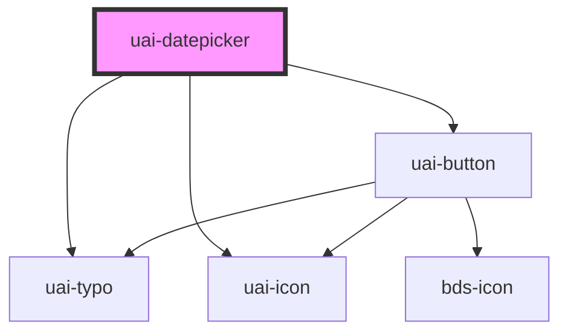

# uai-datepicker

<!-- Auto Generated Below -->

## Overview

Field to choose a date or a period in the UAI calendar. With typeOfDate "single" (default) the panel shows a month
and a date field; with "period" it shows two months side by side with the "Starts" and "Ends" fields, fills the days
between them and previews the period under the pointer. The choice is a draft until Apply; Reset clears it and
closing without applying discards it. Dates are ISO YYYY-MM-DD. Use it for filters and reports over a period, or
when the choice should be confirmed. Pair with a visible label. Avoid it for a single date typed in a form (use
uai-input-date). Wrap the app in UaiThemeProvider.

## Properties

| Property               | Attribute                 | Description                                                                                                                                                                                                                                                     | Type                                                      | Default     |
| ---------------------- | ------------------------- | --------------------------------------------------------------------------------------------------------------------------------------------------------------------------------------------------------------------------------------------------------------- | --------------------------------------------------------- | ----------- |
| `ariaLabel`            | `aria-label`              | Accessible name of the field when the visible label is not enough.                                                                                                                                                                                              | `string`                                                  | `null`      |
| `danger`               | `danger`                  | If true, shows the error state and errorMessage.                                                                                                                                                                                                                | `boolean`                                                 | `false`     |
| `disabled`             | `disabled`                | If true, the field cannot be used and is left out of the form data.                                                                                                                                                                                             | `boolean`                                                 | `false`     |
| `dtButtonClear`        | `dt-button-clear`         | Data test id of the Reset button.                                                                                                                                                                                                                               | `string`                                                  | `null`      |
| `dtButtonConfirm`      | `dt-button-confirm`       | Data test id of the Apply button.                                                                                                                                                                                                                               | `string`                                                  | `null`      |
| `dtButtonNext`         | `dt-button-next`          | Data test id of the next month button.                                                                                                                                                                                                                          | `string`                                                  | `null`      |
| `dtButtonPrev`         | `dt-button-prev`          | Data test id of the previous month button.                                                                                                                                                                                                                      | `string`                                                  | `null`      |
| `dtInputEnd`           | `dt-input-end`            | Data test id of the end date field of the panel.                                                                                                                                                                                                                | `string`                                                  | `null`      |
| `dtInputStart`         | `dt-input-start`          | Data test id of the start date field of the panel (or the only one).                                                                                                                                                                                            | `string`                                                  | `null`      |
| `dtOutzone`            | `dt-outzone`              | Data test id of the field that opens the panel. Kept from bds-datepicker, where it was the outside area.                                                                                                                                                        | `string`                                                  | `null`      |
| `dtSelectMonth`        | `dt-select-month`         | Data test id of the month button.                                                                                                                                                                                                                               | `string`                                                  | `null`      |
| `dtSelectYear`         | `dt-select-year`          | Data test id of the year button.                                                                                                                                                                                                                                | `string`                                                  | `null`      |
| `endDateLimit`         | `end-date-limit`          | Latest date that can be chosen, as ISO YYYY-MM-DD. The legacy DD/MM/YYYY still works, with a warning. Later days are disabled.                                                                                                                                  | `string`                                                  | `undefined` |
| `errorMessage`         | `error-message`           | Message below the field while danger is true.                                                                                                                                                                                                                   | `string`                                                  | `''`        |
| `helperMessage`        | `helper-message`          | Message below the field that helps to fill it.                                                                                                                                                                                                                  | `string`                                                  | `''`        |
| `label`                | `label`                   | Label shown above the field. Without it, the default text of the language is shown ("Data").                                                                                                                                                                    | `string`                                                  | `undefined` |
| `language`             | `language`                | Language of the texts and of the calendar. Can be one of: 'pt_BR' (default), 'en_US', 'es_ES'.                                                                                                                                                                  | `"en_US" \| "es_ES" \| "pt_BR"`                           | `'pt_BR'`   |
| `message`              | `message`                 | Message shown inside the panel, above the buttons, such as a rule about the period.                                                                                                                                                                             | `string`                                                  | `null`      |
| `name`                 | `name`                    | Name of the value in the submitted form data: the date, or the start and the end of the period.                                                                                                                                                                 | `string`                                                  | `undefined` |
| `placeholder`          | `placeholder`             | Text shown in the field while nothing is chosen. Defaults to the browser's regional date format.                                                                                                                                                                | `string`                                                  | `undefined` |
| `positionOptions`      | `position-options`        | Side and alignment of the panel. Can be 'auto' (default) or a side and an edge such as 'bottom-left', 'bottom-right', 'top-left', 'top-right'. 'top-center' and 'bottom-center' keep only the side; the right and left sides of the legacy fall back to 'auto'. | `string`                                                  | `'auto'`    |
| `size`                 | `size`                    | Height of the field. Can be one of: 'short', 'medium' (default).                                                                                                                                                                                                | `"medium" \| "short"`                                     | `'medium'`  |
| `startDateLimit`       | `start-date-limit`        | Earliest date that can be chosen, as ISO YYYY-MM-DD. The legacy DD/MM/YYYY still works, with a warning. Earlier days are disabled.                                                                                                                              | `string`                                                  | `undefined` |
| `typeOfDate`           | `type-of-date`            | One date or a period. Can be one of: 'single' (default), 'period'.                                                                                                                                                                                              | `"period" \| "single"`                                    | `'single'`  |
| `valueDateSelected`    | `value-date-selected`     | Chosen date, or the start of the period, as ISO YYYY-MM-DD (the legacy DD/MM/YYYY still works, with a warning).                                                                                                                                                 | `string`                                                  | `null`      |
| `valueEndDateSelected` | `value-end-date-selected` | End of the period, as ISO YYYY-MM-DD (the legacy DD/MM/YYYY still works, with a warning).                                                                                                                                                                       | `string`                                                  | `null`      |
| `variantBanner`        | `variant-banner`          | Tone of the message inside the panel. Can be one of: 'system', 'info', 'success', 'warning' (default), 'error'.                                                                                                                                                 | `"error" \| "info" \| "success" \| "system" \| "warning"` | `'warning'` |

## Events

| Event                        | Description                                                                                                      | Type                                 |
| ---------------------------- | ---------------------------------------------------------------------------------------------------------------- | ------------------------------------ |
| `uaiConcludeDatepicker`      | Emitted on Apply with a choice. detail: { startDate, endDate? } as ISO.                                          | `CustomEvent<UaiDatepickerConclude>` |
| `uaiEmptyConcludeDatepicker` | Emitted on Apply with nothing chosen.                                                                            | `CustomEvent<void>`                  |
| `uaiEndDate`                 | Emitted when the end date of the draft changes. detail: { value } as ISO or null.                                | `CustomEvent<{ value: string; }>`    |
| `uaiStartDate`               | Emitted when the start date of the draft changes (or the date, with "single"). detail: { value } as ISO or null. | `CustomEvent<{ value: string; }>`    |

## Methods

### `clear() => Promise<void>`

Clears the chosen date or period.

#### Returns

Type: `Promise<void>`

### `close() => Promise<void>`

Closes the panel, discarding the draft.

#### Returns

Type: `Promise<void>`

### `open() => Promise<void>`

Opens the panel.

#### Returns

Type: `Promise<void>`

## Shadow Parts

| Part                | Description                                                             |
| ------------------- | ----------------------------------------------------------------------- |
| `"calendar-arrow"`  | The previous and next buttons of a calendar header.                     |
| `"calendar-day"`    | Each day button of the calendars.                                       |
| `"calendar-option"` | Each month or year in their pickers.                                    |
| `"calendar-picker"` | The month and year buttons of a calendar header.                        |
| `"date-input"`      | The date fields inside the panel.                                       |
| `"input-container"` | The field that shows the chosen date or period and opens the panel.     |
| `"input__message"`  | The helper or error message below the field.                            |
| `"message"`         | The message shown inside the panel.                                     |
| `"panel"`           | The floating panel with the calendars, the date fields and the buttons. |

## CSS Custom Properties

| Name                     | Description                                                      |
| ------------------------ | ---------------------------------------------------------------- |
| `--uai-datepicker-width` | Width of the field. Defaults to the full width of the container. |

## Dependencies

### Depends on

- [uai-typo](../uai-typo)
- [uai-icon](../uai-icon)
- [uai-button](../uai-button)

### Graph

----------------------------------------------

*Built with [StencilJS](https://stenciljs.com/)*
