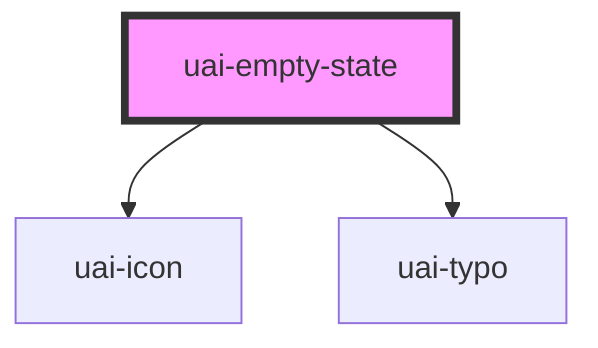

# uai-empty-state

<!-- Auto Generated Below -->

## Overview

Empty or error state of a page, panel, card or list: a decorative icon, a title, a short description and optional actions.
Use when a region has nothing to show or failed to load; pair with uai-button in the actions slot and uai-paper around a page state;
avoid it for loading (use a skeleton) and for transient feedback (use a toast).

## Properties

| Property      | Attribute     | Description                                                                                                                                                                                | Type                                                  | Default     |
| ------------- | ------------- | ------------------------------------------------------------------------------------------------------------------------------------------------------------------------------------------ | ----------------------------------------------------- | ----------- |
| `dataTest`    | `data-test`   | Test selector on the host (data-test). Use for automation; pair with semantic queries. Avoid styling by it.                                                                                | `string`                                              | `null`      |
| `description` | `description` | Short supporting text. Use it to say what the person can do now; the default slot replaces it. Avoid long paragraphs.                                                                      | `string`                                              | `null`      |
| `heading`     | `heading`     | Visible title (required). Use a short sentence that says what happened, without a final period; avoid generic titles such as "Erro".                                                       | `string`                                              | `null`      |
| `headingTag`  | `heading-tag` | Semantic element of the title; the look is always title-sm semibold. Use the level that fits the page outline; avoid choosing it by size.                                                  | `"h1" \| "h2" \| "h3" \| "h4" \| "h5" \| "h6" \| "p"` | `'h2'`      |
| `icon`        | `icon`        | UAI icon name, always decorative. Use one that matches the situation; without it, 'message-ballon' (neutral) or 'error' (error) is used. Avoid icons that carry meaning the text does not. | `string`                                              | `null`      |
| `tone`        | `tone`        | 'error' tints the icon with feedback-error and announces the state with role="alert". Use it for load failures; pair the title with what failed; avoid color alone to convey it.           | `"error" \| "neutral"`                                | `'neutral'` |
| `variant`     | `variant`     | Density: 'page' for a page or panel, 'inline' for a narrow column, card or side list. Use the one that fits the region; avoid 'page' in narrow columns.                                    | `"inline" \| "page"`                                  | `'page'`    |

## Slots

| Slot        | Description                                                                                                           |
| ----------- | --------------------------------------------------------------------------------------------------------------------- |
|             | Rich description, such as text with a link. When filled, it replaces the description prop.                            |
| `"actions"` | One or two uai-button (page: variant="outline" size="short"; inline: variant="text" size="short"). Hidden when empty. |

## Shadow Parts

| Part            | Description                 |
| --------------- | --------------------------- |
| `"actions"`     | The actions row.            |
| `"description"` | The description.            |
| `"heading"`     | The title.                  |
| `"icon-box"`    | The circle around the icon. |

## Dependencies

### Depends on

- [uai-icon](../uai-icon)
- [uai-typo](../uai-typo)

### Graph

----------------------------------------------

*Built with [StencilJS](https://stenciljs.com/)*
