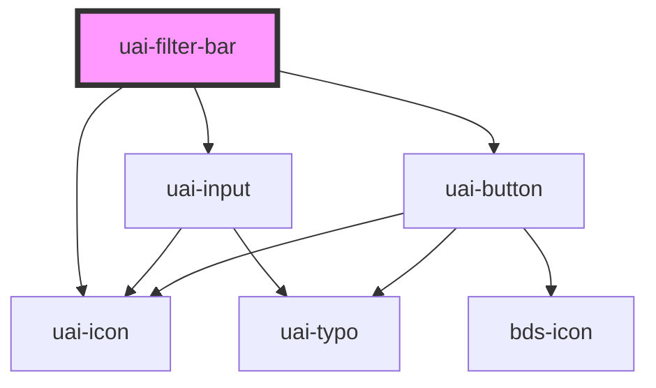

# uai-filter-bar

<!-- Auto Generated Below -->

## Overview

Composite analytical filter toolbar combining period presets, quick search, active filter chips, and a two-level category popover.
Use at the top of analytical pages and dashboards; pair with `UaiCard`, `UaiLineChart`, and `UaiBarChart`;
avoid embedding backend requests directly inside the toolbar.

## Properties

| Property            | Attribute             | Description                                                                                                                                                                                                                                     | Type                                   | Default     |
| ------------------- | --------------------- | ----------------------------------------------------------------------------------------------------------------------------------------------------------------------------------------------------------------------------------------------- | -------------------------------------- | ----------- |
| `appliedFilters`    | `applied-filters`     | Map of category ids to selected option values, as an object or JSON string. Use to control or seed active filters; pair with `categories` and `onUaiFilterChange`; avoid unknown category keys.                                                 | `string \| { [x: string]: string[]; }` | `{}`        |
| `categories`        | `categories`          | Filter categories and options displayed in the two-level popover, as an array or JSON string. Use to let people filter by dimensions such as channel or campaign; pair with `appliedFilters` and `onUaiFilterChange`; avoid empty option lists. | `UaiFilterCategory[] \| string`        | `[]`        |
| `dataTest`          | `data-test`           | Automation selector applied to the toolbar container. Use in automated tests; pair with semantic role queries; avoid styling by this attribute.                                                                                                 | `string`                               | `null`      |
| `filterButtonLabel` | `filter-button-label` | Label override for the filter trigger button. Use concise verbs; pair with `language`; avoid icon-only triggers when space allows text.                                                                                                         | `string`                               | `''`        |
| `language`          | `language`            | Locale for built-in labels and default period presets (`pt_BR`, `en_US`, `es_ES`). Use to match the application language; pair with label override props when needed; avoid mixing locales.                                                     | `"en_US" \| "es_ES" \| "pt_BR"`        | `'pt_BR'`   |
| `periods`           | `periods`             | Preset periods rendered in the segmented group, as an array or JSON string. Use when customizing available date ranges; pair with `selectedPeriod` and `onUaiPeriodChange`; avoid more than seven presets in one bar.                           | `UaiFilterPeriodPreset[] \| string`    | `undefined` |
| `searchPlaceholder` | `search-placeholder`  | Placeholder override for the quick search input. Use to specify what can be searched (for example campaigns or flows); pair with `language`; avoid long instructions.                                                                           | `string`                               | `''`        |
| `searchValue`       | `search-value`        | Current text value of the quick search input. Use in controlled flows; pair with `onUaiSearchChange`; avoid mutating without updating consumer state.                                                                                           | `string`                               | `''`        |
| `selectedPeriod`    | `selected-period`     | Identifier of the currently selected period preset. Use in controlled or uncontrolled mode; pair with `onUaiPeriodChange`; avoid ids absent from `periods`.                                                                                     | `string`                               | `'7d'`      |
| `showFilterButton`  | `show-filter-button`  | Shows or hides the trailing filter button. Use `false` when only period and search are needed; pair with `categories`; avoid hiding when `categories` are provided.                                                                             | `boolean`                              | `true`      |
| `showPeriods`       | `show-periods`        | Shows or hides the segmented period preset group. Use `false` when the page has no temporal dimension; pair with `periods`; avoid hiding both periods, search, and filters simultaneously.                                                      | `boolean`                              | `true`      |
| `showSearch`        | `show-search`         | Shows or hides the built-in quick search input. Use `true` to filter metrics or items by text; pair with `searchValue` and `onUaiSearchChange`; avoid duplicating another page-level search right below.                                        | `boolean`                              | `true`      |

## Events

| Event                 | Description                                                                                                                                                                                         | Type                                           |
| --------------------- | --------------------------------------------------------------------------------------------------------------------------------------------------------------------------------------------------- | ---------------------------------------------- |
| `uaiFilterChange`     | Emitted when category filters are applied, cleared, or removed via chip. Use to refresh analytical cards and charts; pair with `appliedFilters`; avoid mutating the emitted detail object in place. | `CustomEvent<{ filters: UaiAppliedFilters; }>` |
| `uaiFilterOpenChange` | Emitted when the filter popover opens or closes. Use for analytics or coordinating external UI; pair with `open()` and `close()`; avoid preventing Escape closure.                                  | `CustomEvent<{ open: boolean; }>`              |
| `uaiPeriodChange`     | Emitted when the user selects a period preset. Use to update analytical queries; pair with `selectedPeriod`; avoid firing network calls on already-selected presets.                                | `CustomEvent<{ id: string; label: string; }>`  |
| `uaiSearchChange`     | Emitted when the quick search value changes. Use to filter visible items or metrics; pair with `searchValue`; avoid blocking typing with synchronous heavy work.                                    | `CustomEvent<{ value: string; }>`              |

## Methods

### `close() => Promise<void>`

Closes the filter category popover if open. Use to dismiss programmatically; pair with `open()`; avoid skipping focus restoration on keyboard flows.

#### Returns

Type: `Promise<void>`

### `open() => Promise<void>`

Opens the filter category popover anchored to the filter trigger. Use for programmatic focus flows; pair with `close()`; avoid opening when `categories` is empty.

#### Returns

Type: `Promise<void>`

## Slots

| Slot        | Description                                                              |
| ----------- | ------------------------------------------------------------------------ |
| `"actions"` | Optional trailing controls displayed after the filter trigger.           |
| `"chips"`   | Optional additional chips displayed next to applied category chips.      |
| `"period"`  | Optional custom period selector replacing the default segmented presets. |
| `"search"`  | Optional custom search control replacing the built-in `uai-input`.       |

## Shadow Parts

| Part        | Description                                  |
| ----------- | -------------------------------------------- |
| `"bar"`     | The main filter toolbar surface.             |
| `"panel"`   | The floating two-level filter popover panel. |
| `"periods"` | The segmented period preset group.           |
| `"search"`  | The search control container.                |

## Dependencies

### Depends on

- [uai-icon](../uai-icon)
- [uai-input](../uai-input)
- [uai-button](../uai-button)

### Graph

----------------------------------------------

*Built with [StencilJS](https://stenciljs.com/)*
