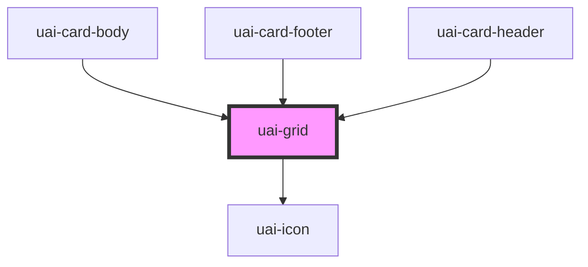

# uai-grid

<!-- Auto Generated Below -->

## Overview

UAI layout grid and reorderable section row. Keeps legacy `bds-grid` 12-column props while adding
UAI Core row composition (`type="default" | "draggable"`) and vertical block sorting (`sortable`).
Use `type="draggable"` inside a `sortable` column `UaiGrid` to let people reorder whole rows and add items;
pair with `UaiCard` and `UaiSectionTitle`; avoid nesting `draggable` rows inside another `draggable` row.

## Properties

| Property            | Attribute            | Description                                                                                                                                                                                                                                                      | Type                                                                                                                                                                                                                                                                                                                                                                                                                                                                                                                                                                                                                                                                                                                            | Default     |
| ------------------- | -------------------- | ---------------------------------------------------------------------------------------------------------------------------------------------------------------------------------------------------------------------------------------------------------------- | ------------------------------------------------------------------------------------------------------------------------------------------------------------------------------------------------------------------------------------------------------------------------------------------------------------------------------------------------------------------------------------------------------------------------------------------------------------------------------------------------------------------------------------------------------------------------------------------------------------------------------------------------------------------------------------------------------------------------------- | ----------- |
| `addDisabled`       | `add-disabled`       | Explicitly disables the lateral `+` button with `aria-disabled="true"` while keeping it focusable. Use when external business rules block adding items; pair with `addDisabledLabel`; avoid hiding the button abruptly during keyboard navigation.               | `boolean`                                                                                                                                                                                                                                                                                                                                                                                                                                                                                                                                                                                                                                                                                                                       | `false`     |
| `addDisabledLabel`  | `add-disabled-label` | Accessible name and tooltip title override when the `+` button reaches `maxItems` or `addDisabled`. Use to explain why no more items can be added; pair with `maxItems`; avoid generic messages.                                                                 | `string`                                                                                                                                                                                                                                                                                                                                                                                                                                                                                                                                                                                                                                                                                                                        | `''`        |
| `addLabel`          | `add-label`          | Accessible name override for the lateral `+` button when enabled. Use to specify what kind of block will be added; pair with `type="draggable"`; avoid empty strings.                                                                                            | `string`                                                                                                                                                                                                                                                                                                                                                                                                                                                                                                                                                                                                                                                                                                                        | `''`        |
| `addable`           | `addable`            | Controls whether the lateral `+` button is rendered when `type="draggable"`. Use `true` when users can append items to the row; pair with `maxItems` and `onUaiAddClick`; avoid when the row has a fixed single item.                                            | `boolean`                                                                                                                                                                                                                                                                                                                                                                                                                                                                                                                                                                                                                                                                                                                       | `true`      |
| `alignItems`        | `align-items`        | Controls alignment along the cross axis. Use `stretch` for equal-height cards or `center` for toolbars; pair with `direction`; avoid clipping taller items.                                                                                                      | `"baseline" \| "center" \| "flex-end" \| "flex-start" \| "stretch"`                                                                                                                                                                                                                                                                                                                                                                                                                                                                                                                                                                                                                                                             | `undefined` |
| `bgColor`           | `bg-color`           | Legacy color name mapped to the closest semantic UAI background token. Use surface tokens in new UAI usage; pair with `UaiThemeProvider`; avoid raw hex colors.                                                                                                  | `"$color-border-1" \| "$color-border-2" \| "$color-border-3" \| "$color-brand" \| "$color-content-bright" \| "$color-content-default" \| "$color-content-din" \| "$color-content-disable" \| "$color-content-ghost" \| "$color-delete" \| "$color-error" \| "$color-focus" \| "$color-hover" \| "$color-info" \| "$color-negative" \| "$color-positive" \| "$color-pressed" \| "$color-primary" \| "$color-secondary" \| "$color-shadow-0" \| "$color-shadow-1" \| "$color-success" \| "$color-surface-0" \| "$color-surface-1" \| "$color-surface-2" \| "$color-surface-3" \| "$color-surface-4" \| "$color-surface-negative" \| "$color-surface-positive" \| "$color-surface-primary" \| "$color-system" \| "$color-warning"` | `undefined` |
| `container`         | `container`          | Applies a centered container capped by the UAI `width/content` token. Use for page-aligned rows; pair with `gap`; avoid combining with `containerFluid`.                                                                                                         | `boolean`                                                                                                                                                                                                                                                                                                                                                                                                                                                                                                                                                                                                                                                                                                                       | `undefined` |
| `containerFluid`    | `container-fluid`    | Applies the wider responsive fluid-container max widths compatible with `bds-grid`. Use only for legacy fluid layouts; pair with `flexWrap="wrap"`; avoid combining with `container`.                                                                            | `boolean`                                                                                                                                                                                                                                                                                                                                                                                                                                                                                                                                                                                                                                                                                                                       | `undefined` |
| `controlledReorder` | `controlled-reorder` | Skips automatic DOM node movement on reorder so controlled frameworks (such as React state) own child order. Use `true` when rendering `draggable` rows from a reactive array in `onUaiReorder`; pair with `sortable`; avoid `true` in uncontrolled static HTML. | `boolean`                                                                                                                                                                                                                                                                                                                                                                                                                                                                                                                                                                                                                                                                                                                       | `false`     |
| `dataTest`          | `data-test`          | Automation selector applied to the draggable container or host. Use in automated tests; pair with accessible role queries; avoid styling by this attribute.                                                                                                      | `string`                                                                                                                                                                                                                                                                                                                                                                                                                                                                                                                                                                                                                                                                                                                        | `null`      |
| `direction`         | `direction`          | Controls the flex direction of children. Use `column` for vertical stacks and `row` for horizontal rows; pair with `gap`; avoid reversing visual vs DOM focus order unnecessarily.                                                                               | `"column" \| "column-reverse" \| "row" \| "row-reverse"`                                                                                                                                                                                                                                                                                                                                                                                                                                                                                                                                                                                                                                                                        | `undefined` |
| `dragLabel`         | `drag-label`         | Accessible name override for the lateral drag handle button. Use to name the specific section being reordered; pair with `type="draggable"`; avoid empty strings.                                                                                                | `string`                                                                                                                                                                                                                                                                                                                                                                                                                                                                                                                                                                                                                                                                                                                        | `''`        |
| `flexWrap`          | `flex-wrap`          | Controls whether children wrap onto multiple lines. Use `wrap` for 12-column grids; pair with `xxs`–`xg`; avoid wrapping inside fixed-slot `draggable` rows.                                                                                                     | `"wrap" \| "wrap-reverse"`                                                                                                                                                                                                                                                                                                                                                                                                                                                                                                                                                                                                                                                                                                      | `undefined` |
| `gap`               | `gap`                | Gap token alias retained for compatibility with `bds-grid` (`2` maps to `spacing/md`). Use `2` for standard card rows and vertical stacks; pair with `direction`; avoid arbitrary margins on children.                                                           | `"1" \| "10" \| "11" \| "12" \| "2" \| "3" \| "4" \| "5" \| "6" \| "7" \| "8" \| "9" \| "half" \| "none"`                                                                                                                                                                                                                                                                                                                                                                                                                                                                                                                                                                                                                       | `undefined` |
| `height`            | `height`             | Sets an explicit CSS height on the grid container. Use token variables or percentages; pair with `alignItems`; avoid literal pixel strings.                                                                                                                      | `string`                                                                                                                                                                                                                                                                                                                                                                                                                                                                                                                                                                                                                                                                                                                        | `undefined` |
| `justifyContent`    | `justify-content`    | Controls how children are distributed along the main axis. Use standard flex alignment values; pair with `direction`; avoid non-standard CSS strings.                                                                                                            | `"center" \| "flex-end" \| "flex-start" \| "space-around" \| "space-between" \| "space-evenly" \| "stretch"`                                                                                                                                                                                                                                                                                                                                                                                                                                                                                                                                                                                                                    | `undefined` |
| `language`          | `language`           | Language for default accessible labels of the drag handle, plus button, and live announcements. Use `pt_BR`, `en_US`, or `es_ES`; pair with `dragLabel` and `addLabel` for custom copy; avoid untranslated labels.                                               | `"en_US" \| "es_ES" \| "pt_BR"`                                                                                                                                                                                                                                                                                                                                                                                                                                                                                                                                                                                                                                                                                                 | `'pt_BR'`   |
| `lg`                | `lg`                 | 12-column span from the legacy `lg` breakpoint. Use for responsive column widths; pair with `xxs`; avoid without a base span.                                                                                                                                    | `"1" \| "10" \| "11" \| "12" \| "2" \| "3" \| "4" \| "5" \| "6" \| "7" \| "8" \| "9" \| "auto"`                                                                                                                                                                                                                                                                                                                                                                                                                                                                                                                                                                                                                                 | `undefined` |
| `lgOffset`          | `lg-offset`          | Left offset from the legacy `lg` breakpoint. Use for responsive offsets; pair with `lg`; avoid in `type="draggable"` rows.                                                                                                                                       | `"1" \| "10" \| "11" \| "12" \| "2" \| "3" \| "4" \| "5" \| "6" \| "7" \| "8" \| "9" \| "auto"`                                                                                                                                                                                                                                                                                                                                                                                                                                                                                                                                                                                                                                 | `undefined` |
| `margin`            | `margin`             | Margin token aliases retained for compatibility with `bds-grid`. Accepts one value or a space-separated list, for example `"t-2 x-auto"`. Use for tokenized outer spacing; pair with `container`; avoid manual negative margins.                                 | `string`                                                                                                                                                                                                                                                                                                                                                                                                                                                                                                                                                                                                                                                                                                                        | `undefined` |
| `maxItems`          | `max-items`          | Maximum number of slotted items allowed in the row before marking the `+` button `aria-disabled="true"`. Use `4` for dashboard KPI rows; pair with `addable` and `onUaiAddClick`; avoid setting `0`.                                                             | `number`                                                                                                                                                                                                                                                                                                                                                                                                                                                                                                                                                                                                                                                                                                                        | `4`         |
| `md`                | `md`                 | 12-column span from the legacy `md` breakpoint. Use for responsive column widths; pair with `xxs`; avoid without a base span.                                                                                                                                    | `"1" \| "10" \| "11" \| "12" \| "2" \| "3" \| "4" \| "5" \| "6" \| "7" \| "8" \| "9" \| "auto"`                                                                                                                                                                                                                                                                                                                                                                                                                                                                                                                                                                                                                                 | `undefined` |
| `mdOffset`          | `md-offset`          | Left offset from the legacy `md` breakpoint. Use for responsive offsets; pair with `md`; avoid in `type="draggable"` rows.                                                                                                                                       | `"1" \| "10" \| "11" \| "12" \| "2" \| "3" \| "4" \| "5" \| "6" \| "7" \| "8" \| "9" \| "auto"`                                                                                                                                                                                                                                                                                                                                                                                                                                                                                                                                                                                                                                 | `undefined` |
| `padding`           | `padding`            | Padding token aliases retained for compatibility with `bds-grid`. Accepts one value or a space-separated list, for example `"t-2 x-3"`. Use for tokenized container spacing; pair with `gap`; avoid overriding internal `draggable` slot padding.                | `string`                                                                                                                                                                                                                                                                                                                                                                                                                                                                                                                                                                                                                                                                                                                        | `undefined` |
| `sm`                | `sm`                 | 12-column span from the legacy `sm` breakpoint. Use for responsive column widths; pair with `xxs`; avoid without a base span.                                                                                                                                    | `"1" \| "10" \| "11" \| "12" \| "2" \| "3" \| "4" \| "5" \| "6" \| "7" \| "8" \| "9" \| "auto"`                                                                                                                                                                                                                                                                                                                                                                                                                                                                                                                                                                                                                                 | `undefined` |
| `smOffset`          | `sm-offset`          | Left offset from the legacy `sm` breakpoint. Use for responsive offsets; pair with `sm`; avoid in `type="draggable"` rows.                                                                                                                                       | `"1" \| "10" \| "11" \| "12" \| "2" \| "3" \| "4" \| "5" \| "6" \| "7" \| "8" \| "9" \| "auto"`                                                                                                                                                                                                                                                                                                                                                                                                                                                                                                                                                                                                                                 | `undefined` |
| `sortable`          | `sortable`           | Enables vertical drag-and-drop and keyboard (`Alt+ArrowUp` / `Alt+ArrowDown`) sorting of child `uai-grid[type="draggable"]` rows. Use on a vertical (`direction="column"`) parent `UaiGrid`; pair with `onUaiReorder`; avoid enabling on leaf item grids.        | `boolean`                                                                                                                                                                                                                                                                                                                                                                                                                                                                                                                                                                                                                                                                                                                       | `false`     |
| `type`              | `type`               | Row composition mode from UAI Core (`default` or `draggable`). Use `draggable` to display the lateral reorder handle and plus action while preserving slot `gap`; pair with a `sortable` parent `UaiGrid`; avoid using the native HTML `draggable` attribute.    | `"default" \| "draggable"`                                                                                                                                                                                                                                                                                                                                                                                                                                                                                                                                                                                                                                                                                                      | `undefined` |
| `xg`                | `xg`                 | 12-column span from the legacy `xg` breakpoint. Use for responsive column widths; pair with `xxs`; avoid without a base span.                                                                                                                                    | `"1" \| "10" \| "11" \| "12" \| "2" \| "3" \| "4" \| "5" \| "6" \| "7" \| "8" \| "9" \| "auto"`                                                                                                                                                                                                                                                                                                                                                                                                                                                                                                                                                                                                                                 | `undefined` |
| `xgOffset`          | `xg-offset`          | Left offset from the legacy `xg` breakpoint. Use for responsive offsets; pair with `xg`; avoid in `type="draggable"` rows.                                                                                                                                       | `"1" \| "10" \| "11" \| "12" \| "2" \| "3" \| "4" \| "5" \| "6" \| "7" \| "8" \| "9" \| "auto"`                                                                                                                                                                                                                                                                                                                                                                                                                                                                                                                                                                                                                                 | `undefined` |
| `xs`                | `xs`                 | 12-column span from the legacy `xs` breakpoint. Use for responsive column widths; pair with `xxs`; avoid without a base span.                                                                                                                                    | `"1" \| "10" \| "11" \| "12" \| "2" \| "3" \| "4" \| "5" \| "6" \| "7" \| "8" \| "9" \| "auto"`                                                                                                                                                                                                                                                                                                                                                                                                                                                                                                                                                                                                                                 | `undefined` |
| `xsOffset`          | `xs-offset`          | Left offset from the legacy `xs` breakpoint. Use for responsive offsets; pair with `xs`; avoid in `type="draggable"` rows.                                                                                                                                       | `"1" \| "10" \| "11" \| "12" \| "2" \| "3" \| "4" \| "5" \| "6" \| "7" \| "8" \| "9" \| "auto"`                                                                                                                                                                                                                                                                                                                                                                                                                                                                                                                                                                                                                                 | `undefined` |
| `xxs`               | `xxs`                | Base 12-column span. Use values `1`–`12` or `auto`; pair with a `flexWrap="wrap"` parent `UaiGrid`; avoid combining with `type="draggable"`.                                                                                                                     | `"1" \| "10" \| "11" \| "12" \| "2" \| "3" \| "4" \| "5" \| "6" \| "7" \| "8" \| "9" \| "auto"`                                                                                                                                                                                                                                                                                                                                                                                                                                                                                                                                                                                                                                 | `undefined` |
| `xxsOffset`         | `xxs-offset`         | Base left offset in the 12-column grid. Use values `1`–`12` or `auto`; pair with `xxs`; avoid in `type="draggable"` rows.                                                                                                                                        | `"1" \| "10" \| "11" \| "12" \| "2" \| "3" \| "4" \| "5" \| "6" \| "7" \| "8" \| "9" \| "auto"`                                                                                                                                                                                                                                                                                                                                                                                                                                                                                                                                                                                                                                 | `undefined` |

## Events

| Event         | Description                                                                                                                                                                                                                                                                | Type                                |
| ------------- | -------------------------------------------------------------------------------------------------------------------------------------------------------------------------------------------------------------------------------------------------------------------------- | ----------------------------------- |
| `uaiAddClick` | Emitted when the lateral `+` button of a `type="draggable"` row is activated while enabled. Use to append or choose a new card/item for this row; pair with `maxItems`; avoid mutating unrelated rows.                                                                     | `CustomEvent<UaiGridAddDetail>`     |
| `uaiReorder`  | Emitted by a `sortable` `UaiGrid` when a child `type="draggable"` row moves to a new index via pointer or `Alt+ArrowUp`/`Alt+ArrowDown`. Use to persist or sync the new section order; pair with `sortable`; avoid mutating DOM manually when `controlledReorder` is true. | `CustomEvent<UaiGridReorderDetail>` |

## Methods

### `focusDragHandle() => Promise<void>`

Focuses the internal drag handle when `type="draggable"`. Use after programmatic reorder in controlled layouts; pair with `controlledReorder`; avoid calling on non-draggable grids.

#### Returns

Type: `Promise<void>`

## Slots

| Slot | Description                                                |
| ---- | ---------------------------------------------------------- |
|      | Grid items, `UaiCard` elements, or nested `uai-grid` rows. |

## Shadow Parts

| Part            | Description                                                                 |
| --------------- | --------------------------------------------------------------------------- |
| `"add-button"`  | Lateral plus button rendered when `type="draggable"` and `addable` is true. |
| `"drag-handle"` | Lateral drag handle button rendered when `type="draggable"`.                |
| `"slot"`        | Inner row slot container rendered when `type="draggable"`.                  |

## Dependencies

### Used by

 - [uai-card-body](../uai-card-body)
 - [uai-card-footer](../uai-card-footer)
 - [uai-card-header](../uai-card-header)

### Depends on

- [uai-icon](../uai-icon)

### Graph

----------------------------------------------

*Built with [StencilJS](https://stenciljs.com/)*
