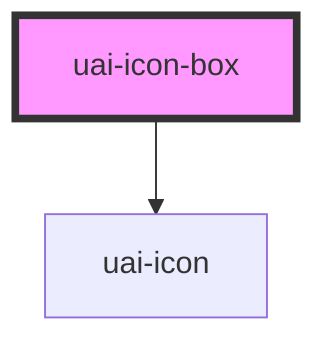

# uai-icon-box

<!-- Auto Generated Below -->

## Overview

Passive rounded surface container that frames a UAI icon or custom slotted graphic.
Use alongside card headings or KPI indicators; pair with `aria-label` only when the icon conveys standalone meaning;
avoid using it as an interactive button (use `uai-icon-button` instead).

## Properties

| Property    | Attribute    | Description                                                                                          | Type                   | Default     |
| ----------- | ------------ | ---------------------------------------------------------------------------------------------------- | ---------------------- | ----------- |
| `ariaLabel` | `aria-label` | Accessible label when the icon box communicates standalone meaning; otherwise the box is decorative. | `string`               | `null`      |
| `dataTest`  | `data-test`  | Selector attribute applied to the box container for automated tests.                                 | `string`               | `null`      |
| `icon`      | `icon`       | Name of the glyph from the UAI icon font. When omitted, renders the default slot content.            | `string`               | `null`      |
| `iconTheme` | `icon-theme` | Style of the UAI icon glyph (`outline` or `solid`).                                                  | `"outline" \| "solid"` | `'outline'` |
| `size`      | `size`       | Scale of the icon container (`sm`, `md`, or `lg`).                                                   | `"lg" \| "md" \| "sm"` | `'md'`      |

## Slots

| Slot | Description                   |
| ---- | ----------------------------- |
|      | Optional custom icon content. |

## Shadow Parts

| Part    | Description             |
| ------- | ----------------------- |
| `"box"` | The icon box container. |

## Dependencies

### Depends on

- [uai-icon](../uai-icon)

### Graph

----------------------------------------------

*Built with [StencilJS](https://stenciljs.com/)*
