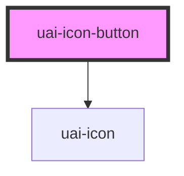

# uai-icon-button

<!-- Auto Generated Below -->

## Overview

Square icon-only action button for toolbars, card headers, and compact controls.
Use `variant="ghost"` or `variant="outline"` for secondary actions and `variant="solid"` for high-emphasis triggers;
pair with `aria-label` or `aria-labelledby` so assistive technologies announce the action; avoid omitting an accessible name.

## Properties

| Property         | Attribute         | Description                                                                                    | Type                                                 | Default     |
| ---------------- | ----------------- | ---------------------------------------------------------------------------------------------- | ---------------------------------------------------- | ----------- |
| `ariaLabel`      | `aria-label`      | Accessible name forwarded to the inner `<button>`. Required when `aria-labelledby` is not set. | `string`                                             | `null`      |
| `ariaLabelledby` | `aria-labelledby` | ID reference forwarded to the inner `<button>` when labelled by an external element.           | `string`                                             | `null`      |
| `color`          | `color`           | Semantic color of the action (`primary`, `content`, `positive`, or `negative`).                | `"content" \| "negative" \| "positive" \| "primary"` | `'primary'` |
| `dataTest`       | `data-test`       | Selector attribute forwarded to the inner `<button>` for automated tests.                      | `string`                                             | `null`      |
| `disabled`       | `disabled`        | If true, disables the native button and prevents `uaiClick` emission.                          | `boolean`                                            | `false`     |
| `icon`           | `icon`            | Name of the glyph from the UAI icon font. When omitted, nothing is rendered.                   | `string`                                             | `null`      |
| `iconTheme`      | `icon-theme`      | Style of the UAI icon glyph (`outline` or `solid`).                                            | `"outline" \| "solid"`                               | `'outline'` |
| `loading`        | `loading`         | If true, renders a loading spinner instead of the icon and prevents `uaiClick` emission.       | `boolean`                                            | `false`     |
| `size`           | `size`            | Control size (`compact`, `short`, `medium`, or `large`), mapped to `control-height/*` tokens.  | `"compact" \| "large" \| "medium" \| "short"`        | `'medium'`  |
| `type`           | `type`            | Native button type (`button`, `submit`, or `reset`).                                           | `"button" \| "reset" \| "submit"`                    | `'button'`  |
| `variant`        | `variant`         | Visual emphasis of the button (`solid`, `outline`, or `ghost`).                                | `"ghost" \| "outline" \| "solid"`                    | `'solid'`   |

## Events

| Event      | Description                                                                                | Type                      |
| ---------- | ------------------------------------------------------------------------------------------ | ------------------------- |
| `uaiClick` | Emitted when the button is activated by pointer or keyboard while enabled and not loading. | `CustomEvent<MouseEvent>` |

## Methods

### `isActive(value: boolean) => Promise<void>`

Controls the visual active/pressed state of the button programmatically.

#### Parameters

| Name    | Type      | Description |
| ------- | --------- | ----------- |
| `value` | `boolean` |             |

#### Returns

Type: `Promise<void>`

## Shadow Parts

| Part       | Description                |
| ---------- | -------------------------- |
| `"button"` | The native button element. |

## Dependencies

### Depends on

- [uai-icon](../uai-icon)

### Graph

----------------------------------------------

*Built with [StencilJS](https://stenciljs.com/)*
