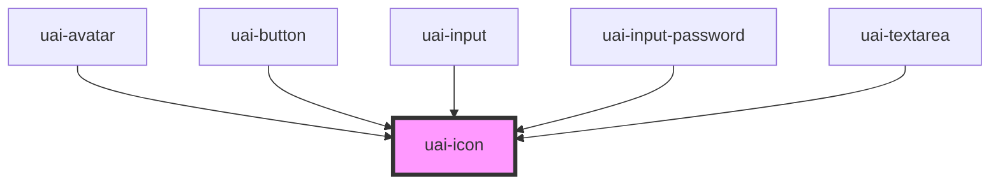

# uai-icon

<!-- Auto Generated Below -->

## Overview

Interface icon from the UAI icon font of blip-tokens. Use it for icons in UAI screens and inside UAI components.
Sizes keep the bds-icon names: x-small is `sizing/sm`, small is `sizing/md` and medium (default) is `sizing/lg`.
Without `color`, the icon takes the text color around it, so it matches the label next to it.
The app must load the font once: `import 'blip-tokens/uai-icons/css';`.

## Properties

| Property    | Attribute    | Description                                                                                                                                                                                                                                       | Type                                                                                                                                                                                       | Default     |
| ----------- | ------------ | ------------------------------------------------------------------------------------------------------------------------------------------------------------------------------------------------------------------------------------------------- | ------------------------------------------------------------------------------------------------------------------------------------------------------------------------------------------ | ----------- |
| `ariaLabel` | `aria-label` | Accessible name. Set it when the icon conveys meaning on its own. Without it, the icon is decorative and hidden from assistive technology.                                                                                                        | `string`                                                                                                                                                                                   | `null`      |
| `color`     | `color`      | Icon color, as a UAI color token: content-primary, content-secondary, content-disabled, content-inverse, content-link, feedback-info, feedback-success, feedback-warning or feedback-error. Without it, the icon uses the surrounding text color. | `"content-disabled" \| "content-inverse" \| "content-link" \| "content-primary" \| "content-secondary" \| "feedback-error" \| "feedback-info" \| "feedback-success" \| "feedback-warning"` | `undefined` |
| `dataTest`  | `data-test`  | Data test is the prop to specifically test the component action object.                                                                                                                                                                           | `string`                                                                                                                                                                                   | `null`      |
| `name`      | `name`       | Icon name, as in the Figma icon library without the theme prefix. For example "info" or "arrow-right".                                                                                                                                            | `string`                                                                                                                                                                                   | `undefined` |
| `size`      | `size`       | Icon size: 'x-small' (`sizing/sm`), 'small' (`sizing/md`) or 'medium' (`sizing/lg`, default).                                                                                                                                                     | `"medium" \| "small" \| "x-small"`                                                                                                                                                         | `'medium'`  |
| `theme`     | `theme`      | Icon style: 'outline' (default) or 'solid'.                                                                                                                                                                                                       | `"outline" \| "solid"`                                                                                                                                                                     | `'outline'` |

## Shadow Parts

| Part      | Description                                   |
| --------- | --------------------------------------------- |
| `"glyph"` | The element that renders the icon font glyph. |

## CSS Custom Properties

| Name              | Description                                                                                              |
| ----------------- | -------------------------------------------------------------------------------------------------------- |
| `--uai-icon-size` | Overrides the icon size. Components that embed uai-icon (like uai-button) set it to their own icon size. |

## Dependencies

### Used by

 - [uai-avatar](../uai-avatar)
 - [uai-button](../uai-button)
 - [uai-input](../uai-input)
 - [uai-input-password](../uai-input-password)
 - [uai-textarea](../uai-textarea)

### Graph

----------------------------------------------

*Built with [StencilJS](https://stenciljs.com/)*
