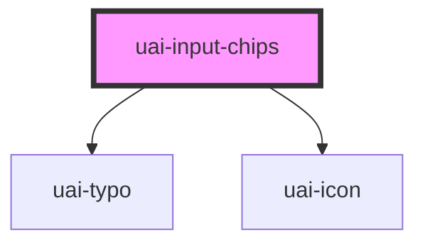

# uai-input-chips

<!-- Auto Generated Below -->

## Overview

Field that turns free text into removable chips. The person types a value and presses Enter, or separates values
with comma or semicolon; Backspace on the empty field removes the last chip. It takes part in native forms: with a
name, each chip is submitted as one entry (read them with FormData.getAll). Use it for several open values, such as
e-mails or tags. Pair with UaiButton in forms. Avoid it to choose from known options (use uai-select-chips or
uai-autocomplete). Wrap the app in UaiThemeProvider.

## Properties

| Property               | Attribute                | Description                                                                                                                                      | Type                            | Default     |
| ---------------------- | ------------------------ | ------------------------------------------------------------------------------------------------------------------------------------------------ | ------------------------------- | ----------- |
| `ariaLabel`            | `aria-label`             | Accessible name of the field when there is no visible label.                                                                                     | `string`                        | `null`      |
| `blurCreation`         | `blur-creation`          | If true, leaving the field turns the typed text into a chip.                                                                                     | `boolean`                       | `false`     |
| `chips`                | `chips`                  | Values shown as chips. Accepts an array or a JSON array string, for example '["ana@blip.ai", "bia@blip.ai"]'.                                    | `string \| string[]`            | `[]`        |
| `counterLength`        | `counter-length`         | If true, shows the number of chips and maxChipsLength.                                                                                           | `boolean`                       | `false`     |
| `danger`               | `danger`                 | If true, shows the error state and errorMessage. Has priority over success.                                                                      | `boolean`                       | `false`     |
| `dataTest`             | `data-test`              | Data test id, set on the native input.                                                                                                           | `string`                        | `null`      |
| `delimiters`           | --                       | Characters that split the text into several chips. Default: comma and semicolon (/,\|;/).                                                        | `RegExp`                        | `/,\|;/`    |
| `disableSubmit`        | `disable-submit`         | **[DEPRECATED]** Has no effect.                                                                           | `boolean`                       | `undefined` |
| `disabled`             | `disabled`               | If true, the field cannot be used and the chips are left out of the form data.                                                                   | `boolean`                       | `false`     |
| `dtButtonClose`        | `dt-button-close`        | Data test id, set on the remove button of each chip.                                                                                             | `string`                        | `null`      |
| `duplicated`           | `duplicated`             | If true, repeated values are accepted. If false (default), a value equal to an existing chip, ignoring case, is ignored.                         | `boolean`                       | `false`     |
| `emailErrorMessage`    | `email-error-message`    | Message shown when type is 'email' and a chip is not an e-mail. Without it, the default text is shown.                                           | `string`                        | `undefined` |
| `errorMessage`         | `error-message`          | Message below the field while danger is true.                                                                                                    | `string`                        | `''`        |
| `height`               | `height`                 | **[DEPRECATED]** The field grows with the chips. Has no effect.                                           | `string`                        | `undefined` |
| `helperMessage`        | `helper-message`         | Message below the field that helps to fill it.                                                                                                   | `string`                        | `''`        |
| `icon`                 | `icon`                   | UaiIcon name shown before the chips.                                                                                                             | `string`                        | `''`        |
| `inputName`            | `input-name`             | Name of the values in the submitted form data. Same as name, kept from bds-input-chips.                                                          | `string`                        | `''`        |
| `label`                | `label`                  | Label shown above the field. Without a visible label, set aria-label.                                                                            | `string`                        | `''`        |
| `language`             | `language`               | Language of the default texts. Can be one of: 'pt_BR' (default), 'en_US', 'es_ES'.                                                               | `"en_US" \| "es_ES" \| "pt_BR"` | `'pt_BR'`   |
| `maxChipsLength`       | `max-chips-length`       | Largest number of chips. When it is reached, the text input is hidden.                                                                           | `number`                        | `undefined` |
| `maxHeight`            | `max-height`             | **[DEPRECATED]** The field grows with the chips. Has no effect.                                           | `string`                        | `undefined` |
| `maxlength`            | `maxlength`              | Largest number of characters of each chip.                                                                                                       | `number`                        | `undefined` |
| `name`                 | `name`                   | Name of the values in the submitted form data; each chip is one entry. Without name (or inputName), the field is not submitted.                  | `string`                        | `undefined` |
| `placeholder`          | `placeholder`            | Example of a value, shown while the text is empty. Do not use it as the label.                                                                   | `string`                        | `''`        |
| `readonly`             | `readonly`               | If true, the chips are shown without remove buttons and no value can be typed.                                                                   | `boolean`                       | `false`     |
| `required`             | `required`               | If true, the field without chips blocks the form submission.                                                                                     | `boolean`                       | `undefined` |
| `requiredErrorMessage` | `required-error-message` | Message shown when a required field has no chips. Without it, the default text is shown.                                                         | `string`                        | `undefined` |
| `size`                 | `size`                   | Minimum height of the field, which grows with the chips. Can be one of: 'short', 'medium' (default).                                             | `"medium" \| "short"`           | `'medium'`  |
| `success`              | `success`                | If true, shows the success state and successMessage.                                                                                             | `boolean`                       | `false`     |
| `successMessage`       | `success-message`        | Message below the field while success is true.                                                                                                   | `string`                        | `''`        |
| `type`                 | `type`                   | Kind of value. Can be one of: 'text' (default), 'email'. With 'email', chips that are not e-mails are marked as errors and the field is invalid. | `"email" \| "text"`             | `'text'`    |
| `value`                | `value`                  | Text being typed, before it becomes a chip.                                                                                                      | `string`                        | `''`        |

## Events

| Event                      | Description                                                                               | Type                                |
| -------------------------- | ----------------------------------------------------------------------------------------- | ----------------------------------- |
| `uaiBlur`                  | Emitted when the text input loses focus. detail: all chips.                               | `CustomEvent<string[]>`             |
| `uaiChange`                | Emitted when chips are added or removed. detail: { data (all chips), value (last chip) }. | `CustomEvent<UaiInputChipsChange>`  |
| `uaiChangeChips`           | Emitted when chips are added or removed. Same as uaiChange, kept from bds-input-chips.    | `CustomEvent<UaiInputChipsChange>`  |
| `uaiExtendedQuantityInput` | Emitted when maxChipsLength is reached. detail: { value: true }.                          | `CustomEvent<{ value: boolean; }>`  |
| `uaiInputChipsFocus`       | Emitted when the text input receives focus.                                               | `CustomEvent<void>`                 |
| `uaiInputChipsInput`       | Emitted on every keystroke with the native InputEvent.                                    | `CustomEvent<InputEvent>`           |
| `uaiSubmit`                | Emitted when the text input loses focus with chips. detail: { value (all chips) }.        | `CustomEvent<{ value: string[]; }>` |

## Methods

### `add(value?: string) => Promise<void>`

Adds chips from the given text, or from the typed text when no value is given.

#### Parameters

| Name    | Type     | Description |
| ------- | -------- | ----------- |
| `value` | `string` |             |

#### Returns

Type: `Promise<void>`

### `clear() => Promise<void>`

Removes all chips and the typed text.

#### Returns

Type: `Promise<void>`

### `get() => Promise<string[]>`

Returns the chips.

#### Returns

Type: `Promise<string[]>`

### `isValid() => Promise<boolean>`

Returns true when the chips are valid for the type and, if required, there is at least one.

#### Returns

Type: `Promise<boolean>`

### `removeFocus() => Promise<void>`

Removes the focus from the text input.

#### Returns

Type: `Promise<void>`

### `setFocus() => Promise<void>`

Moves the focus to the text input.

#### Returns

Type: `Promise<void>`

## Slots

| Slot            | Description                                                                                         |
| --------------- | --------------------------------------------------------------------------------------------------- |
| `"input-right"` | Content after the chips and the text (for example a clear button). Give actions an accessible name. |

## Shadow Parts

| Part                | Description                                                  |
| ------------------- | ------------------------------------------------------------ |
| `"chip"`            | Each chip.                                                   |
| `"chip-remove"`     | The remove button of each chip.                              |
| `"chips"`           | The list of chips.                                           |
| `"input"`           | The native input where new values are typed.                 |
| `"input-container"` | The field box with border, icon, chips and the native input. |
| `"input__message"`  | The helper, error or success message below the field.        |

## CSS Custom Properties

| Name                      | Description                                                      |
| ------------------------- | ---------------------------------------------------------------- |
| `--uai-input-chips-width` | Width of the field. Defaults to the full width of the container. |

## Dependencies

### Depends on

- [uai-typo](../uai-typo)
- [uai-icon](../uai-icon)

### Graph

----------------------------------------------

*Built with [StencilJS](https://stenciljs.com/)*
