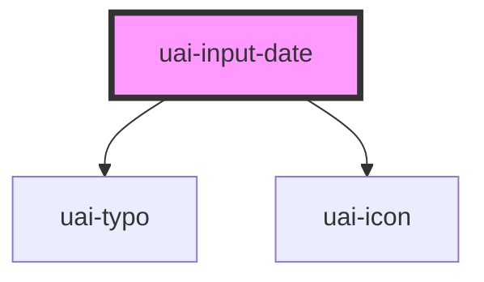

# uai-input-date

<!-- Auto Generated Below -->

## Overview

Date field. The person types the date as DD-MM-YYYY in every language or picks it in the browser calendar;
value, min, max and the submitted form value are ISO YYYY-MM-DD. Use it
for a single known date, such as a birth or due date. Pair with UaiButton in forms. Avoid it for periods, presets or
times (use uai-datepicker when available). Wrap the app in UaiThemeProvider.

## Properties

| Property               | Attribute                | Description                                                                                                                   | Type                            | Default     |
| ---------------------- | ------------------------ | ----------------------------------------------------------------------------------------------------------------------------- | ------------------------------- | ----------- |
| `ariaLabel`            | `aria-label`             | Accessible name of the field when the visible label is not enough.                                                            | `string`                        | `null`      |
| `danger`               | `danger`                 | If true, shows the error state and errorMessage. Has priority over success.                                                   | `boolean`                       | `false`     |
| `dataTest`             | `data-test`              | Data test id, set on the native input.                                                                                        | `string`                        | `null`      |
| `dateErrorMessage`     | `date-error-message`     | Message shown when the typed date is incomplete or does not exist. Without it, the default text is shown.                     | `string`                        | `undefined` |
| `disabled`             | `disabled`               | If true, the field and the calendar button cannot be used and the value is left out of the form data.                         | `boolean`                       | `false`     |
| `errorMessage`         | `error-message`          | Message below the field while danger is true.                                                                                 | `string`                        | `''`        |
| `helperMessage`        | `helper-message`         | Message below the field that helps to fill it.                                                                                | `string`                        | `''`        |
| `icon`                 | `icon`                   | UaiIcon name shown before the date.                                                                                           | `string`                        | `''`        |
| `inputName`            | `input-name`             | Name of the value in the submitted form data. Same as name, kept from bds-input.                                              | `string`                        | `''`        |
| `label`                | `label`                  | Label shown above the field. Without it, the default text of the language is shown ("Data").                                  | `string`                        | `undefined` |
| `language`             | `language`               | Language of the default texts. The date format is always DD-MM-YYYY. Can be 'pt_BR' (default), 'en_US', 'es_ES'.              | `"en_US" \| "es_ES" \| "pt_BR"` | `'pt_BR'`   |
| `max`                  | `max`                    | Latest accepted date, as ISO YYYY-MM-DD.                                                                                      | `string`                        | `undefined` |
| `maxErrorMessage`      | `max-error-message`      | Message shown when the date is after max. Without it, the default text with the max date is shown.                            | `string`                        | `undefined` |
| `min`                  | `min`                    | Earliest accepted date, as ISO YYYY-MM-DD.                                                                                    | `string`                        | `undefined` |
| `minErrorMessage`      | `min-error-message`      | Message shown when the date is before min. Without it, the default text with the min date is shown.                           | `string`                        | `undefined` |
| `name`                 | `name`                   | Name of the value in the submitted form data, which is the ISO date. Without name (or inputName), the field is not submitted. | `string`                        | `undefined` |
| `placeholder`          | `placeholder`            | Text shown while the field is empty. Without it, "DD-MM-YYYY" is shown.                                                       | `string`                        | `undefined` |
| `readonly`             | `readonly`               | If true, the date can be selected and copied but not edited, and the calendar button is hidden.                               | `boolean`                       | `false`     |
| `required`             | `required`               | If true, an empty field blocks the form submission.                                                                           | `boolean`                       | `undefined` |
| `requiredErrorMessage` | `required-error-message` | Message shown when a required field is empty. Without it, the default text of the language is shown.                          | `string`                        | `undefined` |
| `size`                 | `size`                   | Height of the field. Can be one of: 'short', 'medium' (default).                                                              | `"medium" \| "short"`           | `'medium'`  |
| `success`              | `success`                | If true, shows the success state and successMessage.                                                                          | `boolean`                       | `false`     |
| `successMessage`       | `success-message`        | Message below the field while success is true.                                                                                | `string`                        | `''`        |
| `value`                | `value`                  | Selected date as ISO YYYY-MM-DD, for example "2026-12-25". Empty while the typed date is incomplete or invalid.               | `string`                        | `''`        |

## Events

| Event       | Description                                                                                                                                                              | Type                              |
| ----------- | ------------------------------------------------------------------------------------------------------------------------------------------------------------------------ | --------------------------------- |
| `uaiChange` | Emitted when the date changes, by typing, by the calendar or programmatically. detail: { value } as ISO YYYY-MM-DD, or '' while the typed date is incomplete or invalid. | `CustomEvent<{ value: string; }>` |
| `uaiFocus`  | Emitted when the field receives focus.                                                                                                                                   | `CustomEvent<void>`               |
| `uaiInput`  | Emitted on every keystroke with the native InputEvent.                                                                                                                   | `CustomEvent<InputEvent>`         |
| `uaiOnBlur` | Emitted when the field loses focus.                                                                                                                                      | `CustomEvent<void>`               |

## Methods

### `clear() => Promise<void>`

Clears the date.

#### Returns

Type: `Promise<void>`

### `isValid() => Promise<boolean>`

Returns true when the date is complete, exists, is within min and max, and is present when required.

#### Returns

Type: `Promise<boolean>`

### `removeFocus() => Promise<void>`

Removes the focus from the field.

#### Returns

Type: `Promise<void>`

### `setFocus() => Promise<void>`

Moves the focus to the field.

#### Returns

Type: `Promise<void>`

## Slots

| Slot            | Description                                                                                      |
| --------------- | ------------------------------------------------------------------------------------------------ |
| `"input-right"` | Content after the calendar button (for example a clear button). Give actions an accessible name. |

## Shadow Parts

| Part                | Description                                                                |
| ------------------- | -------------------------------------------------------------------------- |
| `"calendar-button"` | The button that opens the browser calendar.                                |
| `"input"`           | The native text input with the date as DD-MM-YYYY.                         |
| `"input-container"` | The field box with border, icon, the native input and the calendar button. |
| `"input__message"`  | The helper, error or success message below the field.                      |

## CSS Custom Properties

| Name                     | Description                                                      |
| ------------------------ | ---------------------------------------------------------------- |
| `--uai-input-date-width` | Width of the field. Defaults to the full width of the container. |

## Dependencies

### Depends on

- [uai-typo](../uai-typo)
- [uai-icon](../uai-icon)

### Graph

----------------------------------------------

*Built with [StencilJS](https://stenciljs.com/)*
