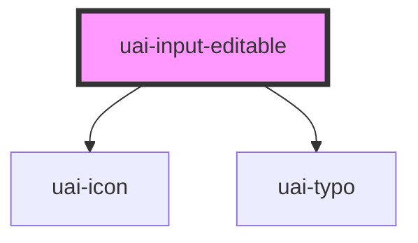

# uai-input-editable

<!-- Auto Generated Below -->

## Overview

Value shown as text that the person can edit and confirm. In reading mode it shows the value and an Edit button;
in editing mode it shows a field with Save and Cancel. Enter saves, Escape cancels and the focus goes back to Edit.
Empty values, values shorter than minlength and values with danger are not saved. It takes part in native forms
with the saved value. Use it to rename or adjust an existing value in place, such as a title. Pair with a label
that names the value. Avoid it for forms where every field is edited at once (use uai-input). Wrap the app in
UaiThemeProvider.

## Properties

| Property                | Attribute                 | Description                                                                                                                                       | Type                                          | Default      |
| ----------------------- | ------------------------- | ------------------------------------------------------------------------------------------------------------------------------------------------- | --------------------------------------------- | ------------ |
| `ariaLabel`             | `aria-label`              | Accessible name of the field when there is no visible label.                                                                                      | `string`                                      | `null`       |
| `danger`                | `danger`                  | If true, shows the error state and errorMessage, and saving is blocked. Has priority over success.                                                | `boolean`                                     | `false`      |
| `dataTest`              | `data-test`               | Data test id, set on the native input.                                                                                                            | `string`                                      | `null`       |
| `disabled`              | `disabled`                | If true, the value is shown without the Edit button and is left out of the form data.                                                             | `boolean`                                     | `false`      |
| `dtButtonClose`         | `dt-button-close`         | Data test id, set on the Cancel button.                                                                                                           | `string`                                      | `null`       |
| `dtButtonConfirm`       | `dt-button-confirm`       | Data test id, set on the Save button.                                                                                                             | `string`                                      | `null`       |
| `dtButtonEdit`          | `dt-button-edit`          | Data test id, set on the Edit button.                                                                                                             | `string`                                      | `null`       |
| `errorMessage`          | `error-message`           | Message below the field while danger is true.                                                                                                     | `string`                                      | `''`         |
| `expand`                | `expand`                  | **[DEPRECATED]** The field takes the width of its container (--uai-input-editable-width). Has no effect.   | `boolean`                                     | `undefined`  |
| `helperMessage`         | `helper-message`          | Message below the field that helps to fill it.                                                                                                    | `string`                                      | `''`         |
| `inputName`             | `input-name`              | Name of the saved value in the submitted form data. Same as name, kept from bds-input-editable.                                                   | `string`                                      | `''`         |
| `label`                 | `label`                   | Label shown above the field. It also names the Edit button ("Editar <label>").                                                                    | `string`                                      | `''`         |
| `language`              | `language`                | Language of the default texts. Can be one of: 'pt_BR' (default), 'en_US', 'es_ES'.                                                                | `"en_US" \| "es_ES" \| "pt_BR"`               | `'pt_BR'`    |
| `maxlength`             | `maxlength`               | Largest number of characters. Typing stops at the limit.                                                                                          | `number`                                      | `undefined`  |
| `minlength`             | `minlength`               | Smallest number of characters to save.                                                                                                            | `number`                                      | `0`          |
| `minlengthErrorMessage` | `minlength-error-message` | Message shown when saving a value shorter than minlength. Without it, the default text is shown.                                                  | `string`                                      | `undefined`  |
| `name`                  | `name`                    | Name of the saved value in the submitted form data. Without name (or inputName), the field is not submitted.                                      | `string`                                      | `undefined`  |
| `placeholder`           | `placeholder`             | Text shown while the value is empty, in both modes.                                                                                               | `string`                                      | `''`         |
| `requiredErrorMessage`  | `required-error-message`  | Message shown when saving an empty value. Without it, the default text of the language is shown.                                                  | `string`                                      | `undefined`  |
| `size`                  | `size`                    | Height of the field. Can be one of: 'short', 'standard' (default), 'tall'. 'medium' is the same as 'standard'.                                    | `"medium" \| "short" \| "standard" \| "tall"` | `'standard'` |
| `success`               | `success`                 | If true, shows the success state and successMessage.                                                                                              | `boolean`                                     | `false`      |
| `successMessage`        | `success-message`         | Message below the field while success is true.                                                                                                    | `string`                                      | `''`         |
| `value`                 | `value`                   | Saved value, shown in reading mode and submitted with the form.                                                                                   | `string`                                      | `''`         |

## Events

| Event                  | Description                                                                                  | Type                                       |
| ---------------------- | -------------------------------------------------------------------------------------------- | ------------------------------------------ |
| `uaiBlur`              | Emitted when the field loses focus while editing.                                            | `CustomEvent<void>`                        |
| `uaiCancel`            | Emitted when the editing is cancelled.                                                       | `CustomEvent<void>`                        |
| `uaiChange`            | Emitted on every keystroke while editing. detail: { value (being typed), oldValue (saved) }. | `CustomEvent<UaiInputEditableEventDetail>` |
| `uaiFocus`             | Emitted when the field receives focus while editing.                                         | `CustomEvent<void>`                        |
| `uaiInput`             | Emitted on every keystroke with the native InputEvent.                                       | `CustomEvent<InputEvent>`                  |
| `uaiInputEditableSave` | Emitted when a value is saved. detail: { value (new), oldValue }.                            | `CustomEvent<UaiInputEditableEventDetail>` |

## Methods

### `cancel() => Promise<void>`

Discards the value being typed and returns to reading mode.

#### Returns

Type: `Promise<void>`

### `edit() => Promise<void>`

Starts editing and moves the focus to the field.

#### Returns

Type: `Promise<void>`

### `save() => Promise<boolean>`

Saves the value being typed. Returns false when it cannot be saved (empty, shorter than minlength or danger).

#### Returns

Type: `Promise<boolean>`

### `setFocus() => Promise<void>`

Moves the focus to the field while editing, or to the Edit button.

#### Returns

Type: `Promise<void>`

## Shadow Parts

| Part                | Description                                           |
| ------------------- | ----------------------------------------------------- |
| `"cancel-button"`   | The button that discards the changes.                 |
| `"confirm-button"`  | The button that saves the value.                      |
| `"edit-button"`     | The button that starts editing.                       |
| `"input"`           | The native input, in editing mode.                    |
| `"input-container"` | The field box, in reading and editing modes.          |
| `"input__message"`  | The helper, error or success message below the field. |

## CSS Custom Properties

| Name                         | Description                                                      |
| ---------------------------- | ---------------------------------------------------------------- |
| `--uai-input-editable-width` | Width of the field. Defaults to the full width of the container. |

## Dependencies

### Depends on

- [uai-icon](../uai-icon)
- [uai-typo](../uai-typo)

### Graph

----------------------------------------------

*Built with [StencilJS](https://stenciljs.com/)*
