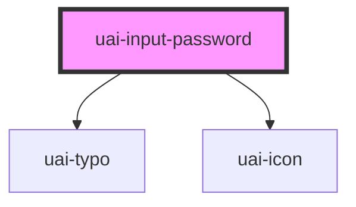

# uai-input-password

<!-- Auto Generated Below -->

## Overview

Password field with native form support, an accessible visibility toggle and an optional consumer-provided
strength indicator. The indicator never evaluates the password or guarantees security. Wrap the app in
UaiThemeProvider.

## Properties

| Property                | Attribute                 | Description                                                                                           | Type                                                                  | Default     |
| ----------------------- | ------------------------- | ----------------------------------------------------------------------------------------------------- | --------------------------------------------------------------------- | ----------- |
| `ariaLabel`             | `aria-label`              | Accessible name when there is no visible label.                                                       | `string`                                                              | `null`      |
| `autoCapitalize`        | `auto-capitalize`         | Automatic capitalization on virtual keyboards.                                                        | `"characters" \| "none" \| "off" \| "on" \| "sentences" \| "words"`   | `'off'`     |
| `autoComplete`          | `auto-complete`           | Browser autofill hint while the password is revealed. While masked, autocomplete is current-password. | `"current-password" \| "new-password" \| "off" \| "on" \| "username"` | `'off'`     |
| `danger`                | `danger`                  | If true, shows the error state and errorMessage. Has priority over success.                           | `boolean`                                                             | `false`     |
| `dataTest`              | `data-test`               | Data test id, set on the native input.                                                                | `string`                                                              | `null`      |
| `disabled`              | `disabled`                | If true, the field cannot be focused or edited and is left out of the form data.                      | `boolean`                                                             | `false`     |
| `errorMessage`          | `error-message`           | Message below the field while danger is true.                                                         | `string`                                                              | `''`        |
| `helperMessage`         | `helper-message`          | Message below the field that helps to fill it.                                                        | `string`                                                              | `''`        |
| `icon`                  | `icon`                    | UaiIcon name shown before the password.                                                               | `string`                                                              | `''`        |
| `inputName`             | `input-name`              | Name of the value in submitted form data, kept from bds-input-password.                               | `string`                                                              | `''`        |
| `label`                 | `label`                   | Label shown above the field. Without a visible label, set aria-label.                                 | `string`                                                              | `''`        |
| `max`                   | `max`                     | Largest accepted number. Kept for compatibility; password inputs do not enforce numeric bounds.       | `string`                                                              | `undefined` |
| `maxlength`             | `maxlength`               | Largest number of characters. Typing stops at the limit.                                              | `number`                                                              | `undefined` |
| `min`                   | `min`                     | Smallest accepted number. Kept for compatibility; password inputs do not enforce numeric bounds.      | `string`                                                              | `undefined` |
| `minlength`             | `minlength`               | Smallest number of characters. Checked on blur and form submission.                                   | `number`                                                              | `undefined` |
| `minlengthErrorMessage` | `minlength-error-message` | Message shown when the password is shorter than minlength.                                            | `string`                                                              | `undefined` |
| `name`                  | `name`                    | Name of the value in submitted form data. Without name or inputName, the field is not submitted.      | `string`                                                              | `undefined` |
| `openEyes`              | `open-eyes`               | Controls whether the password is revealed. The visibility button updates this property.               | `boolean`                                                             | `false`     |
| `placeholder`           | `placeholder`             | Example of the expected text, shown while the field is empty. Do not use it as the label.             | `string`                                                              | `''`        |
| `readonly`              | `readonly`                | If true, the value can be selected and copied but not edited.                                         | `boolean`                                                             | `false`     |
| `required`              | `required`                | If true, an empty field blocks form submission.                                                       | `boolean`                                                             | `false`     |
| `requiredErrorMessage`  | `required-error-message`  | Message shown when a required field is empty. Without it, the browser message is shown.               | `string`                                                              | `undefined` |
| `showStrength`          | `show-strength`           | If true, shows the visual strength indicator. The level remains consumer-provided.                    | `boolean`                                                             | `false`     |
| `size`                  | `size`                    | Height of the field. Can be 'short' or 'medium' (default).                                            | `"medium" \| "short"`                                                 | `'medium'`  |
| `strengthLevel`         | `strength-level`          | Consumer-provided visual level. This component does not evaluate the password.                        | `"high" \| "low" \| "medium" \| "none"`                               | `'none'`    |
| `success`               | `success`                 | If true, shows the success state and successMessage.                                                  | `boolean`                                                             | `false`     |
| `successMessage`        | `success-message`         | Message below the field while success is true.                                                        | `string`                                                              | `''`        |
| `value`                 | `value`                   | Current password. It is not reflected to an attribute.                                                | `string`                                                              | `''`        |

## Events

| Event                    | Description                                                                       | Type                                                    |
| ------------------------ | --------------------------------------------------------------------------------- | ------------------------------------------------------- |
| `uaiInputPasswordBlur`   | Emitted when the field loses focus.                                               | `CustomEvent<void>`                                     |
| `uaiInputPasswordChange` | Emitted when the value changes, by typing or programmatically. detail: { value }. | `CustomEvent<{ value: string; }>`                       |
| `uaiInputPasswordFocus`  | Emitted when the field receives focus.                                            | `CustomEvent<void>`                                     |
| `uaiInputPasswordInput`  | Emitted on every keystroke with the native InputEvent.                            | `CustomEvent<InputEvent>`                               |
| `uaiInputPasswordSubmit` | Emitted on Enter. detail: { event, value }.                                       | `CustomEvent<{ event: KeyboardEvent; value: string; }>` |
| `uaiKeyDownBackspace`    | Emitted on Backspace or Delete. detail: { event, value }.                         | `CustomEvent<{ event: KeyboardEvent; value: string; }>` |

## Methods

### `clear() => Promise<void>`

Clears the password.

#### Returns

Type: `Promise<void>`

### `getInputElement() => Promise<HTMLInputElement>`

Returns the native input element.

#### Returns

Type: `Promise<HTMLInputElement>`

### `isValid() => Promise<boolean>`

Checks the native required and character-length constraints.

#### Returns

Type: `Promise<boolean>`

### `removeFocus() => Promise<void>`

Removes focus from the password field.

#### Returns

Type: `Promise<void>`

### `setFocus() => Promise<void>`

Moves focus to the password field.

#### Returns

Type: `Promise<void>`

## Slots

| Slot                  | Description                                                       |
| --------------------- | ----------------------------------------------------------------- |
| `"input-left"`        | Content before the password text, inside the field border.        |
| `"input-right"`       | Content after the password text. Give actions an accessible name. |
| `"inside-input-left"` | Content right before the password text.                           |

## Shadow Parts

| Part                | Description                                                         |
| ------------------- | ------------------------------------------------------------------- |
| `"input"`           | The native password input.                                          |
| `"input-container"` | The field box with border, adornments, input and visibility button. |
| `"input__message"`  | The helper, error or success message below the field.               |

## Dependencies

### Depends on

- [uai-typo](../uai-typo)
- [uai-icon](../uai-icon)

### Graph

----------------------------------------------

*Built with [StencilJS](https://stenciljs.com/)*
