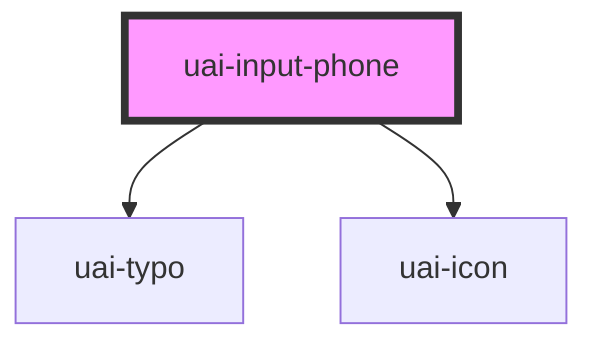

# uai-input-phone

<!-- Auto Generated Below -->

## Overview

Phone number field with a country code selector. Use it to ask for a phone number when the country matters:
the person picks the country (flag and dial code) and types the number freely, without mask or automatic
formatting. It takes part in native forms: give it a name to submit "<code> <number>" (for example
"+55 11 99999-0000"). Pair with UaiButton in forms. Avoid it for numbers without a country, or to infer the
country from the number. Wrap the app in UaiThemeProvider.

## Properties

| Property               | Attribute                | Description                                                                                                                                   | Type                            | Default     |
| ---------------------- | ------------------------ | --------------------------------------------------------------------------------------------------------------------------------------------- | ------------------------------- | ----------- |
| `ariaLabel`            | `aria-label`             | Accessible name of the field when the visible label is not enough.                                                                            | `string`                        | `null`      |
| `danger`               | `danger`                 | If true, shows the error state and errorMessage. Has priority over success.                                                                   | `boolean`                       | `false`     |
| `dataTest`             | `data-test`              | Data test id, set on the native input.                                                                                                        | `string`                        | `null`      |
| `disabled`             | `disabled`               | If true, the field and the country selector cannot be used and the value is left out of the form data.                                        | `boolean`                       | `false`     |
| `dtSelectFlag`         | `dt-select-flag`         | Data test id, set on the country selector button.                                                                                             | `string`                        | `null`      |
| `errorMessage`         | `error-message`          | Message below the field while danger is true.                                                                                                 | `string`                        | `''`        |
| `helperMessage`        | `helper-message`         | Message below the field that helps to fill it, for example the expected format.                                                               | `string`                        | `''`        |
| `icon`                 | `icon`                   | UaiIcon name shown before the country selector.                                                                                               | `string`                        | `''`        |
| `inputName`            | `input-name`             | Name of the value in the submitted form data. Same as name.                                                                                   | `string`                        | `''`        |
| `label`                | `label`                  | Label shown above the field. Without it, the default text of the language is shown ("Telefone").                                              | `string`                        | `undefined` |
| `language`             | `language`               | Language of the country names and default texts. Can be one of: 'pt_BR' (default), 'en_US', 'es_ES'.                                          | `"en_US" \| "es_ES" \| "pt_BR"` | `'pt_BR'`   |
| `name`                 | `name`                   | Name of the value in the submitted form data, which is "<code> <number>". Without name (or inputName), the field is not submitted.            | `string`                        | `undefined` |
| `numberErrorMessage`   | `number-error-message`   | Message shown when the number has characters other than digits, spaces and + - ( ) . Without it, the default text of the language is shown.   | `string`                        | `undefined` |
| `options`              | --                       | **[DEPRECATED]** The country list comes from the language. Has no effect.                              | `unknown[]`                     | `undefined` |
| `placeholder`          | `placeholder`            | Example of the expected number, shown while the field is empty, for example "11 99999-0000". Do not use it as the label.                      | `string`                        | `''`        |
| `readonly`             | `readonly`               | If true, the number can be selected and copied but not edited, and the country cannot be changed.                                             | `boolean`                       | `false`     |
| `required`             | `required`               | If true, an empty number blocks the form submission.                                                                                          | `boolean`                       | `undefined` |
| `requiredErrorMessage` | `required-error-message` | Message shown when a required field is empty. Without it, the default text of the language is shown.                                          | `string`                        | `undefined` |
| `size`                 | `size`                   | Height of the field. Can be one of: 'short', 'medium' (default).                                                                              | `"medium" \| "short"`           | `'medium'`  |
| `success`              | `success`                | If true, shows the success state and successMessage.                                                                                          | `boolean`                       | `false`     |
| `successMessage`       | `success-message`        | Message below the field while success is true.                                                                                                | `string`                        | `''`        |
| `text`                 | `text`                   | Phone number typed by the person, without the country code. Free text: no mask or formatting is applied.                                      | `string`                        | `''`        |
| `value`                | `value`                  | Dial code of the selected country, for example "+55" (default) or "+1". Use changeCountry to pick a country that shares its code with others. | `string`                        | `'+55'`     |

## Events

| Event                  | Description                                                                                                    | Type                                |
| ---------------------- | -------------------------------------------------------------------------------------------------------------- | ----------------------------------- |
| `uaiBlur`              | Emitted when the number loses focus.                                                                           | `CustomEvent<void>`                 |
| `uaiCancel`            | Emitted when the country list closes without a new choice (Escape or click outside).                           | `CustomEvent<void>`                 |
| `uaiFocus`             | Emitted when the number receives focus.                                                                        | `CustomEvent<void>`                 |
| `uaiInput`             | Emitted on every keystroke in the number with the native InputEvent.                                           | `CustomEvent<InputEvent>`           |
| `uaiPhoneNumberChange` | Emitted when the number or the country changes. detail: { value (number), code, isoCode, country (flag key) }. | `CustomEvent<UaiPhoneNumberChange>` |

## Methods

### `changeCountry(code: string, isoCode: string, flag: string) => Promise<void>`

Selects a country. code is the dial code ("+1"), isoCode the ISO text ("US / USA") and flag the country key
("united-states-flag").

#### Parameters

| Name      | Type     | Description |
| --------- | -------- | ----------- |
| `code`    | `string` |             |
| `isoCode` | `string` |             |
| `flag`    | `string` |             |

#### Returns

Type: `Promise<void>`

### `clear() => Promise<void>`

Clears the number. The country stays selected.

#### Returns

Type: `Promise<void>`

### `isValid() => Promise<boolean>`

Returns true when the number meets required and has only digits, spaces and + - ( ) .

#### Returns

Type: `Promise<boolean>`

### `removeFocus() => Promise<void>`

Removes the focus from the field.

#### Returns

Type: `Promise<void>`

### `setFocus() => Promise<void>`

Moves the focus to the number.

#### Returns

Type: `Promise<void>`

## Slots

| Slot            | Description                                                                             |
| --------------- | --------------------------------------------------------------------------------------- |
| `"input-right"` | Content after the number (for example a clear button). Give actions an accessible name. |

## Shadow Parts

| Part                | Description                                                             |
| ------------------- | ----------------------------------------------------------------------- |
| `"country-button"`  | The country selector button (flag, dial code and arrow).                |
| `"country-list"`    | The floating list of countries.                                         |
| `"country-option"`  | Each country in the list.                                               |
| `"input"`           | The native tel input.                                                   |
| `"input-container"` | The field box with border, icon, country selector and the native input. |
| `"input__message"`  | The helper, error or success message below the field.                   |

## CSS Custom Properties

| Name                      | Description                                                      |
| ------------------------- | ---------------------------------------------------------------- |
| `--uai-input-phone-width` | Width of the field. Defaults to the full width of the container. |

## Dependencies

### Depends on

- [uai-typo](../uai-typo)
- [uai-icon](../uai-icon)

### Graph

----------------------------------------------

*Built with [StencilJS](https://stenciljs.com/)*
