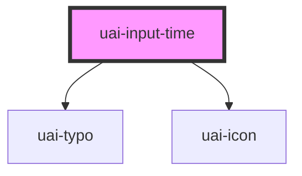

# uai-input-time

<!-- Auto Generated Below -->

## Overview

Time field. The person types the time of day as HH:mm (24 hours), and digits that cannot make a time are refused,
or picks the hour and the minutes in the panel that opens on a click; value, min, max and the submitted form value
are HH:mm. Use it for a time of day, such as an opening hour or a return time. Pair with uai-input-date for a date
and time, and with UaiButton in forms. Avoid it for durations or periods. Wrap the app in UaiThemeProvider.

## Properties

| Property               | Attribute                | Description                                                                                                                                                                            | Type                            | Default     |
| ---------------------- | ------------------------ | -------------------------------------------------------------------------------------------------------------------------------------------------------------------------------------- | ------------------------------- | ----------- |
| `ariaLabel`            | `aria-label`             | Accessible name of the field when the visible label is not enough.                                                                                                                     | `string`                        | `null`      |
| `danger`               | `danger`                 | If true, shows the error state and errorMessage. Has priority over success.                                                                                                            | `boolean`                       | `false`     |
| `dataTest`             | `data-test`              | Data test id, set on the native input.                                                                                                                                                 | `string`                        | `null`      |
| `disabled`             | `disabled`               | If true, the field and the picker button cannot be used and the value is left out of the form data.                                                                                    | `boolean`                       | `false`     |
| `errorMessage`         | `error-message`          | Message below the field while danger is true.                                                                                                                                          | `string`                        | `''`        |
| `helperMessage`        | `helper-message`         | Message below the field that helps to fill it.                                                                                                                                         | `string`                        | `''`        |
| `icon`                 | `icon`                   | UaiIcon name shown before the time.                                                                                                                                                    | `string`                        | `''`        |
| `inputName`            | `input-name`             | Name of the value in the submitted form data. Same as name, kept from bds-input.                                                                                                       | `string`                        | `''`        |
| `label`                | `label`                  | Label shown above the field. Without it, the default text of the language is shown ("Horário").                                                                                        | `string`                        | `undefined` |
| `language`             | `language`               | Language of the default texts. Can be 'pt_BR' (default), 'en_US', 'es_ES'.                                                                                                             | `"en_US" \| "es_ES" \| "pt_BR"` | `'pt_BR'`   |
| `max`                  | `max`                    | Latest accepted time, as HH:mm. Later hours and minutes are disabled in the panel.                                                                                                     | `string`                        | `undefined` |
| `maxErrorMessage`      | `max-error-message`      | Message shown when the time is after max. Without it, the default text with the max time is shown.                                                                                     | `string`                        | `undefined` |
| `min`                  | `min`                    | Earliest accepted time, as HH:mm. Earlier hours and minutes are disabled in the panel.                                                                                                 | `string`                        | `undefined` |
| `minErrorMessage`      | `min-error-message`      | Message shown when the time is before min. Without it, the default text with the min time is shown.                                                                                    | `string`                        | `undefined` |
| `minuteStep`           | `minute-step`            | Interval of the minutes offered in the panel, from 1 to 30: 5 (default) offers 00, 05, 10… Typing accepts any minute. Use 15 or 30 for appointments; avoid 1, which makes a long list. | `number`                        | `5`         |
| `name`                 | `name`                   | Name of the value in the submitted form data, which is the time as HH:mm. Without name (or inputName), the field is not submitted.                                                     | `string`                        | `undefined` |
| `placeholder`          | `placeholder`            | Text shown while the field is empty. Defaults to "hh:mm".                                                                                                                              | `string`                        | `undefined` |
| `readonly`             | `readonly`               | If true, the time can be selected and copied but not edited; the panel does not open and its button is hidden.                                                                         | `boolean`                       | `false`     |
| `required`             | `required`               | If true, an empty field blocks the form submission.                                                                                                                                    | `boolean`                       | `undefined` |
| `requiredErrorMessage` | `required-error-message` | Message shown when a required field is empty. Without it, the default text of the language is shown.                                                                                   | `string`                        | `undefined` |
| `size`                 | `size`                   | Height of the field. Can be one of: 'short', 'medium' (default).                                                                                                                       | `"medium" \| "short"`           | `'medium'`  |
| `success`              | `success`                | If true, shows the success state and successMessage.                                                                                                                                   | `boolean`                       | `false`     |
| `successMessage`       | `success-message`        | Message below the field while success is true.                                                                                                                                         | `string`                        | `''`        |
| `timeErrorMessage`     | `time-error-message`     | Message shown when the typed time is incomplete. Without it, the default text is shown.                                                                                                | `string`                        | `undefined` |
| `value`                | `value`                  | Chosen time as HH:mm, from "00:00" to "23:59". Empty while the typed time is incomplete.                                                                                               | `string`                        | `''`        |

## Events

| Event       | Description                                                                                                                                       | Type                              |
| ----------- | ------------------------------------------------------------------------------------------------------------------------------------------------- | --------------------------------- |
| `uaiChange` | Emitted when the time changes, by typing, by the panel or programmatically. detail: { value } as HH:mm, or '' while the typed time is incomplete. | `CustomEvent<{ value: string; }>` |
| `uaiFocus`  | Emitted when the field receives focus.                                                                                                            | `CustomEvent<void>`               |
| `uaiInput`  | Emitted on every keystroke with the native InputEvent.                                                                                            | `CustomEvent<InputEvent>`         |
| `uaiOnBlur` | Emitted when the field loses focus.                                                                                                               | `CustomEvent<void>`               |

## Methods

### `clear() => Promise<void>`

Clears the time.

#### Returns

Type: `Promise<void>`

### `close() => Promise<void>`

Closes the time panel.

#### Returns

Type: `Promise<void>`

### `isValid() => Promise<boolean>`

Returns true when the time is complete, within min and max, and present when required.

#### Returns

Type: `Promise<boolean>`

### `open() => Promise<void>`

Opens the time panel. Use for imperative control; pair with close.

#### Returns

Type: `Promise<void>`

### `removeFocus() => Promise<void>`

Removes the focus from the field.

#### Returns

Type: `Promise<void>`

### `setFocus() => Promise<void>`

Moves the focus to the field.

#### Returns

Type: `Promise<void>`

## Slots

| Slot            | Description                                                                                    |
| --------------- | ---------------------------------------------------------------------------------------------- |
| `"input-right"` | Content after the picker button (for example a clear button). Give actions an accessible name. |

## Shadow Parts

| Part                | Description                                                              |
| ------------------- | ------------------------------------------------------------------------ |
| `"input"`           | The native text input with the time as HH:mm.                            |
| `"input-container"` | The field box with border, icon, the native input and the picker button. |
| `"input__message"`  | The helper, error or success message below the field.                    |
| `"picker"`          | The floating panel with the hour and minute columns.                     |
| `"picker-button"`   | The button that opens and closes the time panel.                         |
| `"picker-option"`   | Each hour or minute in the panel.                                        |

## CSS Custom Properties

| Name                     | Description                                                      |
| ------------------------ | ---------------------------------------------------------------- |
| `--uai-input-time-width` | Width of the field. Defaults to the full width of the container. |

## Dependencies

### Depends on

- [uai-typo](../uai-typo)
- [uai-icon](../uai-icon)

### Graph

----------------------------------------------

*Built with [StencilJS](https://stenciljs.com/)*
