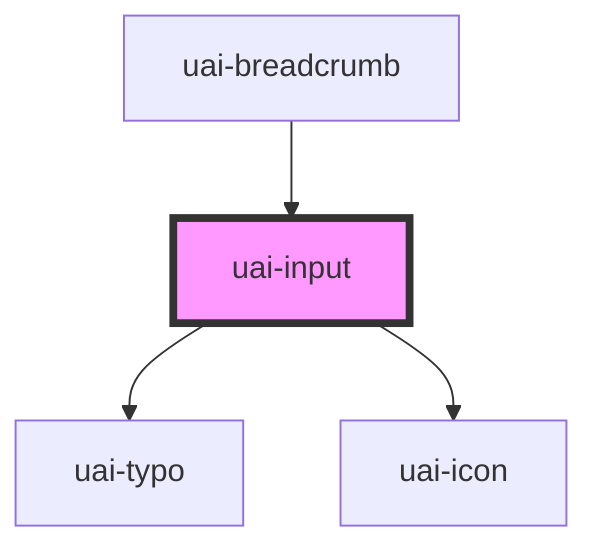

# uai-input

<!-- Auto Generated Below -->

## Overview

Text field. Use it for short free text, e-mail, numbers and search, with an optional label above and a helper,
error or success message below. It takes part in native forms: give it a name to submit its value.
Pair with UaiButton in forms. Avoid it for multiline text (use uai-textarea) or for choosing from a list.
Wrap the app in UaiThemeProvider.

## Properties

| Property                | Attribute                 | Description                                                                                                                                                                     | Type                                                                                 | Default     |
| ----------------------- | ------------------------- | ------------------------------------------------------------------------------------------------------------------------------------------------------------------------------- | ------------------------------------------------------------------------------------ | ----------- |
| `ariaLabel`             | `aria-label`              | Accessible name of the field when there is no visible label.                                                                                                                    | `string`                                                                             | `null`      |
| `autoCapitalize`        | `auto-capitalize`         | Automatic capitalization on virtual keyboards. Can be one of: 'off' (default), 'none', 'words', 'on', 'sentences', 'characters'.                                                | `"characters" \| "none" \| "off" \| "on" \| "sentences" \| "words"`                  | `'off'`     |
| `autoComplete`          | `auto-complete`           | Browser autofill hint. Can be one of: 'off' (default), 'on', 'current-password', 'new-password', 'username'.                                                                    | `"current-password" \| "new-password" \| "off" \| "on" \| "username"`                | `'off'`     |
| `autoResize`            | `auto-resize`             | **[DEPRECATED]** Use uai-textarea. Has no effect.                                                                                        | `boolean`                                                                            | `undefined` |
| `chips`                 | `chips`                   | **[DEPRECATED]** Use uai-input-chips. Has no effect.                                                                                     | `boolean`                                                                            | `undefined` |
| `cols`                  | `cols`                    | **[DEPRECATED]** Use uai-textarea. Has no effect.                                                                                        | `number`                                                                             | `undefined` |
| `counterLength`         | `counter-length`          | If true, shows the number of characters typed and maxlength.                                                                                                                    | `boolean`                                                                            | `false`     |
| `counterLengthRule`     | --                        | Ranges of remaining characters that color the counter: warning (feedback/warning) and delete (feedback/error).                                                                  | `{ warning: CounterTextRule; delete: CounterTextRule; }`                             | `null`      |
| `danger`                | `danger`                  | If true, shows the error state and errorMessage. Has priority over success.                                                                                                     | `boolean`                                                                            | `false`     |
| `dataTest`              | `data-test`               | Data test id, set on the native input.                                                                                                                                          | `string`                                                                             | `null`      |
| `debounceDelay`         | `debounce-delay`          | **[DEPRECATED]** Has no effect.                                                                                                          | `number`                                                                             | `undefined` |
| `disabled`              | `disabled`                | If true, the field cannot be focused or edited and is left out of the form data.                                                                                                | `boolean`                                                                            | `false`     |
| `emailErrorMessage`     | `email-error-message`     | Message shown when an e-mail is invalid. Without it, the browser message is shown.                                                                                              | `string`                                                                             | `undefined` |
| `encode`                | `encode`                  | If true, uaiChange emits the value with HTML special characters escaped.                                                                                                        | `boolean`                                                                            | `false`     |
| `errorMessage`          | `error-message`           | Message below the field while danger is true.                                                                                                                                   | `string`                                                                             | `''`        |
| `helperMessage`         | `helper-message`          | Message below the field that helps to fill it.                                                                                                                                  | `string`                                                                             | `''`        |
| `icon`                  | `icon`                    | UaiIcon name shown before the text, for example "search".                                                                                                                       | `string`                                                                             | `''`        |
| `iconSize`              | `icon-size`               | **[DEPRECATED]** The icon size follows the field. Has no effect.                                                                         | `"medium" \| "small"`                                                                | `undefined` |
| `inputName`             | `input-name`              | Name of the value in the submitted form data. Same as name, kept from bds-input.                                                                                                | `string`                                                                             | `''`        |
| `isSubmit`              | `is-submit`               | If true, Enter clears the field after emitting uaiSubmit and does not submit the form (for chat-like fields).                                                                   | `boolean`                                                                            | `false`     |
| `isTextarea`            | `is-textarea`             | **[DEPRECATED]** Use uai-textarea for multiline text. Has no effect.                                                                     | `boolean`                                                                            | `undefined` |
| `label`                 | `label`                   | Label shown above the field. Without a visible label, set aria-label.                                                                                                           | `string`                                                                             | `''`        |
| `max`                   | `max`                     | Largest accepted value for type "number".                                                                                                                                       | `string`                                                                             | `undefined` |
| `maxErrorMessage`       | `max-error-message`       | Message shown when the number is larger than max. Without it, the browser message is shown.                                                                                     | `string`                                                                             | `undefined` |
| `maxHeight`             | `max-height`              | **[DEPRECATED]** Use uai-textarea. Has no effect.                                                                                        | `number`                                                                             | `undefined` |
| `maxlength`             | `maxlength`               | Largest number of characters. Typing stops at the limit.                                                                                                                        | `number`                                                                             | `undefined` |
| `min`                   | `min`                     | Smallest accepted value for type "number".                                                                                                                                      | `string`                                                                             | `undefined` |
| `minErrorMessage`       | `min-error-message`       | Message shown when the number is smaller than min. Without it, the browser message is shown.                                                                                    | `string`                                                                             | `undefined` |
| `minHeight`             | `min-height`              | **[DEPRECATED]** Use uai-textarea. Has no effect.                                                                                        | `number`                                                                             | `undefined` |
| `minlength`             | `minlength`               | Smallest number of characters. Checked when the field loses focus and on submit.                                                                                                | `number`                                                                             | `undefined` |
| `minlengthErrorMessage` | `minlength-error-message` | Message shown when the text is shorter than minlength. Without it, the browser message is shown.                                                                                | `string`                                                                             | `undefined` |
| `name`                  | `name`                    | Name of the value in the submitted form data. Without name (or inputName), the field is not submitted.                                                                          | `string`                                                                             | `undefined` |
| `numberErrorMessage`    | `number-error-message`    | Message shown when a number is invalid. Without it, the browser message is shown.                                                                                               | `string`                                                                             | `undefined` |
| `pattern`               | `pattern`                 | Regular expression the value must match. Checked when the field loses focus and on submit.                                                                                      | `string`                                                                             | `undefined` |
| `placeholder`           | `placeholder`             | Example of the expected text, shown while the field is empty. Do not use it as the label.                                                                                       | `string`                                                                             | `''`        |
| `readonly`              | `readonly`                | If true, the value can be selected and copied but not edited. It looks like the default state.                                                                                  | `boolean`                                                                            | `false`     |
| `required`              | `required`                | If true, an empty field blocks the form submission.                                                                                                                             | `boolean`                                                                            | `undefined` |
| `requiredErrorMessage`  | `required-error-message`  | Message shown when a required field is empty. Without it, the browser message is shown.                                                                                         | `string`                                                                             | `undefined` |
| `resizable`             | `resizable`               | **[DEPRECATED]** Use uai-textarea. Has no effect.                                                                                        | `boolean`                                                                            | `undefined` |
| `rows`                  | `rows`                    | **[DEPRECATED]** Use uai-textarea. Has no effect.                                                                                        | `number`                                                                             | `undefined` |
| `size`                  | `size`                    | Height of the field. Can be one of: 'short', 'medium' (default).                                                                                                                | `"medium" \| "short"`                                                                | `'medium'`  |
| `success`               | `success`                 | If true, shows the success state and successMessage.                                                                                                                            | `boolean`                                                                            | `false`     |
| `successMessage`        | `success-message`         | Message below the field while success is true.                                                                                                                                  | `string`                                                                             | `''`        |
| `type`                  | `type`                    | Kind of text. Can be one of: 'text' (default), 'email', 'number', 'search'. 'password', 'phonenumber' and 'date' still work but are deprecated: use the specialized UAI inputs. | `"date" \| "email" \| "number" \| "password" \| "phonenumber" \| "search" \| "text"` | `'text'`    |
| `value`                 | `value`                   | Current text of the field.                                                                                                                                                      | `string`                                                                             | `''`        |

## Events

| Event                  | Description                                                                                                           | Type                                                    |
| ---------------------- | --------------------------------------------------------------------------------------------------------------------- | ------------------------------------------------------- |
| `uaiChange`            | Emitted when the value changes, by typing or programmatically. detail: { value }.                                     | `CustomEvent<{ value: string; }>`                       |
| `uaiFocus`             | Emitted when the field receives focus.                                                                                | `CustomEvent<void>`                                     |
| `uaiInput`             | Emitted on every keystroke with the native InputEvent.                                                                | `CustomEvent<InputEvent>`                               |
| `uaiKeyDownBackspace`  | Emitted on Backspace or Delete. detail: { event, value }.                                                             | `CustomEvent<{ event: KeyboardEvent; value: string; }>` |
| `uaiOnBlur`            | Emitted when the field loses focus.                                                                                   | `CustomEvent<void>`                                     |
| `uaiPatternValidation` | Emitted when a field with pattern loses focus. detail: true if the value matches.                                     | `CustomEvent<boolean>`                                  |
| `uaiSubmit`            | Emitted on Enter. detail: { event, value }. Inside a form, call detail.event.preventDefault() to stop the submission. | `CustomEvent<{ event: KeyboardEvent; value: string; }>` |

## Methods

### `clear() => Promise<void>`

Clears the value.

#### Returns

Type: `Promise<void>`

### `getInputElement() => Promise<HTMLInputElement>`

Returns the native input element.

#### Returns

Type: `Promise<HTMLInputElement>`

### `isValid() => Promise<boolean>`

Returns true when the value meets required, minlength, maxlength, min, max, pattern and type.

#### Returns

Type: `Promise<boolean>`

### `removeFocus() => Promise<void>`

Removes the focus from the field.

#### Returns

Type: `Promise<void>`

### `setFocus() => Promise<void>`

Moves the focus to the field.

#### Returns

Type: `Promise<void>`

## Slots

| Slot                  | Description                                                                           |
| --------------------- | ------------------------------------------------------------------------------------- |
| `"input-left"`        | Content before the text, inside the field border (for example a prefix tag).          |
| `"input-right"`       | Content after the text (for example a clear button). Give actions an accessible name. |
| `"inside-input-left"` | Content right before the typed text (for example a currency symbol).                  |

## Shadow Parts

| Part                | Description                                                       |
| ------------------- | ----------------------------------------------------------------- |
| `"input"`           | The native input element.                                         |
| `"input-container"` | The field box with border, icon, adornments and the native input. |
| `"input__message"`  | The helper, error or success message below the field.             |

## CSS Custom Properties

| Name                | Description                                                      |
| ------------------- | ---------------------------------------------------------------- |
| `--uai-input-width` | Width of the field. Defaults to the full width of the container. |

## Dependencies

### Used by

 - [uai-breadcrumb](../uai-breadcrumb)

### Depends on

- [uai-typo](../uai-typo)
- [uai-icon](../uai-icon)

### Graph

----------------------------------------------

*Built with [StencilJS](https://stenciljs.com/)*
