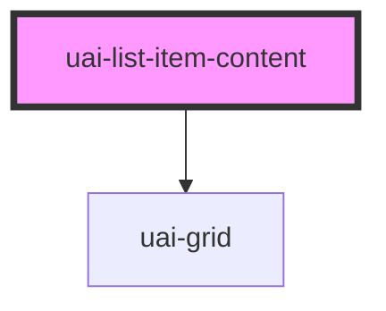

# uai-list-item-content

<!-- Auto Generated Below -->

## Overview

Flex wrapper for custom content inside a uai-list-item slot. Use to stack or align extra content; pair with
the content-area or action-area slots; avoid it for whole page layouts (use uai-grid).

## Properties

| Property         | Attribute         | Description                                                                                                                       | Type                                                                                                         | Default        |
| ---------------- | ----------------- | --------------------------------------------------------------------------------------------------------------------------------- | ------------------------------------------------------------------------------------------------------------ | -------------- |
| `alignItems`     | `align-items`     | Cross-axis alignment. Use flex-start by default; pair with direction. Avoid stretch with icons.                                   | `"baseline" \| "center" \| "flex-end" \| "flex-start" \| "stretch"`                                          | `'flex-start'` |
| `direction`      | `direction`       | Flex direction of the content. Use column for stacked text; pair with gap. Avoid reverse directions for reading order.            | `"column" \| "column-reverse" \| "row" \| "row-reverse"`                                                     | `'column'`     |
| `flexWrap`       | `flex-wrap`       | Wrapping of the content. Use wrap by default; pair with gap. Avoid nowrap with long content.                                      | `"wrap" \| "wrap-reverse"`                                                                                   | `'wrap'`       |
| `gap`            | `gap`             | Space between children, in the uai-grid gap scale. Use for separated content; pair with direction. Avoid margins on the children. | `"1" \| "10" \| "11" \| "12" \| "2" \| "3" \| "4" \| "5" \| "6" \| "7" \| "8" \| "9" \| "half" \| "none"`    | `undefined`    |
| `justifyContent` | `justify-content` | Main-axis alignment. Use flex-start by default; pair with direction. Avoid space-around in narrow rows.                           | `"center" \| "flex-end" \| "flex-start" \| "space-around" \| "space-between" \| "space-evenly" \| "stretch"` | `'flex-start'` |

## Slots

| Slot | Description                             |
| ---- | --------------------------------------- |
|      | Content laid out by the inner uai-grid. |

## Dependencies

### Depends on

- [uai-grid](../uai-grid)

### Graph

----------------------------------------------

*Built with [StencilJS](https://stenciljs.com/)*
