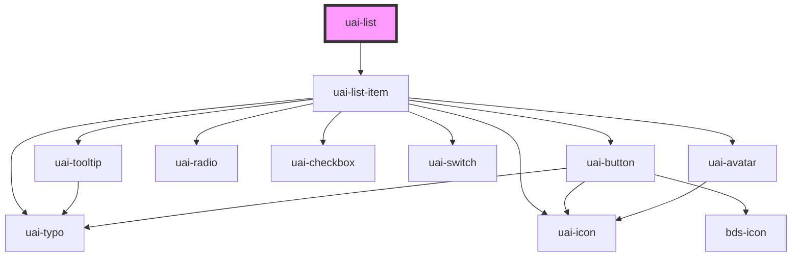

# uai-list

<!-- Auto Generated Below -->

## Overview

List of uai-list-item rows, from data or from child elements. Use for plain lists and for single (radio),
multiple (checkbox) or on/off (switch) selection; pair with typeList; avoid it for tabular data (use uai-table).

The host has the list role (radiogroup when typeList is radio) and each row the listitem role.

## Properties

| Property   | Attribute   | Description                                                                                                                                                                                                                                                                                                             | Type                                             | Default     |
| ---------- | ----------- | ----------------------------------------------------------------------------------------------------------------------------------------------------------------------------------------------------------------------------------------------------------------------------------------------------------------------- | ------------------------------------------------ | ----------- |
| `data`     | `data`      | Rows as a JSON string or an array: data='[{"value": "01","text": "Text","secondaryText": "Secondary Text","avatarName": "","avatarThumbnail": "","checked": true,"icon": "settings-builder"}]'. Use for lists built from data, also in Angular; pair with typeList. When set, child uai-list-item elements are ignored. | `UaiListData[] \| string`                        | `undefined` |
| `typeList` | `type-list` | Control of every row: checkbox, radio, switch or default. Use to make the whole list selectable; pair with the change events. When null, each row keeps its own typeList.                                                                                                                                               | `"checkbox" \| "default" \| "radio" \| "switch"` | `null`      |
| `value`    | `value`     | Value of the selected radio row. Use to read or set the selection of a radio list; pair with uaiListRadioChange. Avoid it in other list types.                                                                                                                                                                          | `string`                                         | `undefined` |

## Events

| Event                    | Description                                                                                                                                                        | Type                                     |
| ------------------------ | ------------------------------------------------------------------------------------------------------------------------------------------------------------------ | ---------------------------------------- |
| `uaiClickActionsButton`  | Same as uaiClickActionsButtons, with the corrected spelling; both are emitted with the same detail. Use in new code; avoid listening to both.                      | `CustomEvent<UaiListActionButtonDetail>` |
| `uaiClickActionsButtons` | An action button of a data row was clicked; name kept from bdsClickActionsButtons. detail: value, icon and elementButton. Use with data; pair with actionsButtons. | `CustomEvent<UaiListActionButtonDetail>` |
| `uaiListCheckboxChange`  | A checkbox row changed by user interaction. detail: every checked checkbox row. Use to keep the selection; pair with typeList checkbox.                            | `CustomEvent<UaiListChangeDetail[]>`     |
| `uaiListRadioChange`     | A radio row was selected by user interaction. detail: the selected row. Use to keep the selection; pair with value.                                                | `CustomEvent<UaiListChangeDetail>`       |
| `uaiListSwitchChange`    | A switch row changed by user interaction. detail: every switch row that is on. Use to keep the settings; pair with typeList switch.                                | `CustomEvent<UaiListChangeDetail[]>`     |

## Slots

| Slot | Description                                       |
| ---- | ------------------------------------------------- |
|      | uai-list-item children. Ignored when data is set. |

## Dependencies

### Depends on

- [uai-list-item](../uai-list-item)

### Graph

----------------------------------------------

*Built with [StencilJS](https://stenciljs.com/)*
