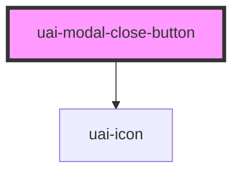

# uai-modal-close-button

<!-- Auto Generated Below -->

## Overview

Close icon row for custom modal layouts. Use it when the default close button of uai-modal is hidden;
pair with a click handler on the host; avoid it as the only way to dismiss a modal.

## Properties

| Property | Attribute | Description                                                                                                    | Type      | Default |
| -------- | --------- | -------------------------------------------------------------------------------------------------------------- | --------- | ------- |
| `active` | `active`  | Shows the close icon when 'true'. Use to hide it without removing the element; avoid toggling on every render. | `boolean` | `true`  |

## Shadow Parts

| Part     | Description         |
| -------- | ------------------- |
| `"icon"` | The close icon box. |

## Dependencies

### Depends on

- [uai-icon](../uai-icon)

### Graph

----------------------------------------------

*Built with [StencilJS](https://stenciljs.com/)*
