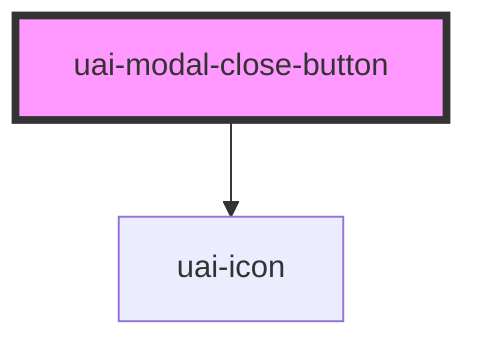

# uai-modal-close-button

<!-- Auto Generated Below -->

## Overview

Close button for custom modal layouts. It is a native button with an accessible name, so it takes the focus and
works with Enter and Space. Use it when the default close button of uai-modal is hidden; listen to `click` on it
to close the modal; avoid it as the only way to dismiss a modal.

## Properties

| Property   | Attribute   | Description                                                                                                            | Type      | Default    |
| ---------- | ----------- | ---------------------------------------------------------------------------------------------------------------------- | --------- | ---------- |
| `active`   | `active`    | Shows the close button when 'true'. Use to hide it without removing the element; a hidden button leaves the tab order. | `boolean` | `true`     |
| `dtButton` | `dt-button` | Test selector on the button. Use for automation; pair with semantic queries. Avoid styling by it.                      | `string`  | `null`     |
| `label`    | `label`     | Accessible name of the button. Use a translated label; avoid leaving it generic.                                       | `string`  | `'Fechar'` |

## Shadow Parts

| Part       | Description              |
| ---------- | ------------------------ |
| `"button"` | The native close button. |

## Dependencies

### Depends on

- [uai-icon](../uai-icon)

### Graph

----------------------------------------------

*Built with [StencilJS](https://stenciljs.com/)*
