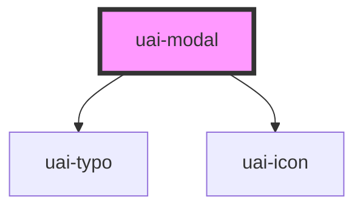

# uai-modal

<!-- Auto Generated Below -->

## Overview

Dialog that blocks the page behind a backdrop to ask for a decision or show focused content.
Built on the native dialog in modal mode: the focus moves into it, stays inside it, the page behind becomes inert and the focus returns on close.
Use for confirmations and short tasks; pair with uai-modal-action for the buttons and UaiThemeProvider;
avoid it for passive notices (use uai-banner).

## Properties

| Property        | Attribute         | Description                                                                                                                                                                                                                   | Type                   | Default     |
| --------------- | ----------------- | ----------------------------------------------------------------------------------------------------------------------------------------------------------------------------------------------------------------------------- | ---------------------- | ----------- |
| `closeButton`   | `close-button`    | Shows the close button when 'true'. Use for dismissible dialogs; avoid hiding it when no other action closes the modal.                                                                                                       | `boolean`              | `true`      |
| `closeLabel`    | `close-label`     | Accessible name of the close button. Use a translated label; avoid leaving it generic.                                                                                                                                        | `string`               | `'Fechar'`  |
| `dtButtonClose` | `dt-button-close` | Test selector on the close button. Use for automation; pair with semantic queries. Avoid styling by it.                                                                                                                       | `string`               | `null`      |
| `dtOutzone`     | `dt-outzone`      | Test selector on the backdrop. Use for automation; pair with semantic queries. Avoid styling by it.                                                                                                                           | `string`               | `null`      |
| `enterClose`    | `enter-close`     | Closes the modal with Enter when no control (button, link, field) has the focus. Use 'false' when Enter has another meaning in the content. Escape is controlled by `escapeClose`.                                            | `boolean`              | `true`      |
| `escapeClose`   | `escape-close`    | Closes the modal with Escape, the standard way to dismiss a dialog. Use 'false' only for flows that need an explicit choice; pair with `outzoneClose` 'false'.                                                                | `boolean`              | `true`      |
| `heading`       | `heading`         | Title shown in the header. Use a short noun phrase; it also names the dialog for assistive technology.                                                                                                                        | `string`               | `undefined` |
| `label`         | `label`           | Accessible name of the dialog. Use only when there is no `heading`; pair with a short sentence.                                                                                                                               | `string`               | `undefined` |
| `open`          | `open`            | Opens or closes the modal. Use for declarative control; pair with uaiModalChanged. Avoid toggling it on every render.                                                                                                         | `boolean`              | `false`     |
| `outzoneClose`  | `outzone-close`   | Closes the modal when the backdrop is clicked. Use 'false' for flows that need an explicit choice.                                                                                                                            | `boolean`              | `true`      |
| `size`          | `size`            | Panel size. 'fixed' keeps a standard width and height; 'dynamic' grows with the content. Use 'dynamic' for variable content.                                                                                                  | `"dynamic" \| "fixed"` | `'fixed'`   |
| `width`         | `width`           | Panel width in rem, e.g. `30` for 30rem. In `fixed` it is the width; in `dynamic` it is the maximum width. Use for narrower or wider dialogs; avoid values wider than the screen, the panel never exceeds it. Defaults to 41. | `number`               | `undefined` |

## Events

| Event             | Description                                                                                   | Type                                                  |
| ----------------- | --------------------------------------------------------------------------------------------- | ----------------------------------------------------- |
| `uaiModalChanged` | Emitted when the modal opens or closes. Use to sync external state; avoid duplicate handlers. | `CustomEvent<{ modalStatus: "opened" \| "closed"; }>` |

## Methods

### `toggle() => Promise<void>`

Opens the modal when closed and closes it when open. Use for imperative control; pair with uaiModalChanged.

#### Returns

Type: `Promise<void>`

## Slots

| Slot       | Description                                                                                         |
| ---------- | --------------------------------------------------------------------------------------------------- |
|            | Modal content.                                                                                      |
| `"footer"` | Footer actions, aligned to the end. Use uai-modal-action or a row of uai-button (Cancelar, Salvar). |

## Shadow Parts

| Part       | Description                                     |
| ---------- | ----------------------------------------------- |
| `"body"`   | The scrollable content area.                    |
| `"close"`  | The close button.                               |
| `"dialog"` | The full-screen container with the backdrop.    |
| `"footer"` | The footer with the actions.                    |
| `"header"` | The header with the title and the close button. |
| `"modal"`  | The modal panel.                                |
| `"title"`  | The title text.                                 |

## Dependencies

### Depends on

- [uai-typo](../uai-typo)
- [uai-icon](../uai-icon)

### Graph

----------------------------------------------

*Built with [StencilJS](https://stenciljs.com/)*
