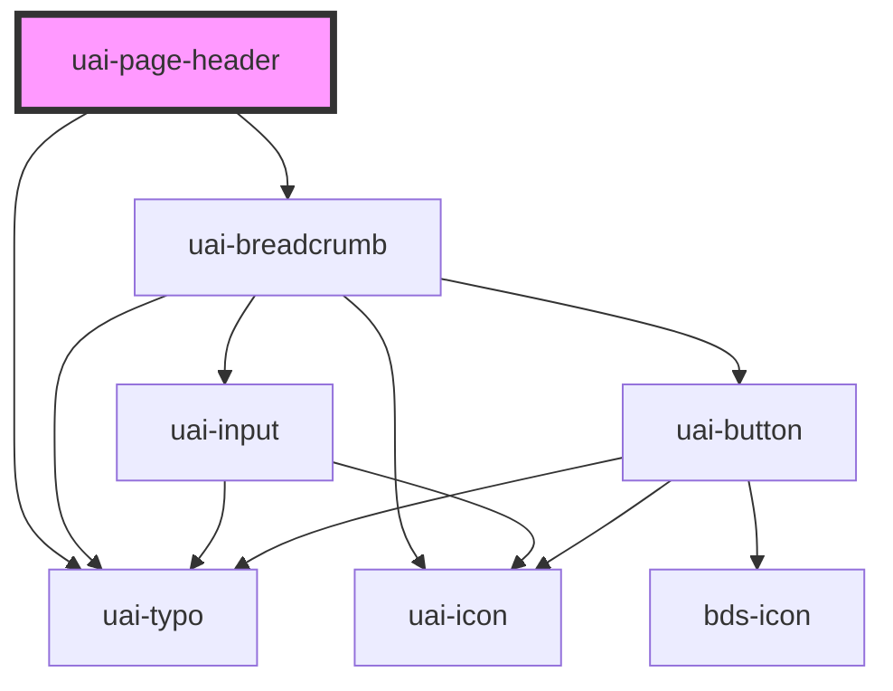

# uai-page-header

<!-- Auto Generated Below -->

## Overview

Page title or hierarchical navigation with consumer-owned actions. Use one per page; pair with UaiButton;
avoid embedding product persistence or global application navigation.

## Properties

| Property    | Attribute    | Description                                                                                                                        | Type                            | Default     |
| ----------- | ------------ | ---------------------------------------------------------------------------------------------------------------------------------- | ------------------------------- | ----------- |
| `editable`  | `editable`   | Enables editing of the secondary breadcrumb's current item. Use with the edit event; pair with items; avoid editing primary title. | `boolean`                       | `false`     |
| `items`     | `items`      | Secondary breadcrumb items, as JSON or array. Use ancestor-to-current order; pair with level secondary; avoid context selectors.   | `UaiBreadcrumbItem[] \| string` | `[]`        |
| `labels`    | --           | Partial breadcrumb text overrides. Use for accessible names; pair with language; avoid empty action names.                         | `UaiBreadcrumbLabels`           | `undefined` |
| `language`  | `language`   | Language for breadcrumb messages. Use a supported locale; pair with labels; avoid translating consumer-provided titles implicitly. | `"en_US" \| "es_ES" \| "pt_BR"` | `'pt_BR'`   |
| `level`     | `level`      | Visual composition. Use primary for title and secondary for breadcrumb; pair with items; avoid treating it as a depth limit.       | `"primary" \| "secondary"`      | `'primary'` |
| `title`     | `title`      | Primary page title. Use with level primary; pair with actions; avoid expecting a secondary breadcrumb fallback.                    | `string`                        | `''`        |
| `wrapItems` | `wrap-items` | Collapses intermediate breadcrumb items above three. Use false to show all; pair with items; avoid imposing a depth limit.         | `boolean`                       | `true`      |

## Events

| Event                    | Description                                                                                                                 | Type                                   |
| ------------------------ | --------------------------------------------------------------------------------------------------------------------------- | -------------------------------------- |
| `uaiBreadcrumbItemClick` | Native link activation bubbling from the breadcrumb. Use to observe navigation; pair with items; avoid re-emitting it.      | `CustomEvent<UaiBreadcrumbItem>`       |
| `uaiBreadcrumbItemEdit`  | Rename request bubbling from the breadcrumb. Use to update items; pair with editable; avoid assuming persistence succeeded. | `CustomEvent<UaiBreadcrumbEditDetail>` |

## Slots

| Slot        | Description                                                                                |
| ----------- | ------------------------------------------------------------------------------------------ |
| `"actions"` | Page actions. Use UaiButton; pair with loading/disabled; avoid rebuilding native controls. |

## Dependencies

### Depends on

- [uai-typo](../uai-typo)
- [uai-breadcrumb](../uai-breadcrumb)

### Graph

----------------------------------------------

*Built with [StencilJS](https://stenciljs.com/)*
