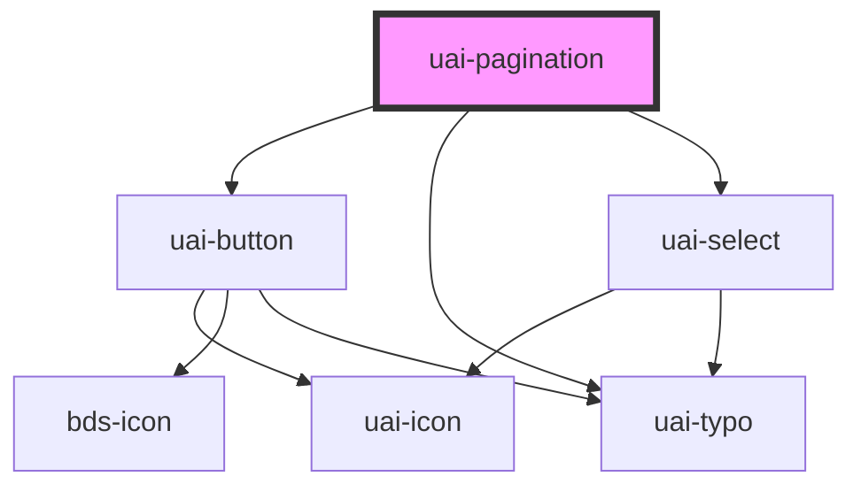

# uai-pagination

<!-- Auto Generated Below -->

## Overview

Navigation between pages of a list or table, with optional items per page and range. Use it below tables and lists
that are split into pages; the page is controlled with page and changes only on user action, announced by
uaiPaginationChange. Pair with UaiTable. Avoid it for infinite scrolling or for fewer than two pages. Wrap the app in
UaiThemeProvider.

## Properties

| Property          | Attribute           | Description                                                                                                                  | Type                            | Default   |
| ----------------- | ------------------- | ---------------------------------------------------------------------------------------------------------------------------- | ------------------------------- | --------- |
| `dtButtonEnd`     | `dt-button-end`     | Test selector on the last page button. Use for automation; pair with semantic queries.                                       | `string`                        | `null`    |
| `dtButtonInitial` | `dt-button-initial` | Test selector on the first page button. Use for automation; pair with semantic queries.                                      | `string`                        | `null`    |
| `dtButtonNext`    | `dt-button-next`    | Test selector on the next page button. Use for automation; pair with semantic queries.                                       | `string`                        | `null`    |
| `dtButtonPrev`    | `dt-button-prev`    | Test selector on the previous page button. Use for automation; pair with semantic queries.                                   | `string`                        | `null`    |
| `dtSelectNumber`  | `dt-select-number`  | Test selector on the page selector. Use for automation; pair with semantic queries.                                          | `string`                        | `null`    |
| `dtSelectSize`    | `dt-select-size`    | Test selector on the items per page selector. Use for automation; pair with semantic queries.                                | `string`                        | `null`    |
| `language`        | `language`          | Language of the texts: pt_BR, en_US or es_MX. Use the language of the interface; avoid mixing languages.                     | `"en_US" \| "es_MX" \| "pt_BR"` | `'pt_BR'` |
| `page`            | `page`              | Current page, starting at 1. Use it to control the page; pair with uaiPaginationChange; values outside 1..pages are clamped. | `number`                        | `1`       |
| `pageCounter`     | `page-counter`      | Shows "of N pages" next to the page selector. Use when the total of pages matters; avoid it in tight spaces.                 | `boolean`                       | `false`   |
| `pageSize`        | `page-size`         | Items per page. Use with total and pageSizeOptions; pair with uaiPageSizeChange; avoid values missing from pageSizeOptions.  | `number`                        | `null`    |
| `pageSizeOptions` | --                  | Choices of items per page, such as [10, 20, 50]. Use to let people pick; leave empty to hide the selector.                   | `number[]`                      | `[]`      |
| `pages`           | `pages`             | Total number of pages. Use it when the server returns pages; ignored when total and pageSize are set.                        | `number`                        | `0`       |
| `total`           | `total`             | Total number of items. Use with pageSize to derive the pages and show the "1-10 of 100" range; avoid it together with pages. | `number`                        | `null`    |

## Events

| Event                 | Description                                                                                        | Type                  |
| --------------------- | -------------------------------------------------------------------------------------------------- | --------------------- |
| `uaiPageSizeChange`   | Emitted when the person changes the items per page. detail: the new size. The page goes back to 1. | `CustomEvent<number>` |
| `uaiPaginationChange` | Emitted when the person changes the page. detail: the new page number.                             | `CustomEvent<number>` |

## Shadow Parts

| Part            | Description                  |
| --------------- | ---------------------------- |
| `"page-select"` | The current page selector.   |
| `"page-size"`   | The items per page selector. |
| `"pagination"`  | The navigation container.    |

## CSS Custom Properties

| Name                            | Description                                               |
| ------------------------------- | --------------------------------------------------------- |
| `--uai-pagination-select-width` | Width of the selectors. Defaults to the sizing/5xl token. |

## Dependencies

### Depends on

- [uai-button](../uai-button)
- [uai-typo](../uai-typo)
- [uai-select](../uai-select)

### Graph

----------------------------------------------

*Built with [StencilJS](https://stenciljs.com/)*
