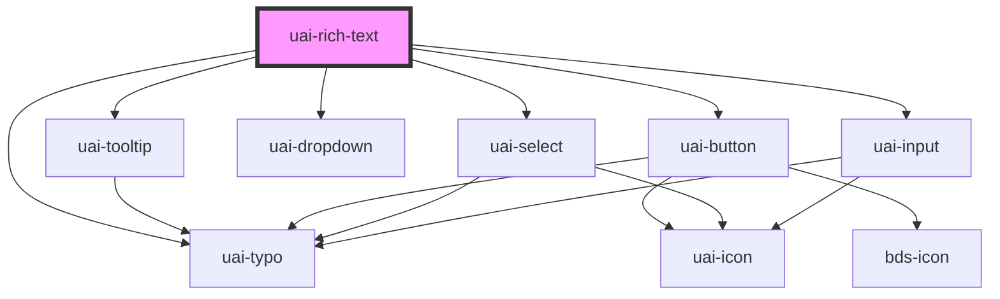

# uai-rich-text

<!-- Auto Generated Below -->

## Overview

Rich text field for editing HTML content, such as a page, with a toolbar for headings, text styles, colors, links,
images, tables, lists, alignment and history. It is a form field like uai-textarea: label, helper, error and success
messages, required, disabled and readonly, and its HTML value is submitted with the form.
Use for formatted content that will be shown as HTML; pair with UaiThemeProvider; avoid it for plain text (use
uai-textarea) or for message formats such as WhatsApp markup.

## Properties

| Property               | Attribute                | Description                                                                                                | Type      | Default                       |
| ---------------------- | ------------------------ | ---------------------------------------------------------------------------------------------------------- | --------- | ----------------------------- |
| `ariaLabel`            | `aria-label`             | Accessible name when there is no visible label.                                                            | `string`  | `null`                        |
| `blockquote`           | `blockquote`             | Turns on quotes.                                                                                           | `boolean` | `false`                       |
| `bold`                 | `bold`                   | Turns on bold (Ctrl/Cmd + B).                                                                              | `boolean` | `false`                       |
| `bulletList`           | `bullet-list`            | Turns on bullet lists.                                                                                     | `boolean` | `false`                       |
| `clearFormatting`      | `clear-formatting`       | Shows the button that removes the formatting of the selection.                                             | `boolean` | `false`                       |
| `code`                 | `code`                   | Turns on inline code and code blocks.                                                                      | `boolean` | `false`                       |
| `danger`               | `danger`                 | Marks the field as invalid and shows `errorMessage`.                                                       | `boolean` | `false`                       |
| `dataTest`             | `data-test`              | Test selector on the content area.                                                                         | `string`  | `null`                        |
| `disabled`             | `disabled`               | Blocks editing and the toolbar.                                                                            | `boolean` | `false`                       |
| `errorMessage`         | `error-message`          | Error text under the field; it is shown while `danger` is true.                                            | `string`  | `''`                          |
| `heading`              | `heading`                | Turns on headings (paragraph and levels 1 to 3), with a style selector in the toolbar.                     | `boolean` | `false`                       |
| `helperMessage`        | `helper-message`         | Helper text under the field.                                                                               | `string`  | `''`                          |
| `highlight`            | `highlight`              | Turns on the highlight color (background of the text), from a palette.                                     | `boolean` | `false`                       |
| `history`              | `history`                | Shows the undo and redo buttons. Undo and redo with Ctrl/Cmd + Z always work, with or without the buttons. | `boolean` | `false`                       |
| `horizontalRule`       | `horizontal-rule`        | Turns on the divider line.                                                                                 | `boolean` | `false`                       |
| `image`                | `image`                  | Turns on images, by address with a description (alternative text).                                         | `boolean` | `false`                       |
| `italic`               | `italic`                 | Turns on italic (Ctrl/Cmd + I).                                                                            | `boolean` | `false`                       |
| `label`                | `label`                  | Visible label of the field. Use a short noun phrase; without it, set aria-label.                           | `string`  | `''`                          |
| `link`                 | `link`                   | Turns on links, including the ones typed as an address, which are linked automatically.                    | `boolean` | `false`                       |
| `maxHeight`            | `max-height`             | Maximum height of the content area, in pixels; the content scrolls beyond it.                              | `number`  | `undefined`                   |
| `minHeight`            | `min-height`             | Minimum height of the content area, in pixels.                                                             | `number`  | `undefined`                   |
| `name`                 | `name`                   | Name used to submit the HTML value with the form.                                                          | `string`  | `undefined`                   |
| `orderedList`          | `ordered-list`           | Turns on numbered lists.                                                                                   | `boolean` | `false`                       |
| `placeholder`          | `placeholder`            | Text shown while the content is empty.                                                                     | `string`  | `''`                          |
| `readonly`             | `readonly`               | Shows the content without letting it be edited; the toolbar is hidden.                                     | `boolean` | `false`                       |
| `required`             | `required`               | Requires content to submit the form.                                                                       | `boolean` | `false`                       |
| `requiredErrorMessage` | `required-error-message` | Message for an empty required field.                                                                       | `string`  | `'Este campo é obrigatório.'` |
| `strike`               | `strike`                 | Turns on strikethrough (Ctrl/Cmd + Shift + S).                                                             | `boolean` | `false`                       |
| `success`              | `success`                | Marks the field as valid and shows `successMessage`.                                                       | `boolean` | `false`                       |
| `successMessage`       | `success-message`        | Success text under the field; it is shown while `success` is true.                                         | `string`  | `''`                          |
| `table`                | `table`                  | Turns on tables, with a menu to add and remove rows and columns.                                           | `boolean` | `false`                       |
| `textAlign`            | `text-align`             | Turns on text alignment (left, center and right).                                                          | `boolean` | `false`                       |
| `textColor`            | `text-color`             | Turns on the text color, from a palette.                                                                   | `boolean` | `false`                       |
| `underline`            | `underline`              | Turns on underline (Ctrl/Cmd + U).                                                                         | `boolean` | `false`                       |
| `value`                | `value`                  | HTML content. Unsafe markup (scripts, event attributes, javascript: links) is dropped when it is read.     | `string`  | `''`                          |

## Events

| Event       | Description                                                                            | Type                              |
| ----------- | -------------------------------------------------------------------------------------- | --------------------------------- |
| `uaiBlur`   | Emitted when the content area loses the focus.                                         | `CustomEvent<void>`               |
| `uaiChange` | Emitted when the field loses the focus after the content changed, with the HTML value. | `CustomEvent<{ value: string; }>` |
| `uaiFocus`  | Emitted when the content area takes the focus.                                         | `CustomEvent<void>`               |
| `uaiInput`  | Emitted on every change of the content, with the HTML value.                           | `CustomEvent<{ value: string; }>` |

## Methods

### `clear() => Promise<void>`

Removes all the content.

#### Returns

Type: `Promise<void>`

### `getContent() => Promise<string>`

Returns the current HTML value ('' when empty).

#### Returns

Type: `Promise<string>`

### `setFocus() => Promise<void>`

Focuses the content area.

#### Returns

Type: `Promise<void>`

## Shadow Parts

| Part                | Description                                        |
| ------------------- | -------------------------------------------------- |
| `"editor"`          | The editable content area.                         |
| `"input-container"` | The bordered box with the toolbar and the content. |
| `"input__message"`  |                                                    |
| `"toolbar"`         | The toolbar.                                       |

## Dependencies

### Depends on

- [uai-tooltip](../uai-tooltip)
- [uai-button](../uai-button)
- [uai-dropdown](../uai-dropdown)
- [uai-select](../uai-select)
- [uai-input](../uai-input)
- [uai-typo](../uai-typo)

### Graph

----------------------------------------------

*Built with [StencilJS](https://stenciljs.com/)*
