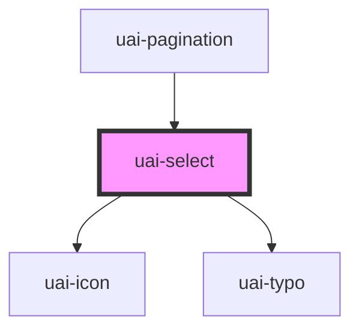

# uai-select

<!-- Auto Generated Below -->

## Overview

Field to choose one option from a list. Use it for 4 to about 15 mutually exclusive choices that do not fit as
radios: the field shows the chosen label and opens a listbox below or above it. It takes part in native forms:
give it a name to submit the chosen value. Pair with a visible label and UaiButton in forms. Avoid it for fewer than
4 options, multiple choice, or searching a long list. Wrap the app in UaiThemeProvider.

## Properties

| Property               | Attribute                | Description                                                                                                                                             | Type                    | Default                  |
| ---------------------- | ------------------------ | ------------------------------------------------------------------------------------------------------------------------------------------------------- | ----------------------- | ------------------------ |
| `ariaLabel`            | `aria-label`             | Accessible name when there is no visible label. Use a short noun; avoid repeating the placeholder.                                                      | `string`                | `null`                   |
| `danger`               | `danger`                 | Error state. Use together with errorMessage; avoid color alone to explain the problem.                                                                  | `boolean`               | `false`                  |
| `dataTest`             | `data-test`              | Test selector on the button. Use for automation; pair with semantic queries. Avoid styling by it.                                                       | `string`                | `null`                   |
| `disabled`             | `disabled`               | Prevents opening and changing the value. Use when the choice is unavailable; pair with explanatory text elsewhere.                                      | `boolean`               | `false`                  |
| `errorMessage`         | `error-message`          | Error text below the field while danger is set. Use to say how to fix the choice.                                                                       | `string`                | `''`                     |
| `helperMessage`        | `helper-message`         | Helper text below the field. Use for format or context; avoid long text.                                                                                | `string`                | `''`                     |
| `icon`                 | `icon`                   | Optional UAI icon name before the chosen label. Use to reinforce the topic; avoid decorative icons.                                                     | `string`                | `''`                     |
| `label`                | `label`                  | Visible label above the field. Use a short noun; pair with helperMessage; avoid it only when aria-label names the field.                                | `string`                | `''`                     |
| `name`                 | `name`                   | Name of the value in the submitted form data. Without it the field is not submitted.                                                                    | `string`                | `undefined`              |
| `options`              | --                       | Options as an array of { value, label, icon?, disabled? }. Use for dynamic lists; takes precedence over uai-select-option children; avoid JSON strings. | `UaiSelectOptionData[]` | `null`                   |
| `placeholder`          | `placeholder`            | Text shown while no option is chosen. Use a short prompt such as "Selecione"; avoid repeating the label.                                                | `string`                | `''`                     |
| `required`             | `required`               | Requires a chosen option before the form is valid. Use with a visible label; pair with requiredErrorMessage.                                            | `boolean`               | `false`                  |
| `requiredErrorMessage` | `required-error-message` | Error text when required and nothing is chosen. Use a short instruction.                                                                                | `string`                | `'Selecione uma opção.'` |
| `size`                 | `size`                   | Field height. Use medium by default and short in dense areas such as table toolbars and pagination.                                                     | `"medium" \| "short"`   | `'medium'`               |
| `success`              | `success`                | Success state. Use after a valid choice; pair with successMessage.                                                                                      | `boolean`               | `false`                  |
| `successMessage`       | `success-message`        | Success text below the field while success is set.                                                                                                      | `string`                | `''`                     |
| `value`                | `value`                  | Chosen value. Use it to preselect or control the field; pair with the uaiChange event; avoid values missing from the options.                           | `number \| string`      | `null`                   |

## Events

| Event       | Description                                                                    | Type                           |
| ----------- | ------------------------------------------------------------------------------ | ------------------------------ |
| `uaiBlur`   | Emitted when the button loses focus.                                           | `CustomEvent<void>`            |
| `uaiCancel` | Emitted when the list closes with Escape or a click outside, without choosing. | `CustomEvent<void>`            |
| `uaiChange` | Emitted when the person chooses an option. detail: { value, label }.           | `CustomEvent<UaiSelectChange>` |
| `uaiFocus`  | Emitted when the button receives focus.                                        | `CustomEvent<void>`            |

## Methods

### `close() => Promise<void>`

Closes the list. Use for imperative control; pair with open.

#### Returns

Type: `Promise<void>`

### `open() => Promise<void>`

Opens the list. Use for imperative control; pair with close; avoid calling it while disabled.

#### Returns

Type: `Promise<void>`

## Slots

| Slot | Description                                                                                   |
| ---- | --------------------------------------------------------------------------------------------- |
|      | UaiSelectOption elements, when the options are written in markup instead of the options prop. |

## Shadow Parts

| Part                 | Description                                                |
| -------------------- | ---------------------------------------------------------- |
| `"select-button"`    | The button that shows the chosen label and opens the list. |
| `"select-container"` | The field box with border, icon, chosen label and arrow.   |
| `"select-list"`      | The floating list of options.                              |
| `"select-message"`   | The helper, error or success message below the field.      |
| `"select-option"`    | Each option in the list.                                   |

## CSS Custom Properties

| Name                 | Description                                                      |
| -------------------- | ---------------------------------------------------------------- |
| `--uai-select-width` | Width of the field. Defaults to the full width of the container. |

## Dependencies

### Used by

 - [uai-pagination](../uai-pagination)

### Depends on

- [uai-icon](../uai-icon)
- [uai-typo](../uai-typo)

### Graph

----------------------------------------------

*Built with [StencilJS](https://stenciljs.com/)*
