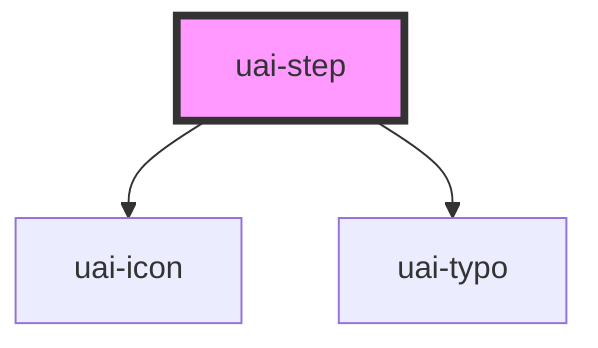

# uai-step

<!-- Auto Generated Below -->

## Overview

One stage of a UaiStepper, with a numbered marker, a title and an optional description.
Use inside uai-stepper, which sets its orientation, number and position; avoid it outside a stepper.

## Properties

| Property      | Attribute     | Description                                                                                                                | Type                         | Default        |
| ------------- | ------------- | -------------------------------------------------------------------------------------------------------------------------- | ---------------------------- | -------------- |
| `active`      | `active`      | Marks the current stage. Use with setActiveStep; avoid more than one active step.                                          | `boolean`                    | `false`        |
| `completed`   | `completed`   | Marks the stage as done and shows a check. Use with setCompletedStep; the active step wins over completed.                 | `boolean`                    | `false`        |
| `dataTest`    | `data-test`   | Data test is the prop to specifically test the component action object.                                                    | `string`                     | `null`         |
| `description` | `description` | Step description. Use for one or two lines of detail; pair with heading; in the horizontal stepper it is cut at two lines. | `string`                     | `null`         |
| `disabled`    | `disabled`    | Makes the step unavailable. Use for stages that cannot be reached yet; avoid combining it with pointer.                    | `boolean`                    | `false`        |
| `heading`     | `heading`     | Step title. Use a short noun phrase; pair with description for details; avoid long sentences.                              | `string`                     | `null`         |
| `index`       | `index`       | Position of the step, starting at 0. Set by the stepper; avoid setting it by hand.                                         | `number`                     | `0`            |
| `last`        | `last`        | Marks the last step, which draws no connector in the vertical layout. Set by the stepper; avoid setting it by hand.        | `boolean`                    | `false`        |
| `orientation` | `orientation` | Layout of the step. Set by the stepper from its orientation; avoid setting it by hand.                                     | `"horizontal" \| "vertical"` | `'horizontal'` |
| `pointer`     | `pointer`     | Shows a pointer cursor. Use when steps are clickable; ignored on disabled steps.                                           | `boolean`                    | `false`        |

## Slots

| Slot            | Description                                                                               |
| --------------- | ----------------------------------------------------------------------------------------- |
| `"description"` | Step description. Use for rich content; pair with no description prop, which it replaces. |
| `"heading"`     | Step title. Use for rich content; pair with no heading prop, which it replaces.           |

## CSS Custom Properties

| Name                     | Description                                                       |
| ------------------------ | ----------------------------------------------------------------- |
| `--uai-step-marker-size` | Diameter of the numbered marker. Defaults to the sizing/xl token. |

## Dependencies

### Depends on

- [uai-icon](../uai-icon)
- [uai-typo](../uai-typo)

### Graph

----------------------------------------------

*Built with [StencilJS](https://stenciljs.com/)*
