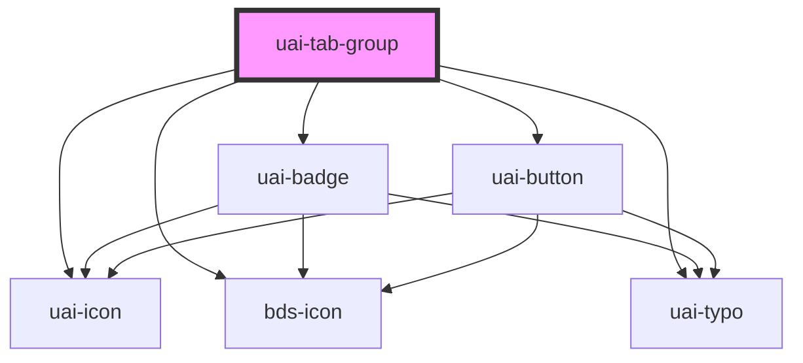

# uai-tab-group

<!-- Auto Generated Below -->

## Overview

Floating tabs with manual keyboard activation. Use for alternate views of related content;
pair with UaiTabItem; avoid using tabs as links to unrelated pages.

## Properties

| Property            | Attribute            | Description                                                                                                                                               | Type                            | Default    |
| ------------------- | -------------------- | --------------------------------------------------------------------------------------------------------------------------------------------------------- | ------------------------------- | ---------- |
| `align`             | `align`              | Header alignment: left, center or right. Use to fit the surrounding layout; pair with floating tabs; avoid unsupported values.                            | `"center" \| "left" \| "right"` | `'center'` |
| `ariaLabel`         | `aria-label`         | Accessible tablist name. Use for distinguishing groups; pair with item labels; avoid unnamed groups when several are present.                             | `string`                        | `null`     |
| `ariaLabelledBy`    | `aria-labelledby`    | Accessible tablist name references. Use for an existing heading; pair with that heading's ID; avoid broken references.                                    | `string`                        | `null`     |
| `contentScrollable` | `content-scrollable` | Enables scrolling of panel content. Use for constrained containers; pair with container height; avoid nested scrolling without need.                      | `boolean`                       | `true`     |
| `dtButtonNext`      | `dt-button-next`     | Next scroll button data-test. Use for automation; pair with dtButtonPrev; avoid using it as an accessible label.                                          | `string`                        | `null`     |
| `dtButtonPrev`      | `dt-button-prev`     | Previous scroll button data-test. Use for automation; pair with dtButtonNext; avoid using it as an accessible label.                                      | `string`                        | `null`     |
| `language`          | `language`           | Scroll control language, pt_BR, en_US or es_ES. Use for built-in labels; pair with translated item labels; avoid translating consumer content implicitly. | `"en_US" \| "es_ES" \| "pt_BR"` | `'pt_BR'`  |

## Events

| Event            | Description                                                                                                                                           | Type                                 |
| ---------------- | ----------------------------------------------------------------------------------------------------------------------------------------------------- | ------------------------------------ |
| `uaiTabChange`   | Activated item element, including reactivation. Use for controlled selection; pair with item.open; avoid expecting a string group ID.                 | `CustomEvent<HTMLUaiTabItemElement>` |
| `uaiTabDisabled` | Item element whose disabled header was activated. Use for unavailable-action feedback; pair with disable; avoid treating it as a disable prop change. | `CustomEvent<HTMLUaiTabItemElement>` |

## Slots

| Slot | Description                                                                                                |
| ---- | ---------------------------------------------------------------------------------------------------------- |
|      | UaiTabItem panels. Use for related views; pair with item labels; avoid mixing the deprecated bds-tabs API. |

## Dependencies

### Depends on

- [uai-icon](../uai-icon)
- [bds-icon](../icon)
- [uai-badge](../uai-badge)
- [uai-button](../uai-button)
- [uai-typo](../uai-typo)

### Graph

----------------------------------------------

*Built with [StencilJS](https://stenciljs.com/)*
