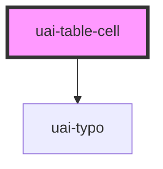

# uai-table-cell

<!-- Auto Generated Below -->

## Overview

Data cell of UaiTableRow. Use it for text or composed content such as avatars, badges and buttons;
pair with UaiTableRow; avoid long paragraphs, which are truncated with an ellipsis.

## Properties

| Property         | Attribute         | Description                                                                                                                | Type                            | Default  |
| ---------------- | ----------------- | -------------------------------------------------------------------------------------------------------------------------- | ------------------------------- | -------- |
| `justifyContent` | `justify-content` | Horizontal alignment of the content. Use right for numbers and center for controls; avoid mixing alignments in one column. | `"center" \| "left" \| "right"` | `'left'` |

## Slots

| Slot | Description   |
| ---- | ------------- |
|      | Cell content. |

## Dependencies

### Depends on

- [uai-typo](../uai-typo)

### Graph

----------------------------------------------

*Built with [StencilJS](https://stenciljs.com/)*
