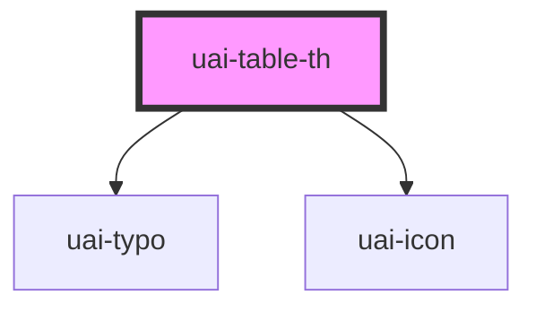

# uai-table-th

<!-- Auto Generated Below -->

## Overview

Column header of UaiTableRow. Use it in the header row; pair with sortable and sortDirection for sortable
columns; avoid sortable on columns the consumer cannot sort.

## Properties

| Property         | Attribute         | Description                                                                                                                                                 | Type                                    | Default  |
| ---------------- | ----------------- | ----------------------------------------------------------------------------------------------------------------------------------------------------------- | --------------------------------------- | -------- |
| `justifyContent` | `justify-content` | Horizontal alignment of the title. Use right for numbers and center for controls; avoid mixing alignments in one column.                                    | `"center" \| "left" \| "right"`         | `'left'` |
| `sortDirection`  | `sort-direction`  | Current sort of the column, sets aria-sort. Use none, ascending or descending; pair with sortable; avoid setting it on several columns.                     | `"ascending" \| "descending" \| "none"` | `'none'` |
| `sortLabel`      | `sort-label`      | Accessible name of the sort button when the title is not enough. Use a short action; pair with sortable; avoid repeating the direction.                     | `string`                                | `null`   |
| `sortable`       | `sortable`        | Turns the title into a button that asks for sorting. Use only when the consumer sorts on uaiTableSort; pair with sortDirection; avoid it without a handler. | `boolean`                               | `false`  |

## Events

| Event          | Description                                                                                                                         | Type                                                 |
| -------------- | ----------------------------------------------------------------------------------------------------------------------------------- | ---------------------------------------------------- |
| `uaiTableSort` | Emitted when the sort button is activated. detail: the next direction, ascending or descending. The consumer updates sortDirection. | `CustomEvent<"ascending" \| "descending" \| "none">` |

## Slots

| Slot | Description   |
| ---- | ------------- |
|      | Column title. |

## Dependencies

### Depends on

- [uai-typo](../uai-typo)
- [uai-icon](../uai-icon)

### Graph

----------------------------------------------

*Built with [StencilJS](https://stenciljs.com/)*
