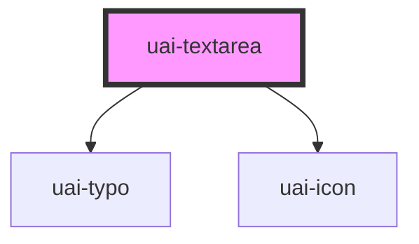

# uai-textarea

<!-- Auto Generated Below -->

## Overview

Multiline text field. Use it for longer free text with an optional label, helper, error or success message.
Pair with UaiInput for single-line values in the same form. Avoid it for selecting from a list.
Wrap the app in UaiThemeProvider.

## Properties

| Property                | Attribute                 | Description                                                                                                                            | Type                                                                  | Default     |
| ----------------------- | ------------------------- | -------------------------------------------------------------------------------------------------------------------------------------- | --------------------------------------------------------------------- | ----------- |
| `ariaLabel`             | `aria-label`              | Accessible name when there is no visible label.                                                                                        | `string`                                                              | `null`      |
| `autoCapitalize`        | `auto-capitalize`         | Automatic capitalization on virtual keyboards.                                                                                         | `"characters" \| "none" \| "off" \| "on" \| "sentences" \| "words"`   | `'off'`     |
| `autoComplete`          | `auto-complete`           | Browser autofill hint.                                                                                                                 | `"current-password" \| "new-password" \| "off" \| "on" \| "username"` | `'off'`     |
| `autoResize`            | `auto-resize`             | If true, the field grows with its content.                                                                                             | `boolean`                                                             | `true`      |
| `chips`                 | `chips`                   | **[DEPRECATED]** Use uai-input-chips for tokenized values. This prop has no effect.             | `boolean`                                                             | `undefined` |
| `cols`                  | `cols`                    | Number of columns. Zero leaves the width fluid.                                                                                        | `number`                                                              | `0`         |
| `counterLength`         | `counter-length`          | If true, shows the number of characters typed and maxlength.                                                                           | `boolean`                                                             | `false`     |
| `counterLengthRule`     | --                        | Ranges of remaining characters that color the counter.                                                                                 | `{ warning: CounterTextRule; delete: CounterTextRule; }`              | `null`      |
| `danger`                | `danger`                  | If true, shows the error state and errorMessage. Has priority over success.                                                            | `boolean`                                                             | `false`     |
| `dataTest`              | `data-test`               | Data test id, set on the native textarea.                                                                                              | `string`                                                              | `null`      |
| `debounceDelay`         | `debounce-delay`          | Optional debounce interval in milliseconds for automatic height measurement.                                                           | `number`                                                              | `undefined` |
| `disabled`              | `disabled`                | If true, the field cannot be edited or submitted.                                                                                      | `boolean`                                                             | `false`     |
| `emailErrorMessage`     | `email-error-message`     | **[DEPRECATED]** Textarea has no native e-mail validation. This prop has no effect.             | `string`                                                              | `undefined` |
| `encode`                | `encode`                  | If true, uaiChange emits HTML-special characters escaped.                                                                              | `boolean`                                                             | `false`     |
| `errorMessage`          | `error-message`           | Message shown while danger is true.                                                                                                    | `string`                                                              | `''`        |
| `helperMessage`         | `helper-message`          | Message below the field that helps to fill it.                                                                                         | `string`                                                              | `''`        |
| `icon`                  | `icon`                    | UaiIcon name shown before the text.                                                                                                    | `string`                                                              | `''`        |
| `iconSize`              | `icon-size`               | **[DEPRECATED]** Use the native body/base icon size. This prop has no effect.                   | `"medium" \| "small"`                                                 | `undefined` |
| `inputName`             | `input-name`              | Name of the value in submitted form data, kept from bds-input.                                                                         | `string`                                                              | `''`        |
| `isSubmit`              | `is-submit`               | If true, Enter clears the field after uaiSubmit and cancels the newline.                                                               | `boolean`                                                             | `false`     |
| `isTextarea`            | `is-textarea`             | **[DEPRECATED]** The textarea is inherently multiline. This prop has no effect.                 | `boolean`                                                             | `undefined` |
| `label`                 | `label`                   | Label shown above the field. Without a visible label, set aria-label.                                                                  | `string`                                                              | `''`        |
| `max`                   | `max`                     | **[DEPRECATED]** Textareas do not support numeric input constraints. This prop has no effect.   | `string`                                                              | `undefined` |
| `maxHeight`             | `max-height`              | Optional maximum height in CSS pixels. Omit for unbounded automatic growth.                                                            | `number`                                                              | `undefined` |
| `maxlength`             | `maxlength`               | Largest number of characters. Typing stops at the limit.                                                                               | `number`                                                              | `undefined` |
| `min`                   | `min`                     | **[DEPRECATED]** Textareas do not support numeric input constraints. This prop has no effect.   | `string`                                                              | `undefined` |
| `minHeight`             | `min-height`              | Optional minimum height in CSS pixels. Omit to use the native height derived from rows.                                                | `number`                                                              | `undefined` |
| `minlength`             | `minlength`               | Smallest number of characters. Checked on blur and form submission.                                                                    | `number`                                                              | `undefined` |
| `minlengthErrorMessage` | `minlength-error-message` | Message shown when the text is shorter than minlength.                                                                                 | `string`                                                              | `undefined` |
| `name`                  | `name`                    | Name of the value in submitted form data. Without name or inputName, the field is not submitted.                                       | `string`                                                              | `undefined` |
| `numberErrorMessage`    | `number-error-message`    | **[DEPRECATED]** Textarea has no native number validation. This prop has no effect.             | `string`                                                              | `undefined` |
| `pattern`               | `pattern`                 | Regular expression the value must match. Checked on blur and form submission.                                                          | `string`                                                              | `undefined` |
| `patternErrorMessage`   | `pattern-error-message`   | Message shown when pattern does not match.                                                                                             | `string`                                                              | `undefined` |
| `placeholder`           | `placeholder`             | Example of the expected text, shown while the field is empty. Do not use it as the label.                                              | `string`                                                              | `''`        |
| `readonly`              | `readonly`                | If true, the value can be selected and copied but not edited.                                                                          | `boolean`                                                             | `false`     |
| `required`              | `required`                | If true, an empty field blocks form submission.                                                                                        | `boolean`                                                             | `undefined` |
| `requiredErrorMessage`  | `required-error-message`  | Message shown when a required field is empty. Without it, the browser message is shown.                                                | `string`                                                              | `undefined` |
| `resizable`             | `resizable`               | If true and autoResize is false, the user can resize the field vertically.                                                             | `boolean`                                                             | `false`     |
| `rows`                  | `rows`                    | Initial visible line count. The browser's native row sizing supplies the default height.                                               | `number`                                                              | `undefined` |
| `size`                  | `size`                    | Minimum control height. Short defaults to one row; medium defaults to three. Explicit rows takes precedence.                           | `"medium" \| "short"`                                                 | `'medium'`  |
| `success`               | `success`                 | If true, shows the success state and successMessage.                                                                                   | `boolean`                                                             | `false`     |
| `successMessage`        | `success-message`         | Message shown while success is true.                                                                                                   | `string`                                                              | `''`        |
| `type`                  | `type`                    | **[DEPRECATED]** Textareas do not have a type. This prop has no effect.                         | `string`                                                              | `undefined` |
| `value`                 | `value`                   | Current multiline text.                                                                                                                | `string`                                                              | `''`        |

## Events

| Event                  | Description                                                                                         | Type                                                    |
| ---------------------- | --------------------------------------------------------------------------------------------------- | ------------------------------------------------------- |
| `uaiChange`            | Emitted when the value changes, by typing or programmatically. detail: { value }.                   | `CustomEvent<{ value: string; }>`                       |
| `uaiFocus`             | Emitted when the field gains focus.                                                                 | `CustomEvent<void>`                                     |
| `uaiInput`             | Emitted on every keystroke with the native InputEvent.                                              | `CustomEvent<InputEvent>`                               |
| `uaiKeyDownBackspace`  | Emitted on Backspace or Delete. detail: { event, value }.                                           | `CustomEvent<{ event: KeyboardEvent; value: string; }>` |
| `uaiOnBlur`            | Emitted when the field loses focus.                                                                 | `CustomEvent<void>`                                     |
| `uaiPatternValidation` | Emitted when a field with pattern loses focus. detail: true if the value matches.                   | `CustomEvent<boolean>`                                  |
| `uaiSubmit`            | Emitted on Enter. detail: { event, value }. The native newline is retained unless isSubmit is true. | `CustomEvent<{ event: KeyboardEvent; value: string; }>` |

## Methods

### `clear() => Promise<void>`

Clears the textarea value.

#### Returns

Type: `Promise<void>`

### `getInputElement() => Promise<HTMLTextAreaElement>`

Returns the native textarea element.

#### Returns

Type: `Promise<HTMLTextAreaElement>`

### `isValid() => Promise<boolean>`

Checks native and pattern validity.

#### Returns

Type: `Promise<boolean>`

### `removeFocus() => Promise<void>`

Removes focus from the textarea.

#### Returns

Type: `Promise<void>`

### `setFocus() => Promise<void>`

Moves focus to the textarea.

#### Returns

Type: `Promise<void>`

## Slots

| Slot                  | Description                                                       |
| --------------------- | ----------------------------------------------------------------- |
| `"input-left"`        | Content before the text, inside the field border.                 |
| `"input-right"`       | Content after the editable text. Give actions an accessible name. |
| `"inside-input-left"` | Content before the editable text.                                 |

## Shadow Parts

| Part                | Description                                                    |
| ------------------- | -------------------------------------------------------------- |
| `"input"`           | The native textarea element.                                   |
| `"input-container"` | The field box with border, adornments and the native textarea. |
| `"input__message"`  | The helper, error or success message below the field.          |

## Dependencies

### Depends on

- [uai-typo](../uai-typo)
- [uai-icon](../uai-icon)

### Graph

----------------------------------------------

*Built with [StencilJS](https://stenciljs.com/)*
