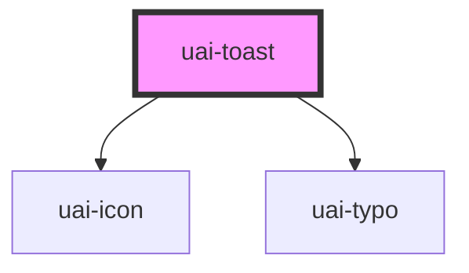

# uai-toast

<!-- Auto Generated Below -->

## Overview

Short notification that floats over the page, with the result of an action or a system message.
Use for transient feedback; pair with UaiToastContainer (or `show()`, which creates it) and a short text; avoid it
for messages the user must act on, which belong in a modal or a banner.

## Properties

| Property         | Attribute          | Description                                                                                                                           | Type                                                                                              | Default         |
| ---------------- | ------------------ | ------------------------------------------------------------------------------------------------------------------------------------- | ------------------------------------------------------------------------------------------------- | --------------- |
| `actionLabel`    | `action-label`     | Text of the optional action button, such as "Desfazer". Clicking it emits uaiToastAction and closes the toast.                        | `string`                                                                                          | `null`          |
| `closable`       | `closable`         | Shows the close button. Keep it on unless the toast closes by itself; avoid a toast nobody can dismiss.                               | `boolean`                                                                                         | `true`          |
| `closeLabel`     | `close-label`      | Accessible name of the close button. Use a translated label; avoid leaving it generic.                                                | `string`                                                                                          | `'Fechar'`      |
| `dtButtonAction` | `dt-button-action` | Test selector on the action button. Use for automation; pair with semantic queries. Avoid styling by it.                              | `string`                                                                                          | `null`          |
| `dtButtonClose`  | `dt-button-close`  | Test selector on the close button. Use for automation; pair with semantic queries. Avoid styling by it.                               | `string`                                                                                          | `null`          |
| `duration`       | `duration`         | Time in milliseconds before the toast closes by itself; 0 keeps it open. The time pauses while the mouse or the focus is on it.       | `number`                                                                                          | `0`             |
| `heading`        | `heading`          | Optional short title, without a final period. Use for the reason of the notification; avoid long titles.                              | `string`                                                                                          | `null`          |
| `message`        | `message`          | Short text, preferably one line. It is plain text (never HTML); for a link, use the default slot.                                     | `string`                                                                                          | `null`          |
| `open`           | `open`             | Whether the toast is shown. Use show() and close() to also place it and emit the events; avoid toggling it in a loop.                 | `boolean`                                                                                         | `false`         |
| `position`       | `position`         | Position used by show() when the toast is not inside a UaiToastContainer. Avoid mixing positions for the same kind of message.        | `"bottom-center" \| "bottom-left" \| "bottom-right" \| "top-center" \| "top-left" \| "top-right"` | `'bottom-left'` |
| `variant`        | `variant`          | Semantic variant: system, info, success, warning or error. Use the one that matches the message; avoid color alone to convey meaning. | `"error" \| "info" \| "success" \| "system" \| "warning"`                                         | `'system'`      |

## Events

| Event            | Description                                                                                                 | Type                                            |
| ---------------- | ----------------------------------------------------------------------------------------------------------- | ----------------------------------------------- |
| `uaiToastAction` | Emitted when the action button is clicked, before the toast closes. Use to run the action, such as undoing. | `CustomEvent<void>`                             |
| `uaiToastClose`  | Emitted when the toast closes, with the reason: close-button, action, timeout, escape or method.            | `CustomEvent<{ reason: UaiToastCloseReason; }>` |
| `uaiToastOpen`   | Emitted when the toast opens. UaiToastContainer uses it to stay on top and announce the toast.              | `CustomEvent<void>`                             |

## Methods

### `close() => Promise<void>`

Closes the toast and emits uaiToastClose with reason "method".

#### Returns

Type: `Promise<void>`

### `show(options?: UaiToastOptions) => Promise<void>`

Opens the toast. Outside a UaiToastContainer, it moves the toast into the container of its position (created in the
nearest UaiThemeProvider when there is none) and removes it from the page after it closes. Options replace the props
of the same name; `removeOnClose` decides whether the toast leaves the page after closing.

#### Parameters

| Name      | Type                                                                                                                                                                                                         | Description |
| --------- | ------------------------------------------------------------------------------------------------------------------------------------------------------------------------------------------------------------ | ----------- |
| `options` | `{ variant?: UaiToastVariant; heading?: string; message?: string; duration?: number; closable?: boolean; closeLabel?: string; actionLabel?: string; position?: UaiToastPosition; removeOnClose?: boolean; }` |             |

#### Returns

Type: `Promise<void>`

## Slots

| Slot | Description                                                            |
| ---- | ---------------------------------------------------------------------- |
|      | Optional rich content shown after `message`, such as text with a link. |

## Shadow Parts

| Part         | Description                      |
| ------------ | -------------------------------- |
| `"action"`   | The action button.               |
| `"close"`    | The close button.                |
| `"icon-box"` | The box around the variant icon. |
| `"toast"`    | The toast surface.               |

## Dependencies

### Depends on

- [uai-icon](../uai-icon)
- [uai-typo](../uai-typo)

### Graph

----------------------------------------------

*Built with [StencilJS](https://stenciljs.com/)*
