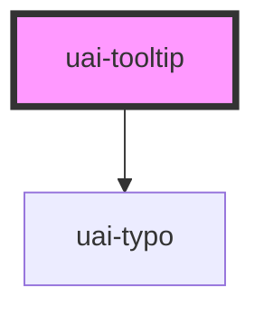

# uai-tooltip

<!-- Auto Generated Below -->

## Overview

Short supplementary text shown on hover or keyboard focus of the wrapped element.
Use for brief hints; pair with UaiThemeProvider; avoid essential information or interactive content.

## Properties

| Property      | Attribute      | Description                                                                                                                                  | Type                                                                                                                                                                                                 | Default         |
| ------------- | -------------- | -------------------------------------------------------------------------------------------------------------------------------------------- | ---------------------------------------------------------------------------------------------------------------------------------------------------------------------------------------------------- | --------------- |
| `dataTest`    | `data-test`    | Test selector on the trigger wrapper. Use for automation; pair with semantic queries. Avoid styling by it.                                   | `string`                                                                                                                                                                                             | `null`          |
| `disabled`    | `disabled`     | Prevents the tooltip from showing. Use when the wrapped element is unavailable; pair with explanatory text elsewhere.                        | `boolean`                                                                                                                                                                                            | `false`         |
| `maxWidth`    | `max-width`    | Maximum tooltip width as a CSS length. Defaults to the width/tooltip token; use for long text; avoid widths narrower than the content needs. | `string`                                                                                                                                                                                             | `null`          |
| `position`    | `position`     | Placement relative to the wrapped element. Use the side with free space; avoid covering related content.                                     | `"bottom-center" \| "bottom-left" \| "bottom-right" \| "left-bottom" \| "left-center" \| "left-top" \| "right-bottom" \| "right-center" \| "right-top" \| "top-center" \| "top-left" \| "top-right"` | `'left-center'` |
| `tooltipText` | `tooltip-text` | Tooltip text;   breaks the line. Use short hints; pair with the wrapped element; avoid essential information.                             | `string`                                                                                                                                                                                             | `'Tooltip'`     |

## Methods

### `invisible() => Promise<void>`

Hides the tooltip. Use for imperative control; pair with visible. Avoid leaving it open after the task ends.

#### Returns

Type: `Promise<void>`

### `visible() => Promise<void>`

Shows the tooltip. Use for imperative control; pair with invisible. Avoid calling it while disabled.

#### Returns

Type: `Promise<void>`

## Slots

| Slot | Description                            |
| ---- | -------------------------------------- |
|      | The element that triggers the tooltip. |

## Shadow Parts

| Part    | Description                     |
| ------- | ------------------------------- |
| `"tip"` | The floating tooltip container. |

## Dependencies

### Depends on

- [uai-typo](../uai-typo)

### Graph

----------------------------------------------

*Built with [StencilJS](https://stenciljs.com/)*
