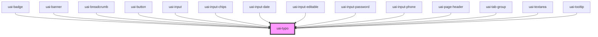

# uai-typo

<!-- Auto Generated Below -->

## Overview

Text with the UAI type scale. variant and bold are the Figma text styles (heading/lg/semibold is variant="heading-lg" bold="semibold");
tag sets the HTML element, so use h1-h4 for titles. Default: body-base, regular, 
. Wrap the app in UaiThemeProvider.

## Properties

| Property        | Attribute        | Description                                                                                                                                                                                                               | Type                                                                                                                                                                                 | Default       |
| --------------- | ---------------- | ------------------------------------------------------------------------------------------------------------------------------------------------------------------------------------------------------------------------- | ------------------------------------------------------------------------------------------------------------------------------------------------------------------------------------ | ------------- |
| `bold`          | `bold`           | Font weight. Can be one of: 'regular', 'medium', 'semibold', 'bold'.                                                                                                                                                      | `"bold" \| "medium" \| "regular" \| "semibold"`                                                                                                                                      | `'regular'`   |
| `dataTest`      | `data-test`      | Data test is the prop to specifically test the component action object.                                                                                                                                                   | `string`                                                                                                                                                                             | `null`        |
| `italic`        | `italic`         | Adds font style italic.                                                                                                                                                                                                   | `boolean`                                                                                                                                                                            | `false`       |
| `letterSpacing` | `letter-spacing` | Letter spacing. 'expanded' matches the spaced body text style.                                                                                                                                                            | `"expanded" \| "normal"`                                                                                                                                                             | `'normal'`    |
| `lineHeight`    | `line-height`    | **[DEPRECATED]** The line height comes from the variant. This prop has no effect.                                                                                                  | `"double" \| "none" \| "plus" \| "simple" \| "small"`                                                                                                                                | `undefined`   |
| `margin`        | `margin`         | If true, adds the default bottom margin to display and heading variants.                                                                                                                                                  | `boolean`                                                                                                                                                                            | `true`        |
| `noWrap`        | `no-wrap`        | Keeps the text on one line and truncates it with an ellipsis.                                                                                                                                                             | `boolean`                                                                                                                                                                            | `false`       |
| `paragraph`     | `paragraph`      | Adds a bottom margin for paragraphs.                                                                                                                                                                                      | `boolean`                                                                                                                                                                            | `false`       |
| `tag`           | `tag`            | Element tag. Use it to give the text the right semantics.                                                                                                                                                                 | `"h1" \| "h2" \| "h3" \| "h4" \| "p" \| "span"`                                                                                                                                      | `'p'`         |
| `variant`       | `variant`        | Text style role from the UAI typography scale. Can be one of: 'display', 'heading-xl', 'heading-lg', 'heading-md', 'title-lg', 'title-md', 'title-sm', 'title', 'body-lg', 'body-base', 'body-sm', 'caption', 'overline'. | `"body-base" \| "body-lg" \| "body-sm" \| "caption" \| "display" \| "heading-lg" \| "heading-md" \| "heading-xl" \| "overline" \| "title" \| "title-lg" \| "title-md" \| "title-sm"` | `'body-base'` |

## Slots

| Slot | Description   |
| ---- | ------------- |
|      | Text content. |

## Shadow Parts

| Part               | Description       |
| ------------------ | ----------------- |
| `"uai-typo__text"` | The text element. |

## Dependencies

### Used by

 - [uai-badge](../uai-badge)
 - [uai-banner](../uai-banner)
 - [uai-breadcrumb](../uai-breadcrumb)
 - [uai-button](../uai-button)
 - [uai-input](../uai-input)
 - [uai-input-chips](../uai-input-chips)
 - [uai-input-date](../uai-input-date)
 - [uai-input-editable](../uai-input-editable)
 - [uai-input-password](../uai-input-password)
 - [uai-input-phone](../uai-input-phone)
 - [uai-page-header](../uai-page-header)
 - [uai-tab-group](../uai-tab-group)
 - [uai-textarea](../uai-textarea)
 - [uai-tooltip](../uai-tooltip)

### Graph

----------------------------------------------

*Built with [StencilJS](https://stenciljs.com/)*
